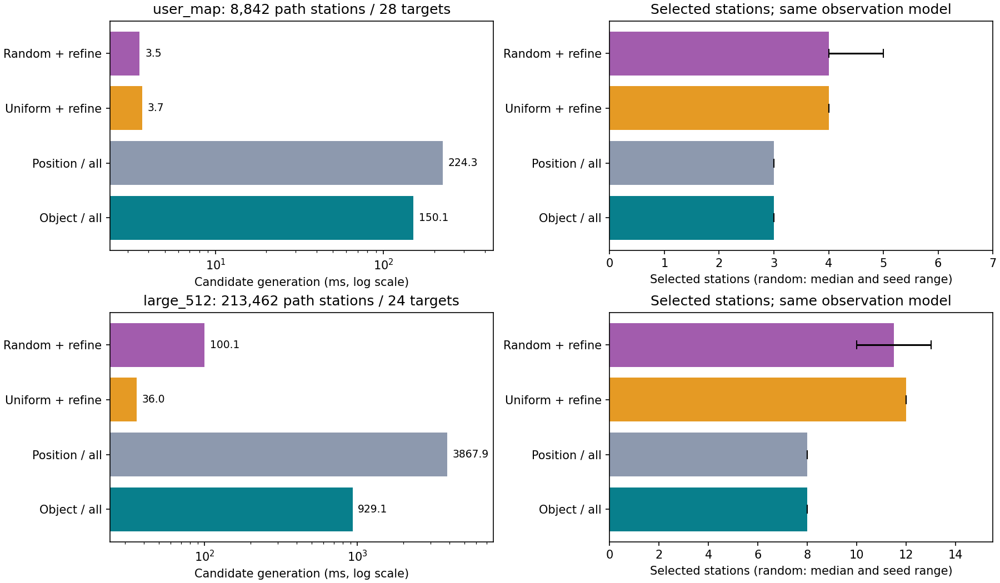
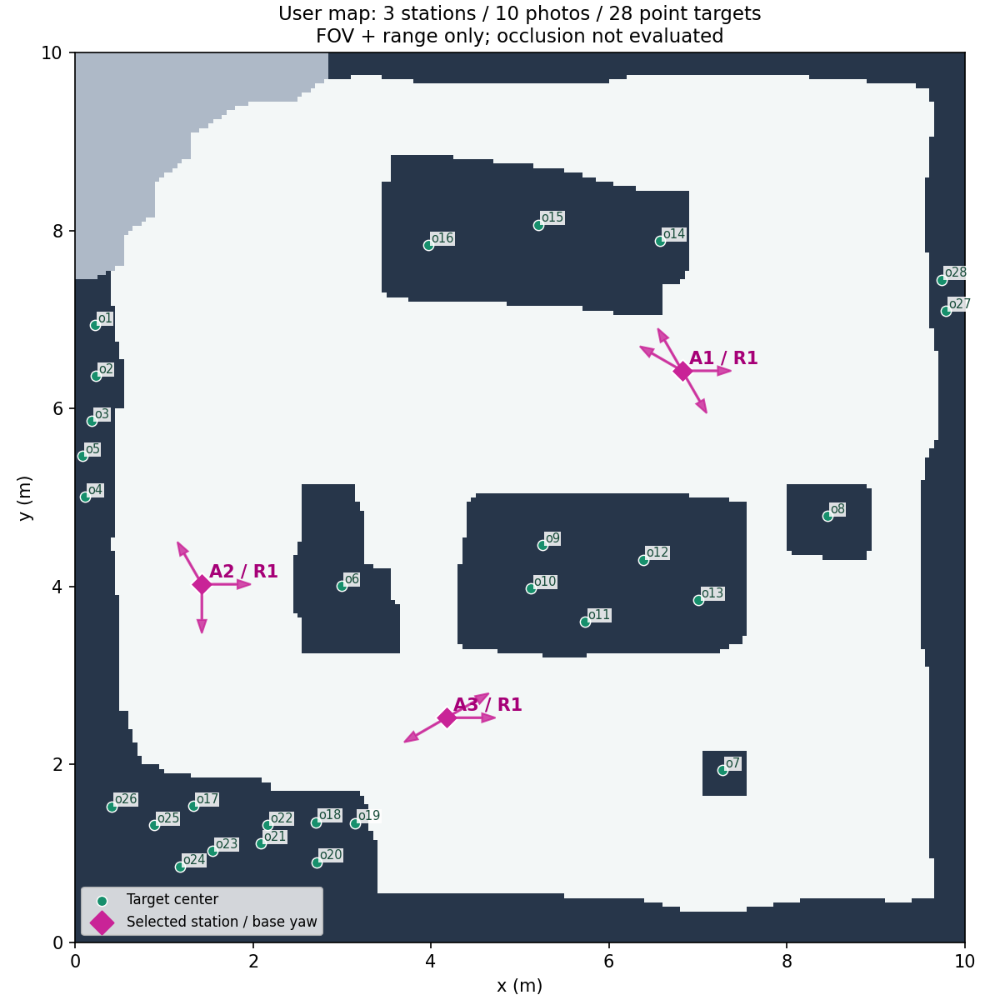

# 物体驱动与位置驱动锚点选择实验

> 2026-10-15 主线更新：已选用物体驱动，正式入口为 [falhv2/anchor_selector.py](../../falhv2/anchor_selector.py)。以下保留原实验结果；涉及 `anchor_experiments` 的运行命令请在 `experiment/anchor-candidate-drivers` 分支执行。主线命令见 [README](../../falhv2/README.md)。

日期：2026-10-14。分支：`experiment/anchor-candidate-drivers`。基线提交：`04c79bb`。本次在独立实验模块中实现两种候选生成方法，复用现有 A1 路径，并使用同一个点观察模型和选站求解器。

**当前建议：离线生成正式候选计划优先采用物体驱动；需要快速预览时使用均匀位置采样加缺口加密。** 在用户地图上，物体驱动计算完整候选覆盖关系约 150 ms，得到 3 个站位、10 张定向照片；64 个均匀采样位置约 3.7 ms，得到 4 个站位、10 张照片。二者都覆盖了当前模型下的全部 28 个物体点。随机采样保留为对照，不作为默认方法。

本轮的覆盖含义严格限定为**物体三维中心点满足相机视场和有效距离条件**。没有物体尺寸、AABB 或像素尺度判断，也没有遮挡、表面朝向或真实识别验证。三个站位不代表真实场景已经可以用十张照片采集完整。

## 输入与实现

使用相同的 D435i 配置：RGB 1280×720，`fx=911.423035`、`fy=909.724121`、`cx=644.835571`、`cy=363.355896`，原生畸变系数全为零。相机相对底盘前移 0.23 m、左移 0 m、高 0.5 m，安装角全为零；允许观察距离为相机光心至物体点的三维欧氏距离 0.2–3.0 m。这是当前配置的实验条件，不是已经由真实采集验证的质量标准。

底盘宽 0.465 m、长 0.545 m、安全距离 0.285 m。A1 在各连通区域内生成四邻接路线。首版候选位置使用路径第一次访问的安全格中心，重合位置合并，保留全部访问索引。所有方法共享每站 0°、30°、…、330° 的 12 个底盘偏航；底盘可原地转向，相机俯仰固定。图像边界采用 `0≤u≤width−1`、`0≤v≤height−1`。

| 模块 | 实际实现 |
|---|---|
| `common.py` | 物体 ID 校验、路径站位去重、相机外参变换、点投影与视场/距离判断；非零畸变暂时明确拒绝，不静默忽略 |
| `object_driver.py` | 每个物体用 KDTree 查询附近路径站位，保守半径为最大距离加相机水平安装偏移；筛选后检查全部声明方向，输出反向支持集合 |
| `position_driver.py` | 均匀、固定种子随机或穷举站位，正向计算物体支持；对缺口成倍扩大候选池，直到全部物体有支持或候选池耗尽 |
| `selection.py` | 根据未覆盖物体动态更新站位票数、删除冗余站位、贪心选照片并再次删除冗余；不移动站位，不预设锚点数量 |
| `run.py` | 可独立运行的实验入口，输出区域、站位、底盘拍摄方向、物体覆盖关系、缺口、耗时和 SVG |
| `benchmark.py`、`summarize.py` | 可复现实验、完整候选与固定子集一致性验收、小规模精确核对、结果汇总与图表 |

物体驱动实现的是**有限路径站位与方向上的反向查询**，不是连续三维可见性体积的精确求交。它通过三角不等式做保守距离粗筛，不会主动丢掉低票位置，再交给共用模型决定最终支持关系。

位置驱动的均匀采样按“去重站位的首次访问序号”展开，不等同于连续路径等米间距采样。初始预算为 64 个站位，优先保留各区域首末站位；随机方法从全部站位生成固定种子的无放回顺序。两种采样都支持嵌套加密；资源预算限制候选数，不限制输出锚点数。随机采样没有生长运动树，不称为 RRT。

## 实验设计与验收

八组场景包括一张用户地图、三张室内合成布局、一张高度/距离缺口场景、两张大图和空物体边界情况。用户地图独立快照保存在实验分支的 `falhv2/anchor_experiments/fixtures/user_map_20261014.json`，没有覆盖工作区中用户修改的 `examples/map.json`。合成输入由固定种子的 `fixtures.py` 生成；运行时另外保存完整场景及配置快照到本地 outputs。

每个确定性配置运行三次，取中位数；随机方法使用种子 0–9，每个种子运行三次，报告十个中位数的中位数及范围。主实验共 192 组配置、576 次完整候选生成与选站。候选计时包含 KDTree、采样、Python 查表和稀疏支持集合构造，不包含 A1、选站、验证、JSON 和绘图；选站另计时。A1 加站位提取每场景记录一次，不能把候选阶段加速倍数直接当作整个流程加速倍数。

验收分成三层：

1. **共用几何独立核对。** 用手算投影、视场/距离边界，以及独立世界坐标刚体变换检查安装平移和三个旋转角。非零畸变、不完整安装参数、重复物体 ID 明确报错。
2. **相同候选必须相同覆盖。** 八组场景的物体驱动完整池与位置穷举完全一致；每个均匀/随机结果再用物体驱动检查相同子集，共完成 176 次子集对照。计时重复中输出一致。这里的一致性依赖同一个观察模型，所以独立几何检查仍然必需。
3. **计划重新核验。** 对最终每个拍摄动作逐目标重算观察条件；照片覆盖并集必须等于候选池可覆盖目标集合，缺口保留原始物体 ID。用 30 组可复现小型随机覆盖关系，将投票与朴素贪心、精确 DP 与子集穷举对照。

当前 18 项锚点实验测试通过。已有相机、编辑器和生产 A1 实现未在本轮修改。这里没有验证实际导航控制、现场遮挡或图像识别效果。

## 用户地图结果

地图 200×200、0.05 m/格，8842 个安全站位、3 个导航连通区域、28 个物体点。固定 A1 路线总长 476.35 m；本次没有按锚点重新优化行驶路线。A1 加站位提取约 92 ms，以下另列候选与选站计算。

| 方法 | 实际候选站位 | 候选计算 / ms | 选站 / ms | 站位数 | 照片数 | 点覆盖 |
|---|---:|---:|---:|---:|---:|---:|
| 物体驱动，完整池 | 8842 | 150.13 | 42.82 | **3** | **10** | 28/28 |
| 位置驱动，穷举 | 8842 | 224.29 | 43.61 | 3 | 10 | 28/28 |
| 均匀采样，允许加密 | 64 | **3.66** | 0.83 | 4 | 10 | 28/28 |
| 随机采样，允许加密，10 种子 | 64 | 3.54 | 0.88 | 4–5 | 11–12 | 每次 28/28 |

物体驱动将精确点—观察检查从 2,970,912 次减少到 794,784 次，减少约 73.2%；候选计算比位置穷举快约 1.49 倍。它仍明显慢于只检查 64 个位置的采样方法，但当前离线计算只需约 0.15 秒，且选出的停车站位更少。

进一步将完整池归并成 189 种不同的站位物体集合，逐一排除全部单站与双站组合，再与已验证可行的三站计划结合，**确认本次离散站位、12 个方向及允许一站多照片的模型下最少站位数为 3**。这一证明只针对站位数，不证明 10 张照片最少，也不证明连续空间或真实图像下最优。





图中箭头表示底盘拍摄偏航，绿色点是物体中心；R1 是导航区域编号。当前三个站位都在区域 1。图上目标点可以落在导航占据格内；没有三维遮挡数据时，这些点仍可能在模型中获得跨障碍支持。该图用于检查计划和假设，不表示这些物体在现场一定可见。

## 大图与其他场景

下表的采样方法均允许因缺口而加密。随机结果为十个种子的站位数范围；除缺口场景外，各方法最终均覆盖全部输入点。

| 场景 | 安全站位 / 物体数 | 物体驱动站位 / 照片 | 均匀加密站位 / 照片 | 随机加密站位 / 照片 |
|---|---:|---:|---:|---:|
| 小房间 | 128 / 8 | 2 / 5 | 2 / 5 | 2 / 5–6 |
| 断开区域 | 448 / 6 | 2 / 6 | 2 / 5 | 2 / 6 |
| 门洞与障碍 | 667 / 7 | 2 / 5 | 2 / 5 | 2 / 4–6 |
| 高度与距离缺口 | 128 / 4 | 1 / 2，覆盖 2/4 | 1 / 2，覆盖 2/4 | 1 / 2，覆盖 2/4 |
| 300×300 | 63986 / 24 | **6 / 17** | 8 / 16 | 7–9 / 15–18 |
| 512×512 | 213462 / 24 | **8 / 17** | 12 / 19 | 10–13 / 18–20 |
| 空物体 | 128 / 0 | 0 / 0 | 0 / 0 | 0 / 0 |

小房间、断开区域、门洞三个完整小案例用精确 DP 确认最少站位均为 2，完整池贪心在这些案例中达到该值。缺口案例对全部四个目标不可行；其中可覆盖的两个目标只需一站。不能把这两者从总目标中删掉再报告 100%。空目标覆盖率记为不适用。

512×512 的具体计算取舍：

| 方法 | 候选计算 / ms | 精确点—观察检查 | 实际采样站位 | 最终站位 / 照片 |
|---|---:|---:|---:|---:|
| 物体驱动完整池 | 929.10 | 3,196,656 | 完整池 213462 | **8 / 17** |
| 位置穷举 | 3867.90 | 61,477,056 | 213462 | 8 / 17 |
| 均匀加密 | **36.01** | 36,864 | 128 | 12 / 19 |
| 随机加密 | 100.08 | 中位数 55,296 | 64–512 | 10–13 / 18–20 |

物体驱动在该大图上比位置穷举快约 4.16 倍，检查次数减少约 94.8%。共同 A1 与站位提取另需约 1.89 秒；物体驱动选站另约 234 ms，均匀采样选站约 15 ms。因此只报告候选阶段的 4.16 倍，不把它解释为总体执行速度。

在小房间中，物体驱动约 1.44 ms，位置穷举约 1.30 ms；附近目标多、场景小时，建树和分对象组织的开销会抵消筛选收益。它没有普遍速度优势。

## 发现的问题与迭代

**随机撒点需要覆盖检查与补点。** 300×300 图中，初始 64 个随机点有 1/10 种子漏掉完整池可覆盖的目标；512×512 有 9/10。加密后这些缺口均消失。512×512 的均匀 64 点也有缺口，增加至 128 点后修复。固定点数不能作为覆盖完成条件。

**“有覆盖就停止”不等于“站位已经很少”。** 用户地图在 64 点时已全覆盖，因此不会继续加密，仍比完整池多一站。512×512 全覆盖后的采样计划为 10–13 站，完整池为 8 站。若主要目标是减少停车，应继续做覆盖保持的候选改进，而不仅补漏。

**照片数仍存在启发式偏差。** 断开区域中，均匀采样与完整池都是两站，但照片为 5 对 6；门洞随机种子也可能得到 4 张照片，而完整池为 5 张。更多候选不会保证当前“两阶段贪心”得到更少照片。站位贪心和冗余删除只给近似解，方向选择也未求精确最优。

**修复了一个实际性能问题。** 初版均匀采样会预生成整个候选顺序，即使只检查 64 点。将其改为惰性生成、保留嵌套顺序后，300×300 的均匀 64 点候选时间从约 53.5 ms 降至 12.2 ms；主表使用优化后重新测量的数据。此前还补充了各区域端点、物体输入校验和一致性测试。

**缺口诊断需要区分原因。** 合成场景中 o3 高 2.5 m，部分位置满足距离，但固定水平相机不能使它进入视场；o4 远离地图，全部位置超距。完整池与 15° 方向加密后都保留这两个缺口。诊断统计每个位姿只分配一个主要原因，优先级为距离、相机后方、水平视场、垂直视场，不是对所有失败条件独立计数。

将全池方向从 30° 加密到 15°，本轮没有新增可覆盖目标，部分案例照片数下降：小房间 5→4、门洞 5→4、300×300 17→16；站位数均不变。这个结果仅说明本轮数据，不能证明 30° 在其他场景足够。

## 选择与下一步

当前任务主要减少站位，且是离线规划，用户图和大图的物体驱动完整池计算时间可接受，因此优先保留它作为正式计划候选。均匀采样加密作为快速预览/基线；随机采样保留多种子实验，不依赖一次随机结果下结论。

后续优先事项：

1. 现场检查所选照片对应的物体，确认跨障碍支持是否实际可见；补充三维遮挡几何后再更新观察模型，不能直接把二维导航障碍当三维遮挡。
2. 在保持站位数的情况下，用小规模精确方向选择核对照片冗余；比较站位并列票数时考虑拍摄成本的规则。
3. 对采样方法尝试“已全覆盖后仍继续压缩站位”的改进，或均匀初始池加物体支持区域定向补候选。作为单独混合方法报告，不与本轮两个方法混算。
4. 骨架路径、扫描间距以及执行路线缩短作为另一组实验。当前所有方法共用 A1 路线，站位减少不意味着机器人一定少走完整路线。

## 运行与复现

在仓库根目录使用已有 conda 环境。规划过程不连接相机、不依赖 Python RealSense SDK，只读取配置；新增科学绘图依赖使用环境中已有 Matplotlib。

```bash
conda activate test
python -B falhv2/anchor_experiments/run.py --method object
python -B falhv2/anchor_experiments/run.py --method position --strategy uniform \
  --output falhv2/outputs/anchor_experiment/uniform_plan.json
python -B falhv2/anchor_experiments/run.py --method position --strategy random --seed 6 \
  --output falhv2/outputs/anchor_experiment/random_plan.json
```

默认读取实验用户地图快照、`config/robot.example.json` 和 `config/camera.d435i.json`；可以用 `--scene`、`--robot`、`--camera` 替换。输出 JSON 与同名 SVG 均在 Git 忽略的 outputs；加 `--save-supports` 可另存完整 A2 稀疏覆盖关系。可用 `--no-refine` 对照不补点的方法，`--max-stations` 设置候选计算限制；限制触发时会如实保留覆盖缺口。

```bash
python -B -m unittest discover -s falhv2/tests -p 'test_anchor*.py' -v
python -B falhv2/anchor_experiments/benchmark.py
python -B falhv2/anchor_experiments/summarize.py
```

基准脚本把完整输入保存到 `outputs/anchor_experiment/benchmark/fixtures.json`。如后续修改了配置，可通过 `--fixtures` 重放该快照，并用 `--output` 保存到其他目录。完整三次计时、十种子结果和逐候选一致性数据保存在本地 `comparison.json`；可版本化的精简记录见 [anchor_driver_summary_20261014.json](anchor_driver_summary_20261014.json)，包含每场景输入 SHA256、环境、聚合数据和原始结果 SHA256。原始 outputs 未加入 Git；代码、输入生成器、用户地图快照、报告、汇总与报告图片保存在实验分支。
