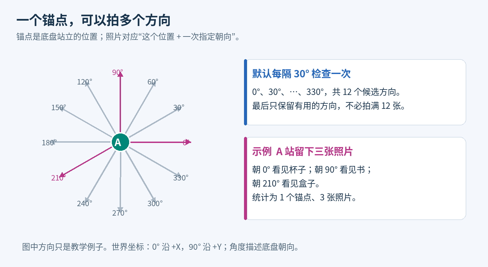
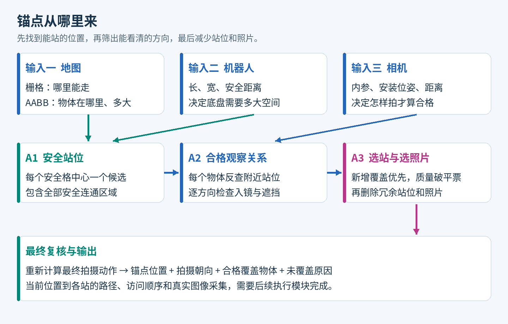
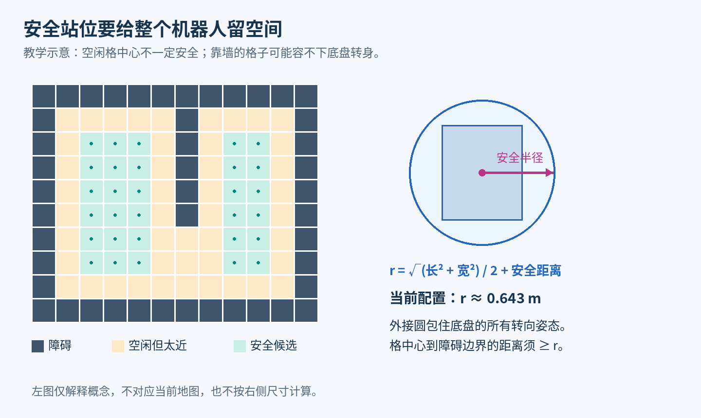
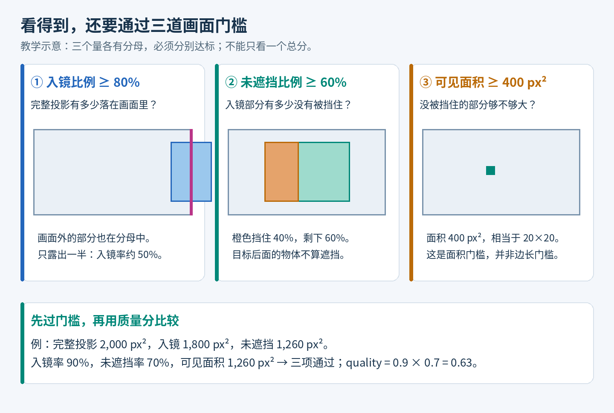
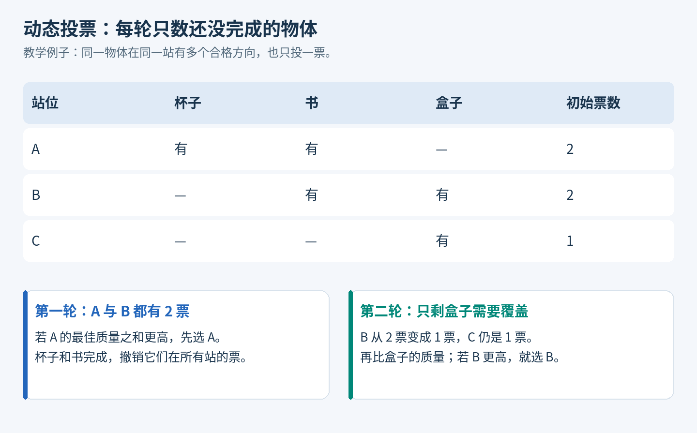
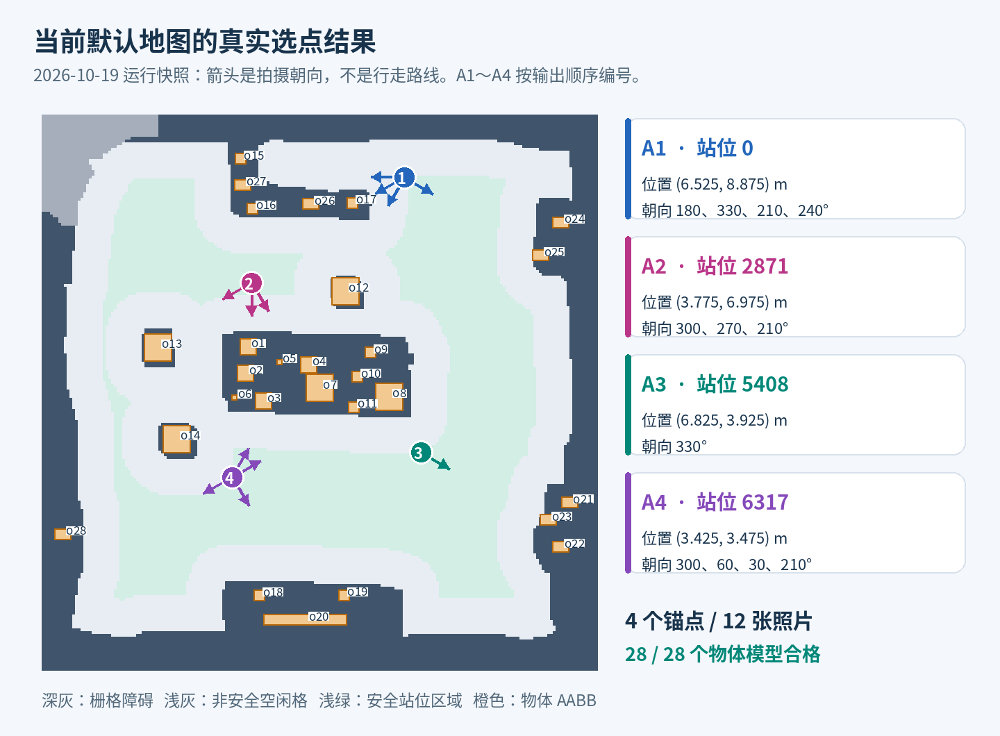

# FALH V2 当前锚点选取图解

> 本篇保留提交 `024a1a9` 时的算法与实跑快照。`refine/anchor-selection` 分支已改为连续权重投票和逐物体热力图；最新规则、参数与验证结果见[锚点选择改进说明](anchor_selection_refine.md)。下文“当前”均指该历史快照。

更新日期：2026-10-19。适用范围：当前仓库的 `falhv2/anchor_selector.py`、`observation_model.py` 和 `regions_extractor.py`，默认使用 `data/map_aabb.json` 中的完整 AABB 物体地图。

**现在的锚点，是从所有安全格中心里，根据物体能否被合格观察选出来的。** 程序先回答“机器人能站在哪里”，再回答“站在那里朝哪个方向，能合格地看到哪些物体”，最后尽量减少站位和照片数量。当前版本不需要预先给定锚点数量，也不先生成一条巡航路线。

用当前默认输入实际运行，结果是 **10,644 个安全候选站位 → 贪心初选 5 站 → 删除冗余后保留 4 个锚点 → 12 张定向照片 → 28/28 个物体达到模型门槛**。这里的“合格”指几何与面积检查通过，真实照片能否清楚识别物体仍需现场验证。

可以把整个过程想成：**你要在房间里给所有物品拍照，希望少挪几次脚，也少按几次快门。** 你需要有地方站，不能离物品太远，不能把主体切出画面，也不能让前面的物品挡掉太多。

## 阅读路线

- 想先明白大意：读第 1～3 节和第 10 节的真实地图。
- 想知道每个判断如何做：读第 4～9 节，尤其是合格观察、动态投票和删冗余。
- 想运行、看结果、查问题：读第 11～14 节。
- 文中的“教学例子”用于解释规则；第 10 节和配套快照是当前默认输入的真实运行结果。

## 1 先分清三个容易混淆的概念

| 概念 | 通俗解释 | 程序里的表示 |
|---|---|---|
| 候选站位 | 机器人可以安全停下并原地转向的一个备选位置 | 一个安全格中心，带站位编号、区域编号和 `(x,y)` |
| 锚点 | 最后被算法选中、计划用于观察的站位 | `anchors` 中的一项 |
| 拍摄动作 | 在一个锚点，以指定底盘朝向拍一张照片 | `observations` 中的一项，包含 `yaw_rad` |

**一个锚点可以对应多张照片。** 例如，站在客厅中央，朝左拍到书架，朝右拍到桌面，这算一个锚点、两个拍摄动作，而不是两个锚点。



图 1：图中灰色和紫色箭头一起表示候选方向，紫色表示教学例子中最后保留的方向。当前位置不变，底盘转向即可改变观察方向。图中的三个保留角度只是示例。

当前默认每隔 **30°** 检查一次：`0°、30°、60°、……、330°`，共 **12 个候选方向**。程序不是要求每站拍满 12 张，而是先检查 12 个方向，再挑有用的方向。世界坐标中，0° 指向 `+X`，90° 指向 `+Y`；这些角度描述的是底盘朝向。相机如果有安装偏角，实际光轴还要叠加安装旋转。

`station_index` 是候选站位的稳定编号，不是机器人到访的先后顺序。输出页面中的 `A1、A2……` 则是最终锚点列表的显示编号，两者也不能混用。

## 2 从输入到输出的完整流程



图 2：A1 负责底盘安全，A2 负责判断观察是否合格，A3 负责选站和选照片。最后再次检查已选拍摄动作，确认覆盖没有丢失。

三个阶段各自回答一个问题：

| 阶段 | 要回答的问题 | 产物 |
|---|---|---|
| A1 安全区域 | 机器人站在这里，会不会离障碍太近 | 全部安全格中心及其连通区域 |
| A2 观察关系 | 从这个站位朝这个方向，能否合格地观察这个物体 | 站位、方向、物体之间的合格关系和质量分 |
| A3 选择与精简 | 选哪些站位和照片，能覆盖所有可覆盖物体 | 最终锚点、拍摄方向、覆盖清单与缺口 |

真正执行任务时，还需要知道“先去哪一站、怎样绕开障碍走过去、实际拍下什么图像”。这些工作属于后续导航与采集，不是当前选点程序已经完成的功能。

## 3 程序到底读了哪些输入

默认输入路径由 [config.py](../../falhv2/config.py) 统一设置，均相对 `falhv2` 目录解析。

| 输入 | 当前默认文件 | 提供的信息 |
|---|---|---|
| 场景 | [map_aabb.json](../../falhv2/data/map_aabb.json) | 二维栅格、物体中心和三维 AABB |
| 机器人 | [robot.json](../../falhv2/data/robot.json) | 底盘宽、长、安全距离 |
| 相机 | [camera.d435i.json](../../falhv2/data/camera.d435i.json) | 图像尺寸、内参、安装位置与角度、观察距离；可选质量门槛 |

### 3.1 一张地图里有两套不同用途的信息

**二维栅格管底盘。** 可以把它理解成地板上的棋盘：`.` 是空闲格，`#` 是障碍，`?` 是未知。未知格和地图外部都不能随便进入。

**三维 AABB 管物体的视觉几何。** AABB 是“与世界坐标轴对齐的长方体包围盒”，相当于给物体套上一个透明的长方体盒子。程序通过 `min=[xmin,ymin,zmin]` 和 `max=[xmax,ymax,zmax]` 知道盒子的大小、位置和高度；`position` 必须是它的中心。

例如：

```json
{
  "id": "cup_box",
  "position": [2.0, 3.0, 0.85],
  "aabb": {
    "min": [1.8, 2.85, 0.6],
    "max": [2.2, 3.15, 1.1]
  }
}
```

这个教学例子描述一个 X 方向宽 0.4 m、Y 方向宽 0.3 m、高 0.5 m 的盒子，底面离地 0.6 m，顶面离地 1.1 m。盒子中间即使实际有空洞，当前观察模型也把整个盒子当作实心。

**这两套信息不会自动互相补齐。** 画了一个 AABB，不等于自动在导航栅格上增加了障碍；只画了二维墙，也不等于观察模型知道墙的三维高度。如果某个物体会挡底盘，需要在栅格里正确标出；如果某个实体会挡视线，需要提供三维几何。当前输入中的所有物体 Box 同时也是覆盖目标，并没有单独的“只遮挡、不要求拍摄”的 Box 类型。

### 3.2 当前实际参数

以下为本次运行读取的配置；不是所有机器人的通用推荐值。

| 参数 | 当前值 | 直观含义 |
|---|---:|---|
| 地图大小 | 200 × 200 格 | 一共 40,000 格 |
| 栅格分辨率 | 0.05 m/格 | 地图覆盖 10 m × 10 m |
| 物体数量 | 28 个 | 每个物体都有完整 AABB |
| 底盘宽 | 0.465 m | 用于计算转身需要的空间 |
| 底盘长 | 0.545 m | 同上 |
| 安全距离 | 0.285 m | 在底盘外接圆半径外再加的余量 |
| 图像尺寸 | 1280 × 720 | 用于判断入镜和投影面积 |
| 相机安装位置 | `[0.23, 0, 0.5]` m | 相对底盘原点：前方 23 cm、左方 0、上方 50 cm |
| 安装 roll、pitch、yaw | 均为 0° | 当前镜头水平朝向底盘正前方 |
| 允许观察距离 | 0.2～3.0 m | 相机光心到物体盒子中心的三维距离 |
| 底盘方向间隔 | 30° | 每个候选站位检查 12 个方向 |

相机内参中的 `fx、fy` 决定三维物体投到画面上的尺度，`cx、cy` 决定投影中心。程序使用这些内参进行投影，不是只用一个随意画出的扇形判断“看得见”。当前内参中的五个畸变系数都是零；代码会拒绝非零畸变输入，而不会悄悄忽略它们。

## 4 第一步 找到机器人能安全站立的位置

实现入口：[regions_extractor.py](../../falhv2/regions_extractor.py) 中的 `plan()`。

### 4.1 空地不一定放得下机器人

想象你在一张地板图上看到一个白色格子。它自己没有障碍，但它旁边可能就是墙。把机器人的中心放在格子里，并不代表机器人四个角都不会碰墙。

所以程序先用一个圆包住整个矩形底盘，再额外增加安全距离。圆的半径为：

```text
安全半径 r = √(底盘宽² + 底盘长²) / 2 + 安全距离
```

当前配置得到：

```text
r = √(0.465² + 0.545²) / 2 + 0.285 ≈ 0.643 m
```

这个圆包住底盘在不同朝向下的占地，因此适用于当前“底盘可以原地转向”的假设。代价是比较保守：某些机器人朝特定方向勉强能通过的窄缝，也可能被排除。



图 3：左侧只是概念示意；右侧解释安全半径。靠墙空闲格被排除后，安全格中心才成为候选站位。左图没有按当前机器人尺寸计算。

### 4.2 距离量到障碍的边缘

程序用 **EDT，也就是欧氏距离变换**，批量计算格中心离障碍有多远。可以把 EDT 理解成一次性给每个格子填上“离最近危险边界的距离”。

这里有一个重要实现细节：它在半格间距的细网格上表示障碍格的角点、边中点和中心，再计算距离。对原始格中心而言，这样量到的是障碍方格的边界，而不是只量到障碍格的中心。否则“离障碍还有一段距离”的判断可能过于乐观。

一个格中心要被留下，必须同时满足：

1. 这个格子本身是空闲格 `.`。
2. 到障碍格、未知格以及地图外边界的最近距离，不小于安全半径。

程序再使用 **四连通** 把安全格分组：只通过上、下、左、右邻接连起来，斜对角碰到一个角不算直接连接。每组就是一个安全连通区域。

### 4.3 每个安全格中心都成为候选

当前主线没有先随机抽一批点，也没有只沿房间中线取点。它在**全部安全区域的每个安全格中心**生成一个候选站位。

候选按“区域 ID → 从上往下的行号 → 从左往右的列号”固定排序。若地图原点是 `(x₀,y₀)`，分辨率是 `s`，总行数为 `H`，则零起始行列 `(row,col)` 对应：

```text
x = x₀ + (col + 0.5) × s
y = y₀ + (H - row - 0.5) × s
```

Y 方向要翻转，是因为图像行号往下增加，而世界坐标 Y 往上增加。这里的坐标是底盘站位参考点，不是相机光心。

当前地图得到 **1 个安全区域、10,644 个候选站位**。如果地图有多个不连通区域，程序也会全部纳入，因为它没有输入机器人起点；“在某个区域内安全”不能直接理解为“机器人从当前位置一定走得到”。如果一个安全格都没有，程序会明确报错。

## 5 第二步 让物体反过来寻找观察位置

实现入口：[anchor_selector.py](../../falhv2/anchor_selector.py) 中的 `generate_candidates()`。

“物体驱动”的意思是：**对每个物体，查找哪些安全站位可能看见它，再检查这些站位的各个方向。** 物体并不真的移动，也不会在连续空间里随意生成新站位；查询始终发生在 A1 已经给出的安全格中心集合里。

### 5.1 先排除明显太远的位置

比如物体在房间左上角，相机最远只允许观察 3 m，房间右下角的站位就没有必要逐方向精算。程序用 `cKDTree` 做附近位置查询。你可以把 KDTree 想成一个“按位置编好的快速通讯录”，用来迅速列出某个圆形范围内的站位。

查询半径为：

```text
最远观察距离 + 相机相对底盘的水平偏移长度 + 极小浮点余量
当前约为 3.0 + 0.23 = 3.23 m
```

为什么要多加 0.23 m？因为相机装在底盘前方。即使底盘中心离物体超过 3 m，朝向合适时，相机光心仍可能进入 3 m 范围。粗筛如果直接使用 3 m，就可能错误删除原本合格的站位。

粗筛只是在二维平面上使用一个宽松的必要条件。高度差、实际朝向和最近距离是否满足，留给下一步精算。**查进这个圆，表示值得检查，不表示已经合格。**

### 5.2 再逐方向检查

对查到的每个站位，程序默认检查 12 个底盘方向。每次检查的对象都是一个三元组：

```text
站位 i + 底盘朝向 θ + 物体 o
```

检查结果记为 `q(i,θ,o)`：合格为 1，不合格为 0。这个符号看起来像公式，其实就是一个“这张照片能不能算作完成了这个物体”的是非判断。

当前实跑中，如果完全不粗筛，需要检查：

```text
10,644 个站位 × 28 个物体 × 12 个方向 = 3,576,384 个组合
```

距离粗筛把站位与物体的组合从 298,032 对减少为 103,611 对，随后实际评估 **1,243,332 个站位、方向、物体组合**。这比无粗筛枚举减少约 **65.2%** 的组合检查；不是运行时间加速比例，也不包含最后动作复核。粗筛的目标是减少无效计算，同时保留有限候选池内可能合格的组合。

## 6 第三步 判断一张照片是否能合格地看到物体

实现入口：[observation_model.py](../../falhv2/observation_model.py) 中的 `BoxObserver.evaluate()` 和 `_evaluate()`。

### 6.1 先把相机摆到正确位置

底盘站位只给出 `(x,y)`，程序把底盘参考点放在世界坐标 `(x,y,0)`。相机安装偏移要随着底盘一起转：底盘转向后，原先的“底盘前方 23 cm”也会转到新的前方。

程序还会叠加相机的安装 roll、pitch、yaw，把物体变换到相机坐标系。安装参考轴是前、左、上；相机光学坐标轴是右、下、前。安装角按 `Rz(yaw) Ry(pitch) Rx(roll)` 组合，其中正的 pitch 表示向下看。

对零畸变针孔模型，物体点在相机坐标中为 `(Xc,Yc,Zc)` 时，画面位置是：

```text
u = fx × Xc / Zc + cx
v = fy × Yc / Zc + cy
```

不需要记住公式，只要理解：**三维位置和相机姿态一起决定物体出现在画面的哪里，以及有多大。**

### 6.2 先检查基本几何和距离

开始面积采样前，程序会排除以下情况：

- 相机光心处于任意实心 AABB 内部或其边界上。
- 目标盒子没有完全位于相机平面前方，包括盒子跨过相机平面的情况。
- 相机光心到目标中心的三维距离不在允许范围内。
- 目标投影外框与画面完全没有交集。

注意，距离是到**物体中心**，不是到最近表面；巨大物体即使表面很近，也不能因此跳过中心距离条件。跨相机平面的盒子被保守拒绝，当前实现不做近裁剪面的完整几何裁切。

### 6.3 三个画面指标分别解决三个问题



图 4：物体可以“几乎全在画面里，但被别的物体挡住”；也可以“完全没有遮挡，但只有几个像素大”。因此需要三个独立门槛。

| 指标 | 计算含义 | 默认门槛 | 没通过时的直观意思 |
|---|---|---:|---|
| `in_frame_fraction` 入镜比例 | 画面内目标投影面积 ÷ 完整目标投影面积 | ≥ 0.8 | 物体被画面边缘切掉太多 |
| `visible_fraction` 未遮挡比例 | 画面内未遮挡目标面积 ÷ 画面内目标投影面积 | ≥ 0.6 | 入镜部分被前方物体挡掉太多 |
| `visible_pixels` 可见像素面积 | 画面内未遮挡目标的估计面积 | ≥ 400 px² | 物体在图像里太小 |

“完整目标投影面积”是目标投影轮廓的面积，不是长方体所有表面的面积之和，也不直接等于投影外接矩形的面积。

举一个教学例子：完整投影是 2,000 px²，其中 1,800 px² 落在画面里，入镜部分有 1,260 px² 没被遮挡。那么：

```text
入镜比例   = 1,800 / 2,000 = 90%  → 通过 80% 门槛
未遮挡比例 = 1,260 / 1,800 = 70%  → 通过 60% 门槛
可见面积   = 1,260 px²            → 通过 400 px² 门槛
```

只要前面的几何、距离检查也通过，这个动作对该物体就是 `q=1`。

400 px² 只是面积，相当于一个 20×20 像素正方形的面积，并不要求物体宽、高分别大于 20 像素，也不代表这样的图像一定能识别。

### 6.4 遮挡怎样判断

可以把相机想成向画面中的许多点发出细线：每条线从相机光心出发，穿过一个采样像素，射向三维场景。

1. 将目标 AABB 的八个角投到画面上，得到投影外接矩形。
2. 在这个矩形里均匀取一批采样点，向它们发射射线。
3. 只把确实与目标盒子相交的射线算作目标投影的一部分。外接矩形里不属于目标轮廓的角落不计入分母。
4. 对落在画面内的目标射线，比较它与目标、其他盒子的最近交点。
5. 如果先碰到其他盒子，之后才碰到目标，说明这部分被遮挡；如果其他盒子在目标后面，就不遮挡目标。

```text
相机 ───── 前方盒子 ───── 目标       先撞前方盒子 → 目标这一部分被挡住
相机 ───── 目标 ───── 后方盒子       先撞目标     → 后方盒子不算遮挡
```

每条射线以目标最近表面为准，不把正面和背面重复计数。`occluder_ids` 汇总的是采样中实际挡在最前面的遮挡体 ID，不是视线附近所有盒子的清单。

### 6.5 采样精度不是无限的

默认先用 **12×12** 网格采样，即在每个目标的投影外接矩形中放 144 个点。如果任一指标接近门槛，则改用 **36×36** 网格重新计算这个动作：

| 触发加密的情况 | 默认门槛下的大致范围 |
|---|---|
| 入镜比例与门槛相差不超过 0.08 | 0.72～0.88 |
| 未遮挡比例与门槛相差不超过 0.08 | 0.52～0.68 |
| 可见面积与门槛相差不超过门槛的 20% | 320～480 px² |

加密结果会替换初始结果。12×12 指采样网格，不是把原图缩小成 12×12 像素；面积仍换算成原始图像中的 px²。

这种做法兼顾速度和临界判断，但很薄的遮挡物仍可能落在采样点之间。当前结果是采样估计，不是逐像素精确渲染，也没有连续几何误差保证。

### 6.6 合格判断和质量分各司其职

通过与否使用独立门槛；另外保存一个质量分：

```text
quality = 入镜比例 × 未遮挡比例
```

它可以理解为“完整目标投影中，既入镜又没有被遮挡的比例”。上面的教学例子得到 `quality=0.9×0.7=0.63`。

质量分用于**合格候选之间的平票比较**。它不含像素面积，不代表识别概率，也不会替代硬门槛。例如，入镜率 100%、未遮挡率 59% 的目标即使质量分高于另一个合格目标，也仍然不能算覆盖，因为它没过 60% 未遮挡门槛。

## 7 第四步 用动态投票选择锚点

实现入口：[anchor_selector.py](../../falhv2/anchor_selector.py) 中的 `select_anchors()`。

### 7.1 先把方向级关系合并成站位级关系

假设在 A 站：

| 朝向 | 合格看见的物体 |
|---|---|
| 0° | 杯子、书 |
| 30° | 杯子 |
| 180° | 盒子 |

那么 A 站的覆盖集合是 `{杯子、书、盒子}`，共 3 个物体。杯子虽然在两个方向都合格，也只算一次。

用集合记号表示，就是：

```text
C(i,θ) = 在站位 i、方向 θ 下合格的物体集合
C(i)   = 该站所有方向 C(i,θ) 的并集
```

“并集”就是把各张清单合并、去掉重复名字。一个站覆盖某物体，只需要至少存在一个合格方向；不同物体的合格方向可以不同。因此，一个站覆盖 14 个物体，不表示存在一张照片同时拍到 14 个。

### 7.2 每个尚未完成的物体给能看见自己的站位投票

开始时，所有物体都没有完成。一个物体给所有能合格观察它的站位各投一票，但每站最多一票。

设 `U` 为尚未覆盖的物体集合，那么某站当前的票数就是：

```text
票数 V(i) = C(i) 中仍属于 U 的物体数量
```

程序每轮优先选票数最多的站，也就是“这一步能新增完成最多物体的站”。这是一种**贪心集合覆盖**：把物体当作任务，把每个站位当作一包能完成的任务，每次先拿当前最有用的一包。



图 5：A 入选后，杯子和书的票在所有站一起撤销。B 的原始票数虽然是 2，下一轮也只剩盒子的一票。

### 7.3 同票时怎样决定

比较顺序是：

1. **新增合格物体数更多的站优先。**
2. 若相同，比较这些新增物体在该站的“最佳合格方向质量”之和。
3. 仍相同，选择 `station_index` 更小的站，保证结果可重复。

例如，某站的杯子有两个合格方向，质量分别为 0.65 和 0.90，杯子给该站贡献的质量就是 **0.90**，不是 1.55。另一物体的最佳方向可以完全不同。

教学比较：A 站能新增覆盖 3 个物体，质量之和 1.9；B 站能新增覆盖 2 个物体，质量之和 2.0。程序先选 A，因为覆盖数量优先，质量只负责同票比较。

实现中将单物体质量乘以一百万并四舍五入为整数，用这些整数比较质量和。这样做有利于稳定地更新优先队列；极小的质量差异可能归为同票。

**多个不合格方向不能凑成一个合格方向。** 例如两张照片各只露出一半物体，如果每张都没过门槛，这个物体不会因为“加起来好像完整”而获得覆盖资格。当前算法没有做多视角表面互补重建。

### 7.4 为什么叫动态投票

选中一个站后，该站新增覆盖的物体从 `U` 中移除。程序通过反向索引找到所有支持这些物体的站，扣掉它们对应的票和质量贡献，然后再选下一站。

代码用堆保存优先顺序，并跳过已过时的条目，避免每轮从头排序所有站位。这只是提高求解效率，核心规则仍然是“当前新增覆盖数 → 当前新增质量和 → 稳定编号”。

循环在所有物体完成，或者再也没有站能新增覆盖时结束。后一种情况会保留未覆盖物体，而不会把它们从统计分母中删除。

## 8 第五步 删除多余站位 再挑选拍摄方向

### 8.1 为什么选完还要回头删

早先选的站位可能很有用，但后面为了完成其他目标增加了新站，新站也覆盖了它的物体。这时，原来的站就可能不再必要。

程序统计每个物体被多少个已选站位覆盖。只有当一个站覆盖的**每一个物体**都还有其他站能够覆盖，才可以把这个站删掉。删除后立即更新计数，再继续检查其他站。


图 6：这个例子说明删除规则，并不表示图中的 A、B、C 一定会按前面的贪心算法全部入选。关键在于，必须逐个删除并更新计数。

在 AABB 模式下，代码优先尝试删除全站覆盖物体的最佳质量总和较低的站；质量相同沿用逆入选顺序。旧点模式没有 AABB 质量分时，直接按逆入选顺序检查。删站过程只要求覆盖不丢失，**不保证每个物体都保留此前最高的观察质量**。

删除不会移动站位，也不会合并成两个站的中点。最终保留站位集合中的任一站，都至少有一个物体不能由其余保留站覆盖。但“不能再直接删掉一站”不等于“换一组站也不可能更少”，所以程序明确标记为启发式结果，不承诺全局最少站数。

### 8.2 在保留站位的所有方向中挑照片

选站时只知道“这个位置转向后有能力完成哪些物体”，还没有确定最终要拍哪些方向。因此下一步会把所有保留站位的合格方向放到一起，再做一次贪心选择：

1. 每次选择新增覆盖物体最多的一个拍摄动作。
2. 同票时比较这些新增物体在这个具体方向下的质量和。
3. 仍同票时按 `(站位编号, 方向编号)` 选择。
4. 重复到所有已实现覆盖的物体都至少分配到一张照片。
5. 再按覆盖计数删除冗余照片；有质量分时优先尝试删除总质量较低的照片。

这一步是**跨所有保留站位一起选照片**，不是要求每站拍满 12 张，也不是要求每站独立拍完自己能看见的全部物体。

照片选择完成后，结果中每张照片的 `object_ids` 保存它能合格看到的完整物体集合，不仅是它被选中那一刻的“新增”物体。因此不同照片之间出现重复物体是正常的。

整体流程先选站、再选照片，体现了减少站位优先、再减少照片的思路；它不是同时精确最小化站位数、照片数、路程和转角的联合优化器。站间距离和导航路程没有进入当前投票公式。

## 9 第六步 独立复核最终计划

程序在两个层次检查结果。

**第一层检查清单。** 把最终照片的物体集合取并集，检查它是否恰好等于选站阶段记录的已覆盖物体集合。删站或删照片不能悄悄丢掉一个目标。

**第二层重算几何。** 对每个最终动作、每个输入物体，重新调用观察模型计算一次，而不是只相信之前的稀疏覆盖关系。重新得到的合格清单必须与照片保存的 `object_ids` 完全相同。AABB 模式还把每个物体的指标保存到该动作的 `object_metrics`。

这能够检查候选关系和最终动作是否一致，但仍然使用同一套模型和采样设置。它不是实拍验收，也不是自动使用更密的采样网格做一次独立高精度证明。

## 10 用当前地图走一遍真实结果

本节对应 2026-10-19 的默认输入实跑，代码版本短号为 `384921c`。输入和关键源文件的 SHA-256、完整结果、地图快照和初选站位覆盖集合都保存在 [run_snapshot.json](assets/anchor_selection_guide/run_snapshot.json)。后续输入或代码变化后，应重新运行，不应把这里的 4 站、12 张视为固定常数。

### 10.1 从一万多个候选站中筛选

| 项目 | 本次结果 |
|---|---:|
| 安全连通区域 | 1 |
| 安全候选站位 | 10,644 |
| 每站候选方向 | 12 |
| 输入目标 | 28 |
| 粗筛后的站位与物体组合 | 103,611 |
| 候选观察组合评估数 | 1,243,332 |
| 合格的站位、方向、物体组合 | 145,644 |
| 候选观察关系生成耗时 | 约 50.50 秒 |
| 选站与选照片耗时 | 约 0.168 秒 |

这里的 145,644 是 `q=1` 的三元组数量，不是站位数量，也不是要拍这么多张照片。耗时来自本次运行，候选生成时间不包含后续最终动作复核、文件写出等阶段，不能当作端到端总耗时。

### 10.2 真实投票记录先选了五站

| 轮次 | 入选站位 `station_index` | 本轮新增物体数 | 新增物体最佳质量之和 | 本轮后累计覆盖 |
|---|---:|---:|---:|---:|
| 1 | 2871 | 14 | 13.608695 | 14/28 |
| 2 | 6317 | 8 | 7.968254 | 22/28 |
| 3 | 4310 | 4 | 4.000000 | 26/28 |
| 4 | 0 | 1 | 1.000000 | 27/28 |
| 5 | 5408 | 1 | 1.000000 | 28/28 |

第一站就能在多个方向合格观察 14 个物体，所以它很有吸引力。第二站补上了 8 个还没完成的物体；第三站补上 `o21、o23、o24、o25`；第四站补上 `o15`；第五站补上 `o22`。

随后程序发现 **4310 站可以删除**。它的全部站位级覆盖是：

```text
{o10, o21, o23, o24, o25, o8, o9}
```

这些任务已经能分给其他保留站：

| 4310 站原来能完成的任务 | 其他保留站提供的覆盖例子 |
|---|---|
| `o10、o8、o9` | 2871 站 |
| `o21、o23` | 5408 站 |
| `o24、o25` | 0 站 |

所以五站变成四站，覆盖仍然是 28/28。这也解释了为什么 `vote_trace` 有五项，而最终 `anchors` 只有四项：前者记录初选过程，后者记录删冗余后的结果。

### 10.3 最终四个锚点长什么样



图 7：依据本次地图、A1 安全区域和最终计划绘制。橙色盒子是物体的 XY 范围，浅绿是安全站位区域，彩色箭头是底盘拍摄朝向。没有绘制行走路线，因为当前程序没有规划路线。地图中的 A1～A4 是锚点显示序号，不是前文算法阶段 A1～A3。

| 显示编号 | 原始站位编号 | 底盘位置 `(x,y)`，米 | 保留的朝向，度 | 照片数 |
|---|---:|---|---|---:|
| A1 | 0 | `(6.525, 8.875)` | 180、330、210、240 | 4 |
| A2 | 2871 | `(3.775, 6.975)` | 300、270、210 | 3 |
| A3 | 5408 | `(6.825, 3.925)` | 330 | 1 |
| A4 | 6317 | `(3.425, 3.475)` | 300、60、30、210 | 4 |

输出锚点按站位编号排序，所以 A1 不是贪心第一轮选出的站。表中的方向顺序来自最终动作列表，也不代表已经优化了原地转动顺序。

每张照片具体承担哪些合格覆盖：

| 锚点 | 底盘朝向 | 合格物体 |
|---|---:|---|
| A1 | 180° | `o15、o16、o26、o27` |
| A1 | 330° | `o24、o25` |
| A1 | 210° | `o17、o26、o27` |
| A1 | 240° | `o12` |
| A2 | 300° | `o10、o3、o4、o5、o9` |
| A2 | 270° | `o1、o14、o5` |
| A2 | 210° | `o13` |
| A3 | 330° | `o21、o22、o23` |
| A4 | 300° | `o18、o19、o20` |
| A4 | 60° | `o2、o3、o6、o7` |
| A4 | 30° | `o11、o4、o7、o8` |
| A4 | 210° | `o28` |

例如 `o5` 出现在 A2 的两张照片中。这种重复允许存在，因为两张照片还分别负责其他不可缺少的物体。精简照片不等于让所有照片的目标清单完全互斥。

### 10.4 一次部分遮挡但仍然合格的真实观察

在 A1，也就是站位 0，底盘朝向 180° 时，目标 `o16` 的结果是：

| 指标 | 实际值 | 对应判断 |
|---|---:|---|
| 相机到物体中心距离 | 约 2.563 m | 位于 0.2～3.0 m 内 |
| 入镜比例 | 100% | ≥ 80%，通过 |
| 画面内未遮挡比例 | 约 61.02% | ≥ 60%，通过 |
| 可见像素面积 | 约 2,129.13 px² | ≥ 400 px²，通过 |
| 遮挡体 | `o26` | 它挡住了目标的一部分 |
| 最终使用的采样网格 | 36×36 | 这次观察使用了加密采样 |
| 质量分 | 约 0.6102 | 作为质量记录保存 |
| `qualified` | `true` | 这张照片对 `o16` 算一次合格覆盖 |

这说明当前程序允许一定程度的遮挡，并非“只要有遮挡就失败”。不过该观察只比 60% 的未遮挡门槛高约 1.02 个百分点，现场采集时很值得重点检查相机位姿误差和真实遮挡情况。

## 11 怎样运行和查看结果

在仓库根目录执行：

```bash
conda activate test
python -B falhv2/anchor_selector.py --save-supports
```

不需要先手动运行 A1，也不需要起点、终点或锚点数量。选点入口会内部重算安全区域，直接读取 `data` 的正式输入。它不会从已有 `outputs` 中挑旧地图，也不会依赖上次生成的规划结果。

默认生成：

| 文件 | 怎么用 |
|---|---|
| `falhv2/outputs/anchor_plan.json` | 查看正式计划、配置、统计、逐物体指标 |
| `falhv2/outputs/anchor_plan.html` | 用浏览器离线打开，交互查看地图、锚点和投影 |
| `falhv2/outputs/anchor_plan.svg` | 查看静态诊断图 |
| `falhv2/outputs/anchor_plan.supports.json` | 加 `--save-supports` 时生成，检查方向级合格关系 |

如果还需要 A1 单独的安全区域 JSON 和 SVG，另运行：

```bash
python -B falhv2/regions_extractor.py
```

它会生成 `safe_regions.json/.svg`。锚点入口虽然会内部计算 A1，但不会顺带把这两个独立文件写出来。

打开 `anchor_plan.html` 后，可以这样阅读：

1. 先看右侧站位数、照片数和覆盖数。
2. 点击某个锚点，再点击它的方向按钮，观察该方向合格看到哪些物体。
3. 点击一个物体，查看支持它的站位和相应观察指标。
4. 打开“候选票数”查看初始站位覆盖数量。这个热度不是贪心每轮扣票后的动态票数。
5. 查看相机投影示意中的 Box 外框和质量指标。投影示意不是实际相机照片，外框本身也不能完整展示遮挡形状。

想试更密的方向，可以把结果输出到另一个名字，便于比较：

```bash
python -B falhv2/anchor_selector.py \
  --yaw-step-deg 15 \
  --output falhv2/outputs/anchor_plan_15deg.json
```

15° 会从每站 12 个方向增加到 24 个方向，计算成本会上升；可能发现 30° 网格漏掉的合格角度，但不能保证最终贪心结果的锚点数必然更少。

## 12 怎样读 JSON 和排查未覆盖物体

### 12.1 最值得先看的字段

| 字段 | 含义 |
|---|---|
| `method` | 当前为 `object_driven` |
| `observation_model` | 当前默认图为 `aabb_solid_sampled` |
| `status` | `complete` 全部覆盖；`partial` 有缺口；`empty_targets` 没有输入目标 |
| `anchor_count` / `photo_count` | 最终站位数与拍摄动作数 |
| `coverage_fraction` | 最终覆盖物体数 ÷ 全部输入物体数；目标为空时为 `null` |
| `covered_object_ids` / `uncovered_object_ids` | 已覆盖与未覆盖物体清单 |
| `vote_trace` | 贪心初选的每轮新增覆盖和质量和，包含后来可能被删掉的站 |
| `anchors[].observations` | 某个最终站位真正保留的方向 |
| `object_metrics` | 某张最终照片下所有物体的合格与不合格指标 |
| `object_diagnostics` | 各物体在候选检查中记录的最佳已检查观察，可用于查缺口 |
| `observation_settings` | 本次实际使用的门槛和采样密度 |
| `navigation` | 当前为 `not_planned` |
| `start_reachability` | 当前为 `not_evaluated_no_start_pose` |
| `optimality` | 当前为 `heuristic_not_globally_optimal` |

`complete` 只表示所有输入物体在当前观察模型下被覆盖，不表示路线已规划完，也不表示已经拍过照片。

`.supports.json` 是稀疏关系表：大多数三元组不合格，所以只保存合格项。例如以下是格式教学例子：

```json
{
  "supports": {
    "123": {
      "0": ["o1", "o2"],
      "3": ["o4"]
    }
  }
}
```

它表示站位 123 在方向索引 0 下合格看到 `o1、o2`，在方向索引 3 下合格看到 `o4`。方向索引需要查同文件的 `yaws_rad` 数组；默认 30° 间隔时，索引 3 对应 90°。在文件声明的有限候选范围内，未保存的项表示 `q=0`。

### 12.2 看到拒绝原因时怎么理解

| `reason` | 直观解释 | 优先检查 |
|---|---|---|
| `camera_inside_geometry` | 相机位于实心盒子内或边界上 | 相机安装偏移、站位、AABB 是否过大或重叠 |
| `behind_or_crossing_camera_plane` | 目标在后方，或盒子跨相机平面 | 朝向、相对位置、盒子尺寸 |
| `distance` | 到物体中心过近或过远 | 观察距离配置和安装位置 |
| `out_of_frame` | 目标投影外框不与画面相交 | 朝向、高度、俯仰、内参 |
| `in_frame_fraction` | 入镜部分不足 | 换方向、站位，检查 Box 尺寸 |
| `visible_fraction` | 入镜部分被挡住太多 | 查看 `occluder_ids`，寻找其他观察侧面 |
| `visible_pixels` | 未遮挡目标投影太小 | 观察距离、物体尺寸和分辨率 |
| `qualified` | 已通过当前模型门槛 | 可以作为该动作的合格覆盖 |

一次观察可能同时有多个问题，但 `reason` 只记录按代码判断顺序选出的一个原因，不是全部问题列表。例如入镜和遮挡都不达标时，优先报入镜比例。想完整分析，应同时看数值指标。

`object_diagnostics` 的“最佳”按合格与否、质量、可见面积、距离排序，表示当前已检查候选中的最佳项，不代表知道如何在连续空间里找到完美位置。如果连 KDTree 粗筛范围内的安全站位都没有，该物体也可能没有这条诊断记录。

**未覆盖只说明当前安全格中心和离散方向里没有合格支持。** 它不证明物理世界中绝对无解：格子之间的某个位置、更细的朝向、不同相机高度或不同场景建模，都可能改变结果。当前规划不会自动为缺口连续移动站位或调整相机俯仰。

## 13 哪些参数会影响锚点结果

| 参数变化 | 直接影响 | 解读时要注意 |
|---|---|---|
| 增大底盘尺寸或安全距离 | 可用站位通常减少 | 可能让狭窄通道消失，或让某些物体失去观察位置 |
| 减小地图格子尺寸 | 可表达的位置更细，候选规模通常更大 | 地图、障碍和物体要保持同一物理坐标含义 |
| 从 30° 改为 15° | 每站多检查一倍方向 | 可能补上角度缺口，也增加计算量 |
| 修改相机安装高度或俯仰 | 改变物体在画面中的上下位置 | 影响高处或低处物体入镜；当前只按固定配置规划 |
| 放宽最大距离 | 粗筛范围更大 | 远处目标仍可能因像素面积太小失败 |
| 提高入镜、未遮挡或像素门槛 | 合格观察关系减少或改变 | 可能需要更多站位，也可能留下覆盖缺口 |
| 增大采样网格 | 更细致地估计投影与遮挡 | 分类可能改变，计算更慢，不会改变真实相机分辨率 |
| 调整 AABB 大小或位置 | 同时改变目标投影与对其他物体的遮挡 | 一个 Box 的变化可能影响多个物体 |

可在相机 JSON 的 `observation_quality` 中显式增加以下字段；当前默认输入只写了距离，其余使用代码默认值：

```json
"observation_quality": {
  "min_distance_m": 0.2,
  "max_distance_m": 3.0,
  "min_in_frame_fraction": 0.8,
  "min_visible_fraction": 0.6,
  "min_visible_pixels": 400.0,
  "sample_grid": 12,
  "refinement_grid": 36
}
```

这些门槛应结合真实采集与识别效果标定。把门槛调低可能让统计覆盖变高，但不等于实际图像更有用；质量分也没有评价模糊、曝光、纹理或语义识别难度。

## 14 当前实现与旧方案的边界

### 14.1 为什么旧资料还会提到路径约束

早期方案先生成扫描路线，再从路径点中提取候选。2026-10-19 的主线已去掉这个前置扫描，直接枚举安全格中心。当前代码入口是 `regions_extractor.py`，不是旧的 `path_planner.py`。

因此不能把旧文档中的“沿路径选择”“已有访问顺序”“路线长度”等概念套到当前输出。当前锚点编号只反映固定排序。历史位置驱动、随机采样等对比实验保留在实验分支，当前主线运行的是物体驱动。

### 14.2 旧点地图仍能运行 但判断能力不同

如果全部物体只有中心点而没有 AABB，程序使用 `legacy_point`：检查中心点在相机前方、进入视场且距离合格，不评估物体体积、部分遮挡和像素面积。点模式的“覆盖”含义比当前 AABB 模式弱。

如果一部分物体有 AABB、另一部分只有点，程序会报错，要求补齐全部 Box；它不会悄悄忽略那些缺少体积的物体对视线的遮挡。

### 14.3 模型解决了哪些问题 还有哪些留给后续

| 当前已经做的判断 | 对应边界 |
|---|---|
| 按底盘外接圆和安全距离筛选格中心 | 是地图几何模型下的安全；仍需实际定位与运动执行保障 |
| 收集全部安全连通区域 | 没有起点，不判断从当前位置能否到达每个区域 |
| AABB 入镜、遮挡和面积门槛 | 实心近似与离散采样；二维墙不会自动成为三维遮挡体 |
| 覆盖优先、质量平票择优 | 没有全局最优站数或最优照片数保证 |
| 站位与照片分别精简 | 没有优化站间路径、访问顺序和总转角 |
| 每个物体至少有一次单动作合格观察 | 没有多视角表面互补覆盖或“多个低质量视角累加合格” |
| 重新计算最终动作并检查覆盖一致性 | 没有真实图像采集、识别与找物成功率验收 |

## 15 代码入口与配套资料

想把上面的过程与代码一一对应，可以按以下顺序读：

| 想看什么 | 文件与关键函数 |
|---|---|
| 默认输入输出在哪 | [config.py](../../falhv2/config.py) |
| 如何计算安全半径和安全格 | [regions_extractor.py](../../falhv2/regions_extractor.py)：`Robot.clearance_m`、`distance_field()`、`plan()` |
| 如何从安全格生成站位 | [anchor_selector.py](../../falhv2/anchor_selector.py)：`stations_from_regions()` |
| 方向怎样枚举 相机怎样投影 | 同文件：`yaw_grid()`、`PointCamera` |
| 如何按物体查询附近站位 | 同文件：`generate_candidates()` |
| 怎样计算 AABB 入镜和遮挡 | [observation_model.py](../../falhv2/observation_model.py)：`BoxObserver`、`ray_box_entry()` |
| 怎样投票 删站和挑照片 | [anchor_selector.py](../../falhv2/anchor_selector.py)：`select_anchors()` |
| 怎样复核与输出 | 同文件：`plan()`、`main()` |
| 如何交互显示结果 | [anchor_selector.html](../../falhv2/anchor_selector.html) |

配套资料：

- [本次运行快照](assets/anchor_selection_guide/run_snapshot.json)：保存本次输入哈希、代码哈希、地图、安全格、初选站位覆盖和完整结果，支持核对文中数字。
- [配图生成脚本](assets/anchor_selection_guide/generate_figures.py)：读取归档快照，生成本文七张 PNG；教学图不代表实测场景。
- [项目运行说明](../../falhv2/README.md)：命令行参数与目录约定。
- [研究路线与交接](research_roadmap_and_handoff.md)：历史变更、实验记录和下一阶段工作。
- [锚点选择研究记录](path_constrained_anchor_selection_v0_20261013.md)：包括旧版路径约束方案；理解当前流程时优先以本篇对应的实现为准。

配图可用当前 `test` 环境重新生成：

```bash
python docs/falhv2/assets/anchor_selection_guide/generate_figures.py
```

该脚本使用 Pillow 和系统 Noto CJK 字体，只读取归档快照，不运行规划器，也不修改当前默认地图或相机配置。
