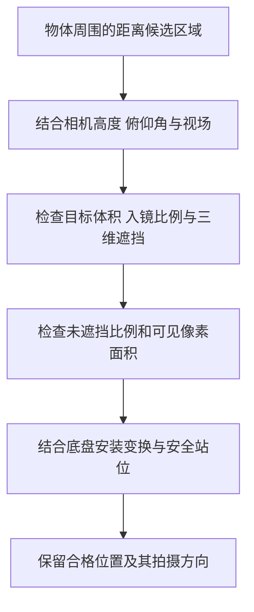
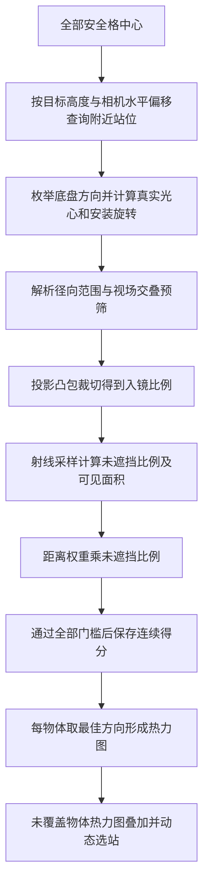

# 锚点选择方法改进讨论

更新日期：2026-10-19。

状态：本分支 `refine/anchor-selection` 已实现连续权重选点和逐物体观察热力图。第 1～6 节保留几何讨论，第 7 节起说明最终规则、工程实现与验证。改进前的图解与运行快照见[旧版锚点选取图解](anchor_selection_explained_20261019.md)，对应提交 `024a1a9`。

## 1 本轮讨论的出发点

在“由物体反向寻找观察位置”时，就应当考虑其他物体的遮挡。只有能够满足观察要求的位置与朝向，才应进入该物体的合格支持集合，参与后续锚点选择。

一个直观的几何理解是：结合相机最近与最远观察距离、安装高度、俯仰角和视场，在物体周围建立一个二维可观察区域。最简单的情况下，这个区域像一个圆环；加入更多约束后，圆环会收缩、出现缺口，或者分裂成多块。

本轮讨论形成的认识是：

- **圆环可以作为理解和构建几何候选区域的起点，但完整可观察区域不一定是圆环。**
- **遮挡检查必须发生在合格观察关系确定之前。** 当前代码已经满足这一点；需要讨论的改进是如何更直接、高效地构建可观察区域，以及如何利用这些区域选择锚点。
- 区域表示需要保留合格拍摄方向，不能只保存“这个二维位置可以看见物体”的布尔值。

## 2 仅考虑距离时的圆环模型

### 2.1 同一高度下的直观模型

先作以下简化：

1. 物体以中心点表示，暂时忽略尺寸与遮挡。
2. 位置表示相机光心，暂时忽略相机相对底盘的安装偏移。
3. 相机能够调整水平朝向，让目标进入合适的观察方向。

如果相机光心与物体中心处于同一高度，最近观察距离为 `d_min`，最远观察距离为 `d_max`，那么：

- 小于 `d_min` 的位置太近，形成中心排除区。
- 大于 `d_max` 的位置太远，形成外部排除区。
- 两者之间是以物体为中心的圆环。

```text
物体中心 → 太近的排除区 → 距离合格的圆环 → 太远的排除区
             d < d_min     d_min ≤ d ≤ d_max     d > d_max
```

这里的圆环只满足距离条件，还没有判断入镜、遮挡或图像面积。

### 2.2 有高度差时要从三维距离换算

当前代码的距离定义是：**相机光心到物体中心的三维欧氏距离**，不是地面上的二维距离，也不是相机到物体最近表面的距离。

设：

- 物体中心高度为 `z_o`。
- 相机光心高度为 `z_c`。
- 高度差为 `Δz = z_o - z_c`。
- 相机与物体中心在 XY 平面上的水平距离为 `ρ`。

则：

```text
d² = ρ² + Δz²
d_min² ≤ ρ² + Δz² ≤ d_max²
```

如果 `|Δz| ≤ d_max`，对应的水平半径范围为：

```text
ρ_min = √max(0, d_min² - Δz²)
ρ_max = √(d_max² - Δz²)
```

如果 `|Δz| > d_max`，高度差本身已经超过最远距离，没有合格位置。如果恰好等于 `d_max`，距离可行范围退化为水平距离为零的位置，仍须检查其他观察条件。

这里更准确的几何操作，是把三维距离约束限制在固定相机高度的水平面上，再用 XY 坐标表达；不能简单忽略高度，把三维最近、最远距离原样当成二维半径。

### 2.3 当前距离配置下的教学例子

当前 `d_min = 0.2 m`、`d_max = 3.0 m`。假设某个物体中心比相机高 `0.5 m`，则：

```text
ρ_min = 0
ρ_max = √(3.0² - 0.5²) ≈ 2.958 m
```

高度差已经大于最近观察距离，因此最近距离约束不再产生中心空洞。**这个例子仅考虑距离时得到的是圆盘，而不是有空洞的圆环。**

后续加入垂直视场后，中心附近仍可能被排除：站得太近时，高处物体可能超出画面上边缘。上述高度差只是教学假设，不表示全部默认物体都比相机高 0.5 m。

## 3 俯仰角与相机视场怎样改变区域

俯仰角决定相机光轴朝上还是朝下，垂直视场决定光轴上下能容纳多大的角度。两者需要一起考虑，只有俯仰角并不足以确定可观察区域。

例如，镜头水平朝前，目标位于镜头上方：

1. 过近时，目标仰角太大，可能跑到画面上方。
2. 退远后，仰角变小，目标进入画面。
3. 继续退远，则可能超过最大观察距离，或者目标投影面积过小。

这会形成一个由视场、距离和像素门槛共同限制的距离带。改变俯仰角，会改变这个距离带；对于低处物体与高处物体，影响不同。

在目标点模型、安装关系具有水平旋转对称性、相机允许连续转向目标等理想条件下，可观察区域仍可能具有圆环形状。但当前实现还存在以下因素：

| 因素 | 对形状的影响 |
|---|---|
| 固定某一个底盘朝向 | 只有方向合适的位置能够入镜，通常保留圆环中的局部区域 |
| 底盘方向每隔 30° 枚举 | 最终位置区域来自多个离散方向的合并，边界不一定光滑 |
| 物体具有完整 AABB | 不同观察侧面对应的投影大小和入镜比例不同 |
| 入镜比例至少 80% | 物体中心在画面内，仍可能因大部分盒子在画面外而失败 |
| 可见面积至少 400 px² | 距离合格，仍可能因物体投影过小而失败 |

因此，“物体四周的一圈”描述的是一个有条件的简化模型，不能直接替代当前 AABB 观察模型。

## 4 遮挡应当进入区域构建过程

### 4.1 从理想区域中排除遮挡过多的位置

假设物体右侧有一个柜子。从柜子更右侧的一些位置拍摄时，柜子可能位于相机与目标之间，这部分位置的观察会受到遮挡。

概念上的构建过程是：



上图表达约束之间的关系，不规定未来实现必须采用这个计算顺序。实际实现可以先应用成本较低的保守筛选，但最终必须让同一个位置与朝向同时满足全部条件。

### 4.2 遮挡不能只用二维连线判断

俯视图上，障碍覆盖了“相机到目标”的连线，不代表三维视线一定被挡住。例如，一个低矮物体可能挡在地面投影上，但相机能够从它上方观察目标。

反过来，目标中心的视线没有被挡住，也不代表目标大部分表面都可见。对于有体积的目标，需要判断投影面积中有多少部分被挡住，而不能只检查到中心的一条射线。

当前 AABB 模型允许部分遮挡，默认要求画面内至少 60% 的目标投影没有被遮挡。因此，需要排除的是**遮挡过多、无法通过门槛的位置与方向**，不能把所有存在遮挡的位置全部删除。

当前模型使用实心 AABB，并用投影采样估计遮挡。未来若采用更快的遮挡区域预筛，需要明确它是保守界限还是近似判断，避免错误删除原本可以通过部分遮挡门槛的观察。

## 5 相机光心区域与底盘站位区域需要区分

当前相机安装位置为相对底盘 `[0.23, 0, 0.5] m`，即前方 23 cm、上方 50 cm。

底盘原地转向时，相机光心也绕底盘参考点移动。因此，同一个底盘站位在不同朝向下，相机与物体的实际距离和遮挡关系都可能不同。

底盘位于 `(x,y,0)`、朝向为 `θ` 时，光心位置可写为：

```text
相机光心 = (x, y, 0) + Rz(θ) × 相机安装平移
```

相机光轴还需要叠加安装旋转。

所以，不能把“相机光心可行圆环上的一个点”直接当作“机器人底盘应该站的位置”。区域构建需要把安装偏移和朝向一起考虑，最终输出底盘参考点及其合格拍摄方向。

## 6 更完整的可观察区域定义

用 `S` 表示当前所有安全格中心，用 `Θ` 表示允许的底盘拍摄方向。沿用当前观察模型中的 `q(p,θ,o)`：

```text
q(p, θ, o) = 1
表示底盘位于 p、朝向 θ 时，物体 o 通过全部观察条件。
```

对物体 `o`，先定义合格的位置与朝向集合：

```text
F_o = { (p, θ) | p ∈ S，θ ∈ Θ，q(p, θ, o) = 1 }
```

它在二维位置上的可观察区域是：

```text
R_o = { p ∈ S | 至少存在一个 θ，使 (p, θ) ∈ F_o }
```

通俗地说：**这个底盘位置是安全的，而且至少有一个允许的方向能合格观察该物体。** 在当前代码里，`S` 和 `Θ` 都是离散集合，因此这里的“区域”实际表现为一批格中心；是否改成连续几何区域，是后续需要明确的设计选择。

保存 `R_o` 时，应同时保留每个位置的合格方向集合，以及方向对应的观察质量。因为两个物体的位置区域有交集，只说明可以在同一站观察它们；若两者需要不同朝向，仍然可能需要两张照片。只有某个共同朝向同时合格，才能由同一张照片完成覆盖。

## 7 已确定的连续权重规则

### 7.1 单个物体对一个动作的得分

对一个安全站位、一个允许的底盘朝向和一个目标，先求包含相机安装位姿、目标高度、视场和距离条件的几何径向范围 `[ρ_near, ρ_far]`。距离使用**相机光心到目标中心的水平距离** `ρ`：

```text
距离权重 = 1 - 0.5 × (ρ - ρ_near) / (ρ_far - ρ_near)
观察得分 = 距离权重 × 未遮挡比例
```

内边界对应 1，外边界对应 0.5，中间线性递减。重合的内外边界没有可以递减的区间，本实现约定距离权重为 1；仍需通过其他几何条件。只有有效径向范围内的动作才参与后续检查，浮点裁切不会使区域外位置变成合格位置。

这里乘的是**未遮挡比例**。如果“遮挡比例”指被挡住的部分，乘数应为 `1－遮挡比例`。

| 位置 | 距离权重 | 最低合格未遮挡比例 |
|---|---:|---:|
| 内边界 | 1.00 | 50% |
| 径向中间 | 0.75 | 约 66.7% |
| 外边界 | 0.50 | 100% |

除了观察得分至少 0.5，动作还必须通过底盘安全、相机不在实体内、目标在相机前方、中心距离、入镜比例至少 80% 和可见面积至少 400 px² 等条件。原来单独的“未遮挡比例至少 60%”已取消，否则上表内边界的 50% 观察仍会被旧规则拒绝。

入镜比例是独立合格门槛，不再乘入投票分数。原字段 `quality = 入镜比例 × 未遮挡比例` 保留作诊断；新的 `observation_score` 才是投票使用的连续得分。

### 7.2 从方向得分得到单物体热力图

在站位 `p`，对物体 `o` 的所有**合格方向**取最高分：

```text
W_o(p) = max{ observation_score(p, θ, o) | 该动作通过全部条件 }
```

如果没有合格方向，`W_o(p)=0`，不贡献有效票。一个物体在同一站有多个合格方向，也只取最高分，不将方向数量累加成更多票。

`W_o` 就是这个物体在安全格中心上的观察热力图。该图保存最高得分和对应方向；没有通过门槛的格子不着色。它不是平滑插值得到的连续空间保证，不会将障碍格、未知格或不安全格填上颜色。

### 7.3 叠加多个物体并动态选站

设尚未覆盖的物体集合为 `U`：

```text
站位总分 S(p) = Σ W_o(p)，其中 o 属于 U
```

每轮选择总分最高的位置。同分时优先新增合格物体更多的站，再按站位编号选择。这里的数量只用于同分比较，已经不再像旧版那样首先比较覆盖数量。

例如，某站能以 0.9 和 0.9 合格观察两个物体，总分 1.8；另一个站能以三个 0.5 合格观察三个物体，总分 1.5。新规则先选前者。

选站后，将这个站能合格覆盖的物体从 `U` 中移除，并撤去它们在**所有站位**的贡献，再寻找新的最高点。最终结果保留全部输入目标作覆盖统计分母；没有任何支持的目标不会被悄悄删除。

实现用每个物体的最佳得分乘一百万后四舍五入的整数进行堆更新和比较。导出同一整数 `vote_units` 供页面叠加，避免 Python 与 JavaScript 在极小分数差异上出现不一致。

### 7.4 选站与选照片仍然分开

初选后删除冗余站位，删除条件仍是所有原有合格覆盖都能由其他保留站承担；优先尝试删除总分较低的站。

在剩余站位的所有方向中，再按“新增覆盖物体数优先、观察得分平票择优”选择照片并删除冗余照片。这一步保持减少照片数量的目标。最终动作再次计算全部物体的几何与得分，核对覆盖清单。

选站得分中，同一站不同物体的最高分可能来自不同方向；最终为节省照片，也可能使用该站另一个仍合格但不是最高分的方向。因此，热力图表示这个站的**最佳合格观察能力**，具体照片的实际分数应看 `score_by_object`。本版不保证全局最少站数、最少照片数或全局最高图像质量。

## 8 几何区域的具体实现

新增 [observation_region.py](../../falhv2/observation_region.py)，由 [observation_model.py](../../falhv2/observation_model.py) 和候选生成器共用。

### 8.1 先将底盘位姿转换成真实相机位姿

底盘位置加上随底盘朝向旋转的安装平移，得到光心。底盘旋转乘以相机安装旋转，得到相机光学轴。因此相机前伸、左右偏移、高度、roll、pitch 和安装 yaw 都会进入区域计算。

### 8.2 按目标和方向求径向范围

对每个待检查动作，固定相机朝向与“光心到目标中心”的水平方位，只改变该方位上的水平距离 `ρ`。目标各个 AABB 角点的相机坐标均可写成：

```text
角点光学坐标 = a × ρ + b
```

这里 `a` 由水平方位和相机旋转决定，`b` 由物体尺寸、角点高度和相机高度决定。因此以下条件都可以变成关于 `ρ` 的一次不等式：

- 所有角点位于相机平面前方。
- Box 投影外框与画面的左、右、上、下边界都有交叠可能。

将这些不等式的解，与第 2 节推导的三维中心距离对应的水平区间相交，就得到动作对应的 `radial_near_m`、`radial_far_m`。

该范围**不是**从当前地图候选站位的最近/最远距离估计出来的。地图安全格数量、障碍分布变化，不会直接改变同一个相机姿态的几何归一化边界。

对于一般 AABB 和安装姿态，范围随目标、水平方位和底盘朝向变化，不能简化为所有物体共用一个圆环。相机光心与目标在 XY 上重合时，水平方位未定义；实现使用光轴的水平投影，若光轴竖直则使用世界 +X 作为退化约定。

### 8.3 几何包络与最终观察区域的区别

当前内外边界是**视场交叠的保守几何包络**。对完整 AABB，采用投影外框交叠必要条件，而不要求目标中心一定入镜，避免漏掉中心位于画面外但盒子仍有部分入镜的观察。

包络不是最终合格区域：它还没有要求 80% 入镜、400 px² 可见面积或得分至少 0.5。最终区域是包络经过这些检查及三维遮挡裁切后留下的格中心。因此：

- 公式在几何包络内边界取 1，但某个内边界观察可能因入镜不足而不能投票。
- 一张实际物体热力图的最大值不保证达到 1。
- 遮挡产生的缺口不会被当成新的“内径”，也不会把缺口边缘重新赋值为 1。
- 这里的径向定义是本版工程约定，不宣称解出了满足全部成像条件的连续最优边界。

### 8.4 预筛与观察评估顺序



遮挡在合格支持关系确定之前计算。旧实现也在投票前检查遮挡；本次新增的是更早的安装姿态与视场预筛、径向距离权重、加权优先级和对应热力图。

### 8.5 入镜比例改为几何裁切

新策略的高密度复核发现，旧版按采样计数估计入镜比例时，同一观察可能在 36×36 下约为 81.3%，在 96×96 下约为 79.5%，从而跨过 80% 合格门槛。

本版对完全处于相机前方的 Box，将八个角点投影的凸包作为完整轮廓，与图像矩形做几何裁切。入镜比例为裁切后面积除以完整轮廓面积，采用双精度裁切与面积计算，不再依赖网格采样。

遮挡仍由射线采样估计，默认 12×12，临近入镜、得分或像素门槛时加密到 36×36。可见面积改为“裁切后的目标投影面积 × 采样未遮挡比例”。这消除了上述入镜计数问题，但并未消除细遮挡物可能漏采的风险。

## 9 输出与热力图查看

运行方式：

```bash
conda activate test
python -B falhv2/anchor_selector.py --save-supports
```

默认生成 `falhv2/outputs/anchor_plan.json/.html/.svg`，以及 `anchor_plan.supports.json`。直接打开 HTML 即可离线查看。

页面提供：

1. **逐物体热力图**：在顶部选择一个物体，或点击地图物体、右侧物体按钮。每个安全格显示该物体最佳合格方向得分，默认色标固定为 0.5～1。
2. **叠加图**：切换为“全部未覆盖物体叠加”，查看各物体有效得分之和。
3. **动态回放**：拖动“已完成贪心轮次”，移除已经完成的物体贡献，查看下一轮选点。总分色标固定在初始尺度，便于比较。
4. **站位探查**：点击热区里的候选格，查看位置和分数；单物体模式还显示最佳底盘朝向，叠加模式显示各物体贡献。
5. **最终照片检查**：每张照片显示所属锚点、底盘朝向和目标数量，逐物体指标包含距离权重、观察得分、入镜、遮挡、可见面积及径向范围。

单物体热力图始终显示完整能力分布，不会因回放轮次把该物体从图中隐藏。回放记录的是删冗余前的贪心初选，可能包含最后被删除的站；它不是导航顺序。

未覆盖物体也在物体列表与 `object_heatmaps` 中。若没有任何合格支持，其热图为空，页面会显示“没有合格观察权重”，而不是伪造一个圆环。无色安全格表示没有有效票；完整诊断仍需结合拒绝原因和采样模型。

### 输出字段迁移

本版输出 `schema_version: 4`：

| 字段 | 含义 |
|---|---|
| `method: object_driven_weighted` | 新的物体驱动加权选站入口 |
| `observation_model: aabb_weighted_region` | 带几何区域和距离权重的 AABB 模型 |
| `observation_settings.min_observation_score` | 默认 0.5 |
| `object_metrics.observation_score` | 具体动作对物体的原始观察得分，是否有效还要看 `qualified` |
| `object_metrics.distance_weight` | 径向位置权重 |
| `radial_near_m / radial_far_m` | 该动作的光心径向边界；区域无效时为 `null` |
| `observations[].score_by_object` | 最终照片中各合格目标的得分 |
| `vote_trace[].weighted_score` | 本轮新增物体的加权总分 |
| `vote_trace[].new_object_count` | 本轮新增合格物体数 |
| supports 文件的 `scores` | 各站位、方向、物体的连续有效分数 |
| supports 文件和页面数据的 `object_heatmaps` | 每物体的 `[站位编号, 最佳合格得分, 最佳方向索引, vote_units]` 列表 |

旧 `qualities` 与 `quality_by_object` 分别改为 `scores` 与 `score_by_object`。支持表未列出的组合没有有效贡献。方向索引通过 `yaws_rad` 查找，不是角度本身。

`min_visible_fraction` 已不再使用；配置若仍显式包含该字段会报错提示迁移，防止用户误以为旧 60% 条件仍然有效。当前默认相机 JSON 没有这个旧字段。

全点地图保留 `legacy_point` 兼容模式，仍是视场与距离检查、每物体单位票；完整的新距离与遮挡权重用于 AABB 地图，页面会明确标记旧点模式。混合点和 AABB 地图仍拒绝规划。

## 10 验证方法与边界

自动化验证覆盖：

- 距离权重在内边界、中间、外边界的值及退化区间处理。
- 地面目标在不同俯仰角下的径向范围与解析三角关系一致。
- 相机安装偏移正确改变底盘观察区域；相同真实光心和朝向得到相同分数。
- 径向预筛与独立角点投影结果对照，包括目标中心在画面外的部分 Box。
- 内边界 50% 未遮挡得到 0.5 并合格，外边界无遮挡得到 0.5 并合格，外边界部分遮挡不合格。
- 入镜比例几何裁切与解析面积一致，不随采样密度跳变。
- 加权总分能够优先选择物体数量较少但分数较高的站。
- 动态堆更新与独立加权贪心对照，热力图中的分数、微单位与最终动作一致。
- 页面单物体图、叠加扣票、轮次回放、最佳朝向、空目标和缺口处理。

选择器仍是启发式：提高总观察权重不保证锚点更少。底盘安全区域仍未按起点过滤，站间路径和访问顺序没有规划。默认二维墙不自动成为三维遮挡体；AABB 是实心近似，遮挡比例仍受采样精度影响。模型合格不等于真实识别成功。

### 默认地图本次运行结果

2026-10-19，使用默认 `map_aabb.json`、`robot.json`、`camera.d435i.json` 与 30° 方向间隔：

| 项目 | 结果 |
|---|---:|
| 安全候选站位 | 10,644 |
| 高度距离粗筛后的站位与物体组合 | 103,571 |
| 径向与视场预筛检查的方向组合 | 1,242,852 |
| 预筛排除的方向组合 | 992,287 |
| 进入完整观察评估的组合 | 250,565 |
| 合格的方向与物体组合 | 133,660 |
| 最终锚点 | 5 |
| 最终定向照片 | 14 |
| 覆盖 | 28/28 |
| 候选关系生成耗时 | 约 61.00 秒 |
| 选站与照片精简耗时 | 约 0.201 秒 |

时间来自单次本机运行，不包含最终复核和文件写出的全部开销。预筛减少了遮挡评估组合，但新增径向权重和几何裁切也有计算成本；本次不宣称端到端加速。旧策略快照是 4 站、12 张，新策略优先加权观察价值，不能用更少锚点作为已经实现的收益。

最终 14 个动作的全部 28 个物体，使用 96×96 网格重新估计遮挡后，合格分类与默认设置完全一致，仍覆盖 28 个目标；复核中所选合格观察的最低得分约为 0.500663。该值接近 0.5 门槛，实际采集仍需要核对位姿、物体模型与观察效果。此复核没有把完整候选矩阵全部重算为高密度。

运行产物为 `falhv2/outputs/anchor_plan.json/.html/.svg/.supports.json`，高密度复核摘要为 `falhv2/outputs/anchor_weighted_validation.json`，包含输入 SHA-256。53 项 Python 测试、锚点查看器与地图编辑器两组 Node.js 测试通过；离线页面另在实际无头浏览器检查了桌面/390 px 窄屏、单物体选择与热图绘制。
