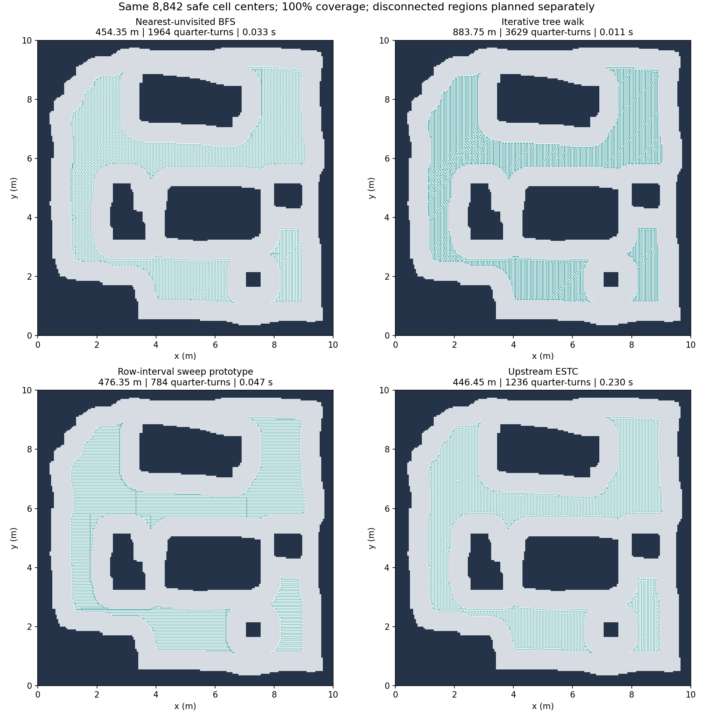

# A1 覆盖路径算法实验与选择

日期：2026-10-13。基线提交：`7eadb72`；实验分支：`experiment/coverage-planner-comparison`。

**当前推荐：半栅格欧氏距离变换（EDT）提取安全区域，再用区间分解、分区往复扫描和 A* 连接生成路线。** 这一方案保持现有输入约定，不需要机器人起始位姿或指定终点。在当前用户地图上，路线生成约 0.047 秒；比原贪心路线长 4.8%，累计转向量减少 60.1%。这是针对本项目当前 A1 的工程选择，尚未经真实机器人执行验证。

推荐实现位于 `falhv2/experiments/plan_candidate.py`。主入口 `falhv2/path_planner.py` 保留基线行为；当前分支尚未合并到 `main`。

## 1. 卡顿主要发生在哪里

基线对每个空闲格中心调用 `clearance_at`，每次重新扫描整张地图并计算到占据方格的距离，复杂度约为 O(空闲格数 × 全图格数)。这比路线搜索本身昂贵得多。

当前地图为 200×200、0.05 米/格，25933 个空闲格。机器人宽 0.465 米、长 0.545 米，安全距离 0.285 米，对应外接圆安全半径 0.643207 米。保守处理后剩余 8842 个安全格中心，分成 8032、808、2 格三个区域。

抽样运行原距离计算，再按空闲格数外推，得到当前图约 264 秒、300×300 合成图约 439 秒、512×512 合成图约 3655 秒。**这些是抽样估计，不是完整旧算法的实测总耗时。** 原路线阶段在当前图实测约 0.063 秒，包含原航点等结果构造。

实验改用 SciPy EDT，将地图放到 `(2H+1)×(2W+1)` 的半格采样平面：占据方格的边、角与中心均被标记，地图外边界也标记为占据。在原格中心和相邻格中心连线的中点查询距离。由于占据物是与网格对齐的闭方格，这些查询位置的最近边界投影也落在半格采样上，可以保持原几何含义，避免把障碍简单当成点而高估净空。[SciPy EDT 文档](https://docs.scipy.org/doc/scipy/reference/generated/scipy.ndimage.distance_transform_edt.html)

20 张小图、700 个查询与原几何计算逐一比较，最大误差约 `3.54e-16` 米。新预处理在当前图约 0.015 秒，在 512×512 合成图约 0.052 秒。后者包含 EDT、安全掩码和连通分量标记，不包含将标签转成 Python 格子集合。

另一个显示负担是逐格输出 SVG：既有输出中，大图可达数十 MB。实验入口使用尺寸有上限的 PNG 预览；完整航点仍保存为 JSON。

原始记录：[预处理测量](../../falhv2/outputs/preprocessing_benchmark.json)。

## 2. 开源方案调研与取舍

| 项目 / 方法 | 与本任务相关的特点 | 本次处理与判断 |
|---|---|---|
| [IPA coverage planning](https://github.com/ipa320/ipa_coverage_planning) | 室内地图分割、Boustrophedon 往复覆盖；ROS/C++ 体系 | 阅读实现与参数。分区扫描思路适合本项目，但完整 ROS 依赖与当前 Python 原型存在接入成本。本次自行实现轻量区间分解，未运行 IPA，不能把实验耗时归于 IPA |
| [Fields2Cover](https://github.com/Fields2Cover/Fields2Cover) | 多边形区域、障碍、条带生成及农业车辆路径；C++ 库和 Python 接口 | 阅读源码与构建依赖。适合将来明确作业幅宽、连续曲率等要求后的路线规划；当前全栅格中心遍历需要额外的栅格与多边形转换，未编译实测 |
| [Nobleo full_coverage_path_planner](https://github.com/nobleo/full_coverage_path_planner) | ROS 导航插件；实现 BSA，插件名为 SpiralSTC；仓库说明公司已不再使用 | 阅读源码。可参考回溯覆盖策略，暂不引入旧 ROS 插件依赖，未编译实测 |
| [PythonRobotics Spiral STC](https://github.com/AtsushiSakai/PythonRobotics/blob/master/PathPlanning/SpiralSpanningTreeCoveragePlanner/spiral_spanning_tree_coverage_path_planner.py) | 易读 Python 示例；以完整空闲 2×2 块构建上层图，有偶数尺寸假设和递归遍历 | 阅读源码。直接使用会改变窄通道、边缘格的覆盖集合，不作为现有 A1 的直接替代，未计入实测排名 |
| [LS-MCPP 的 ESTC](https://github.com/reso1/LS-MCPP) | 扩展生成树覆盖，处理部分占据的块；研究项目含多机器人功能 | 实际调用官方未修改 ESTC 核心，作为较强的路线长度对照；没有运行多机器人局部搜索或路径冲突消解 |

ESTC 固定版本为 `9dcba0b16a3a7669e7632f1b81a04a029d9ba304`，见[核心源码](https://github.com/reso1/LS-MCPP/blob/9dcba0b16a3a7669e7632f1b81a04a029d9ba304/mcpp/estc.py)。适配层将每个四连通区域转换成上游要求的图与坐标，自动选根节点；单格区域直接返回单点。所有算法统一去除不必要的末尾闭合边。上游代码保存在 `/tmp/falhv2-ls-mcpp`，没有复制进本仓库。该项目为 GPL-3.0，完整安装还包含研究求解器依赖；本实验仅加载可独立运行的 ESTC 核心。

## 3. 实际比较的四种方法

1. **greedy**：保留原“BFS 连接最近未访问格”的路线策略，只输出格坐标，作为公平计时的基线。
2. **tree_walk**：迭代 DFS 沿树遍历与回退。时间开销低，但重复路程多。这是普通树遍历，不是经典 STC。
3. **scanline_sweep**：本地原型。逐行提取连续区间；相邻行区间一对一重叠时延续同一分区，发生分裂或合并时建立新分区。每区生成四种往复扫描方向，通过邻近入口选择与 A* 连接。在横扫和纵扫两个完整方案中先选较短者，等长时选转向较少者。没有全局最优保证。
4. **estc_upstream**：官方 ESTC 核心，经上述适配后运行。未启用上游其他转向优化方法。

四种方法使用完全相同的安全格集合，必须访问每个安全格中心，路线只能走四邻接边；每个连通区域分别输出路径，不允许跨不可通行空间连接。起终点由算法内部选择，不要求对所有端点搜索最优。地图未知格不可通行，机器人按外接圆加安全距离处理，假设能够原地旋转。

## 4. 实验与结果

使用已有 conda `test` 环境：Python 3.10.19、NumPy 1.26.4、SciPy 1.15.3；完整环境信息保存在结果 JSON。六组场景包括一张用户地图及其零安全距离变体、两张大矩形障碍合成图、一张窄通道与断开区域图、一张多障碍合成图。它们不是六张独立真实环境地图。

每个场景、每种方法运行三次，报告中位数。每组使用独立进程，30 秒限制覆盖进程启动、三次规划及检查。路线计时包含候选路线或图的建立，不包含导入、共同预处理、集合提取、结果验证、航点转换、绘图及文件 I/O。横纵两种扫描的计算均计入 scanline_sweep 时间。因此，下表与上一节旧入口含结果构造的 0.063 秒口径不同。

**24 组比较、72 次完整运行全部通过**：覆盖集合完全相等、每条路线四邻接连续、所有顶点与边中点满足净空；每组三次输出在进程内一致，无超时。对于本实验的轴对齐栅格方格和四邻接直线边，顶点和中点检查覆盖了线段到障碍距离可能取得最小值的位置。此验证不涵盖真实控制误差或曲线转弯模型。

`Q90` 表示累计转向角除以 90°，180° 回头计作 2；不计各区域起始姿态对齐和区域间转移。

| 场景（安全格 / 区域数） | 方法 | 路线计算 / 秒 | 长度 / 米 | Q90 |
|---|---|---:|---:|---:|
| 用户地图（8842 / 3） | greedy | 0.0331 | 454.35 | 1964 |
| 同上 | tree_walk | 0.0107 | 883.75 | 3629 |
| 同上 | **scanline_sweep** | **0.0470** | **476.35** | **784** |
| 同上 | estc_upstream | 0.2297 | 446.45 | 1236 |
| 用户地图，安全距离 0（16041 / 1） | greedy | 0.0735 | 835.00 | 2596 |
| 同上 | tree_walk | 0.0243 | 1603.95 | 4565 |
| 同上 | scanline_sweep | 0.0794 | 826.90 | 1026 |
| 同上 | estc_upstream | 0.4340 | 806.05 | 1514 |
| 300×300（63986 / 1） | greedy | 0.2012 | 3206.45 | 2619 |
| 同上 | tree_walk | 0.1127 | 6398.45 | 4992 |
| 同上 | scanline_sweep | 0.1699 | 3211.95 | 1006 |
| 同上 | estc_upstream | 2.0648 | 3200.75 | 1152 |
| 512×512（213462 / 1） | greedy | 0.8625 | 10697.10 | 4679 |
| 同上 | tree_walk | 0.5850 | 21346.05 | 8764 |
| 同上 | **scanline_sweep** | **0.7115** | **10695.25** | **1636** |
| 同上 | estc_upstream | 7.7294 | 10674.95 | 2122 |
| 窄通道与断开区域（1100 / 3） | greedy | 0.0041 | 548.50 | 43 |
| 同上 | tree_walk | 0.0011 | 1096.00 | 90 |
| 同上 | scanline_sweep | 0.0203 | 548.50 | 42 |
| 同上 | estc_upstream | 0.0839 | 1041.00 | 72 |
| 多障碍 120×160（12438 / 1） | greedy | 0.0538 | 1317.60 | 2982 |
| 同上 | tree_walk | 0.0194 | 2487.30 | 5040 |
| 同上 | scanline_sweep | 0.0860 | 1389.60 | 1605 |
| 同上 | estc_upstream | 0.3481 | 1262.50 | 3088 |

共同预处理中位数依次为约 0.0145、0.0093、0.0172、0.0521、0.0012、0.0039 秒。地图零安全距离变体仅用于敏感性分析，不代表建议降低实际安全距离。



图中深色为不可通行格、灰色为净空不足的空闲格、浅绿色为安全区域。图形叠加很密集，判断以数值与逐边验证为准。

完整数据：[comparison.json](../../falhv2/outputs/coverage_experiment/comparison.json)；场景与机器人快照：[fixtures.json](../../falhv2/outputs/coverage_experiment/fixtures.json)。

## 5. 为什么选择分区往复扫描

本项目需要易接入 Python、适用于大栅格、输出方便执行的区域路线。EDT 已经消除主要预处理瓶颈，接下来应同时考虑路程与转弯。

- 当前地图中，扫描比 greedy 多走 22 米，但少 1180 个 90° 等价转向；比 ESTC 多走 29.9 米，少 452 个等价转向。
- 512×512 中，扫描和 ESTC 的路线长度只差约 0.19%，扫描计算约 0.71 秒，ESTC 约 7.73 秒。二者都是本机、本图上的测量，不是普遍性能保证。
- 窄通道样例中，扫描为 548.5 米，ESTC 为 1041 米。当前适配下 ESTC 并非所有地形都占优。
- 普通树遍历虽快，但回退使长度接近翻倍，不建议作为默认路线。

补充使用假设模型 `T = L/v + Q90×π/(2ω)`，令线速度为 0.2/0.4/0.6 米每秒，角速度为 0.4/0.8/1.2 弧度每秒，在六组场景的 54 组参数组合中，扫描方案的模型时间均最短。该模型假设停走转向，未计算加减速、导航控制、拍摄与区域间转移，**不是实测执行时间，也不能据此声称全局最优**。[敏感性分析记录](../../falhv2/outputs/coverage_experiment/sensitivity.json)

因此，默认候选选 EDT + scanline_sweep，保留 EDT + greedy 作为便宜的基线，ESTC 作为重视距离时的可选对照。对于更多真实布局，分区顺序与 A* 连接仍可能成为开销来源，应继续依据测量优化。

## 6. 运行与复现

在仓库根目录运行推荐候选，不需要安装 ROS 或上游 ESTC：

```bash
conda activate test
python -B falhv2/experiments/plan_candidate.py
```

输入默认是 `falhv2/outputs/map.json` 和 `falhv2/config/robot.example.json`。输出为 `falhv2/outputs/coverage_experiment/selected_plan.json` 和同名 PNG。支持 `--scene`、`--robot`、`--output`；通过 `--method greedy` 可切换对照。此入口依赖已有 NumPy、SciPy、Matplotlib；上游 ESTC 另需 NetworkX 和 PyYAML。环境未做升级。

完整四算法比较需获取固定上游版本：

```bash
git clone https://github.com/reso1/LS-MCPP.git /tmp/falhv2-ls-mcpp
git -C /tmp/falhv2-ls-mcpp checkout 9dcba0b16a3a7669e7632f1b81a04a029d9ba304
python -B falhv2/experiments/compare_coverage.py \
  --checkout /tmp/falhv2-ls-mcpp \
  --fixtures falhv2/outputs/coverage_experiment/fixtures.json \
  --output /tmp/falhv2-coverage-rerun
```

如果临时目录已存在，直接核对并使用该 checkout。快照固定了实验地图与配置，即使编辑器后来修改 `map.json` 也能复现相同输入。时间随机器负载浮动。

局部验证与生成现有结果图：

```bash
python -B -m unittest discover -s falhv2/tests -p test_coverage_experiments.py -v
python -B falhv2/experiments/plot_comparison.py
python -B falhv2/experiments/analyze_comparison.py
```

## 7. 下一步接入边界

实验入口已经能生成完整区域、路线与世界坐标航点。正式接入 A1 时，应采用 EDT 预处理与推荐扫描方法，并同步更换大图预览、保留错误提示与基线回归验证。

本轮仍严格访问每个安全格中心。0.05 米分辨率意味着大面积中扫描线间隔也只有 0.05 米，路线会很长；算法变快不会自动消除这项任务定义带来的路程。后续应在 A2 明确观察幅宽、相机视角与物体质量覆盖后，独立设置扫描间距或候选站位间距，并重新验证覆盖，不能简单跳格却继续声称原来的全格覆盖。

无起始位姿的离线规划仍然成立；执行时需要把实际机器人位置接入可达区域路线。多个断开区域之间无法凭空生成可执行连接。实际导航跟踪、连续运动约束以及物体视觉覆盖均不属于本次完成的验证范围。
