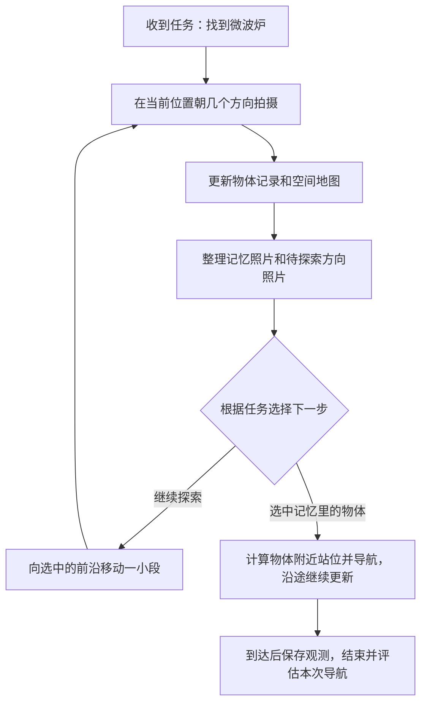
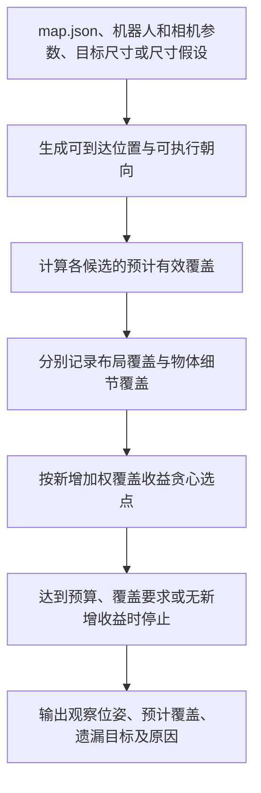

# 预建图后的最小锚点选取系统 v0

- 更新日期：2026-10-10
- 关联规划：[长期动态室内找物研究计划](plan_v0_20260917.md)
- 当前进度：已有地图编辑器和地图输入；选点算法尚待实现和验证。

## 1. 我们要解决什么问题

**房间地图已经有了，机器人应该站在哪里、朝哪里拍，才能用有限次观察，兼顾房间各处和物体细节？**

这属于“已知地图下、带观察质量要求的视点选择问题”。大白话就是：提前选好一组拍摄位置和方向，让每次观察都有用，少漏掉地方，也少拍重复内容。

例如，站在门口可能把大半个房间拍进去，但远处的小物体在图像里只有几个像素。我们既要考虑“拍进去了多少”，也要考虑“物体拍得够不够大”。物体少的角落也需要基本观察，不能只盯着物体密集的地方。

一个“锚点”先定义为 **位置 `(x, y)` + 朝向 `yaw`**，代表一次定向观察。首版固定相机高度和俯仰；同一个位置换方向拍摄，也要另算一次观察。

整个项目的关系是：

**预建图 → 选锚点 → 到点拍摄 → 建立视觉记忆 → 检索与找物 → 环境变化后的维护。**

当前只做到选锚点及展示结果。实际导航、拍摄、补拍、检索、找物和动态维护留到后续。此时的锚点是一份拍摄计划，还没有实际图像。

## 2. 输入是什么

| 输入 | 需要哪些信息 | 用来做什么 |
|---|---|---|
| 二维导航地图 | 空闲、障碍、未知格子，分辨率和原点 | 判断机器人能在哪里站立和通行 |
| 无类别物体位置 | 每个候选物体的 ID 和中心位置 `(x, y, z)` | 确定需要观察的目标及其高度 |
| 机器人参数 | 足迹大小、安全距离、起点或指定可达区域、允许的转向动作 | 排除站不下、到不了或无法执行观察的位置 |
| 相机参数 | 视场或内参、图像分辨率、相对底盘的安装位置和角度 | 判断目标是否进入画面，以及在画面里有多大 |
| 选点要求 | 最多观察几次、布局与物体覆盖要求、目标尺寸假设、最小像素要求、遮挡处理方式 | 决定怎样算一次有效观察，以及何时停止选点 |

地图、物体和机器人必须使用统一坐标系和单位。当前地图以米为单位，原点在左下角，栅格行从上到下保存，读入时需要正确转换。

物体位置只表示“这里有一个需要观察的物体候选”，不包含它是什么、长什么样、如何检索，所以还需要后续拍摄来补充视觉信息。现在用手绘中心点验证选点逻辑，真实系统中这些候选如何获得、是否漏检，需要另外验证。

## 3. 输出是什么

| 输出 | 大白话说明 |
|---|---|
| 锚点集合 | 去哪些位置、分别朝哪个方向观察 |
| 预计覆盖关系 | 每个锚点预计能观察哪些区域和物体，物体的成像是否达到要求 |
| 未满足的目标 | 哪些地方还没覆盖，哪些物体太小、受候选位置或预算限制 |
| 统计与可视化 | 地图上显示锚点、朝向和缺口，分别报告布局覆盖率、物体质量合格率、观察次数和规划耗时 |
| 本次使用的条件 | 保存相机参数、质量阈值、遮挡假设等，便于解释和复现结果 |

输出先是一组观察位姿，访问顺序和行驶路线以后再规划。

所有覆盖都叫 **“预计覆盖”**。达到设定的成像条件，不代表已经真实拍清楚，更不代表识别或找物一定成功。

## 4. 怎样算选得好

有两种不同的提问方式：

- **固定覆盖要求，尽量少拍：** 例如要覆盖 90% 的布局和 95% 的物体，最少需要多少次观察？
- **固定观察预算，尽量多覆盖：** 例如最多观察 8 次，能覆盖多少布局和物体？

**v0 先采用第二种。** 这样可以在相同观察次数下比较不同方法。这里的“最小”指先做一个最小可用版本，不承诺求出数学上最少的锚点。

选点同时考虑两件事：

1. **布局覆盖：** 房间各区域获得基本观察，不忽略物体少的地方；首版采用二维几何近似。
2. **物体细节：** 物体在相机水平、垂直视场内，距离合适，预计投影像素大小达到要求，并按声明的规则处理遮挡。

两类覆盖率分别统计，再按可配置权重取舍，避免地图采样点多就压过物体需求。同一个目标被多次观察，首版只计一次覆盖。若某个角落必须覆盖，应单独设要求，不能只看全局比例。

预算用完、达到覆盖要求或没有可增加覆盖的候选时停止。没满足的目标要留下来说明原因，不能删除困难目标来提高覆盖率。

## 5. 当前数据能做到哪一步

已有 [地图编辑器](../../falhv2/editor_server.py) 和 [map.json](../../falhv2/outputs/map.json)。当前示例是 8×8 米的地图，包含 25 个物体中心点。

中心点能支持方向、视场和距离判断。要估计物体在图像里有多大，还需要真实尺寸，或明确假设“所有目标至少有多大”；按假设尺寸算出的结果，不能当成真实物体轮廓。

**二维障碍格只能说明底盘不能进入，不能直接说明相机看不到。** 当前示例中，25 个物体有 24 个的 XY 落在障碍格内，这可能对应桌柜上的物体。地图没有障碍高度，无法据此判断完整的三维遮挡。为机器人安全距离膨胀过的障碍图，也不能直接用于相机视线判断。

首轮可以先验证视场、距离和投影大小，并标记“遮挡未评估”。之后再加入明确的二维近似，或使用包围盒、点云等三维信息。未评估遮挡的目标不能标成“已确认无遮挡”。

## 6. 最小实现与验证

实现顺序：

1. 读入地图和配置，检查坐标、单位及参数。
2. 根据机器人大小和安全距离，找出起点所在或指定的可达区域，采样可执行的位置和朝向；未知格默认不可通行。
3. 从地图采样布局目标，使用全部物体中心作为细节目标，不按类别或某次找物任务偏置选点。
4. 计算每个候选能覆盖什么、哪些物体达到质量要求。
5. 每轮选择新增覆盖收益最大的候选，直到满足停止条件。这是贪心方法，不保证全局最优。
6. 输出锚点、覆盖关系、未满足目标和可视化。

先用门口、远处物体、不同高度物体、低密度角落等人工可核验的小案例检查判断是否正确；有已知遮挡几何时再验证遮挡。用独立计算或人工检查核对结果，不能只用选点器自己的评分证明有效。

再在同一地图、候选集合、观察预算和遮挡假设下比较：**均匀采样、只考虑几何覆盖、加入细节质量要求的选点**。三种方法最后使用相同评价标准，分别报告布局覆盖、物体质量合格率和局部缺口。

这一轮验证选点逻辑。是否提高实际找物成功率，要等真实拍摄与找物实验来回答。

## 7. 有哪些类似案例

| 案例 | 它在做什么 | 我们可以借鉴什么 |
|---|---|---|
| [视觉传感器布置，2008](https://www.sciencedirect.com/science/article/abs/pii/S0031320308001714) | 选择少量传感器位置覆盖环境边界，也考虑量程和观察角度 | 用少量位置覆盖目标的基本思路 |
| [机器人质量检测视点规划，2022](https://arxiv.org/abs/2201.04310) | 选择能看到测量点、并满足测量质量要求的视点 | 观察质量也要参与选点，这是当前最值得参考的方向 |
| [下一最佳视点 NBV，2022](https://arxiv.org/abs/2203.10113) | 边探索边决定下一次去哪看，兼顾重点区域检查 | 后续实际拍摄发现缺口时，怎样补充观察 |
| [3D-Mem，CVPR 2025](https://umass-embodied-agi.github.io/3D-Mem/) | 用多视角图像组织场景记忆，支持检索与探索 | 后续如何把锚点采集的图像组织成可用记忆 |

视点覆盖、质量约束和贪心选点都有已有工作。我们需要验证的价值是：在同样观察预算下，兼顾房间布局与物体细节，能否减少影响后续找物的观察缺口。

更广泛的开源项目、质量约束案例和阅读建议，见[第 9 节](#9-相近开源算法与案例调研)。

## 8. 用一个找物例子理解 3D-Mem 怎样运行

本节结合 [本地论文（含附录）](3D-Mem_CVPR2025_arxiv_2411.17735v5.pdf) 和官方代码，按物体导航任务的运行顺序说明。**以下房间、照片编号和模型选择都是教学示例，不是论文实验结果，也不是我们的 map.json 仿真结果。**

### 8.1 从收到任务到完成导航

假设机器人第一次来到一套房子，站在客厅，收到任务：**“帮我找到微波炉。”** 此时没有现成的物体记忆，需要边观察、边建图、边决定往哪里走。

这是一个反复执行的循环。它也可能因步数用完或规划失败而结束；选中了一个物体，并不自动等于找对了目标。下面逐步展开。

### 8.2 第一步：先看周围，记录看到了什么

机器人在当前位置朝几个方向拍摄，获得 **彩色图像、深度图和相机位姿**。彩色图像用于检测物体，深度和位姿用于把物体放到空间地图中；同一个沙发出现在两张照片里，会尝试关联为同一个物体。

为方便理解，只列出几张关键照片：

| 照片 | 检测到的物体 |
|---|---|
| A | 沙发、茶几、台灯 |
| B | 沙发、茶几 |
| C | 餐桌、椅子 |

这时系统同时积累两类记录：一份是“有哪些物体、它们在哪里”，另一份是“每张照片拍到了哪些物体”。深度观测还会更新哪些空间可以通行。

原始拍摄方向按配置采样。例如常规步骤拍三个方向、相邻方向相差 60°；公开代码在每个导航子任务的第一步还使用更密的初始观察。**拍摄候选图像发生在整理记忆之前。**[来源：导航主循环](https://github.com/UMass-Embodied-AGI/3D-Mem/blob/main/run_goatbench_evaluation.py#L199)。

### 8.3 第二步：从已有照片中挑出代表性记忆

此时要做的是：给每组已经看到的物体，找一张能够同时包含它们的照片。这一步叫 **共视聚类**。

算法先把待处理物体放在一大组里，检查有没有一张照片包含它们全部。没有，就按物体的水平位置把这组分成两组，再分别检查；重复这个过程，直到每组都有对应照片。

在这个例子里，假设物体位置使它们分成了客厅组和餐桌组：

| 记忆快照 | 代表照片 | 归属这份记忆的物体 |
|---|---|---|
| S1 | A | 沙发、茶几、台灯 |
| S2 | C | 餐桌、椅子 |

照片 B 没有成为代表，因为它不能完整包含客厅组的三个物体。若多张照片都符合条件，论文优先选择检测物体更多的照片，数量相同时比较检测置信度。公开代码还会优先复用本轮聚类已经选中的合格照片；多个组用到同一张照片时合并。[来源：共视聚类实现](https://github.com/UMass-Embodied-AGI/3D-Mem/blob/main/src/hierarchy_clustering.py#L257)。

**S1 是“照片 A 加上物体关联”，聚类中心不等于机器人应该去站的位置。** 这一步挑选的是已经拍过的图像，每个纳入聚类的物体只归属一份记忆，但仍可能出现在其他照片里。不成为代表的照片，也不等于立即从候选记录中删除。

### 8.4 第三步：把可以继续探索的方向列出来

现在还没看到微波炉，机器人需要决定往哪里继续走。系统根据空间地图和探索状态，将待探索区域聚成若干组，为它们设置边界附近的可通行目标位置。这些候选称为 **前沿**。

假设有两个候选：

| 前沿 | 从当前所在位置朝那边拍到的画面 | 对应的导航目标 |
|---|---|---|
| F1 | 门口露出厨房台面的一角 | 厨房入口附近 |
| F2 | 一段通向其他房间的走廊 | 走廊入口附近 |

每个前沿保存“待探索区域、导航位置、朝那个方向看的照片”。**这张照片可以在当前位置拍到，不要求已经走进厨房或走廊。** 也不能通过它看到墙后完整的房间。前沿会随探索而新增、更新或消失。[来源：前沿维护与拍摄](https://github.com/UMass-Embodied-AGI/3D-Mem/blob/main/src/tsdf_planner.py#L119)。

### 8.5 第四步：结合任务，决定下一步往哪里走

系统先根据“找微波炉”筛选可能相关的物体类别，再挑出包含这些类别的记忆照片，减少无关信息。这只是筛选本次送给模型查看的记忆，其他记忆仍然保留。[来源：记忆预筛选](https://github.com/UMass-Embodied-AGI/3D-Mem/blob/main/src/eval_utils_gpt_aeqa.py#L202)。

随后，视觉语言模型会看到任务、相关记忆照片、物体裁剪图以及前沿照片。在本例中，它可能选择 F1，因为画面里的厨房线索更有希望通向微波炉。也可能选错，这不是确定性的房间规则。

模型输出的是“选 F1”这样的候选编号。**几何模块负责产生候选位置，模型负责结合图像和任务做选择，导航模块负责计算怎么走。** 在物体导航任务中，模型也可以直接选择某张记忆照片里的某个物体。[来源：导航决策输入与输出](https://github.com/UMass-Embodied-AGI/3D-Mem/blob/main/src/query_vlm_goatbench.py)。

### 8.6 第五步：走一小段，再观察和更新

机器人向 F1 移动。默认探索步长约为 1 米，之后再次拍摄并更新地图、物体和记忆；探索前沿可以重新选择。因此，不必一直走到远处的前沿才有机会调整方向。[来源：导航配置](https://github.com/UMass-Embodied-AGI/3D-Mem/blob/main/cfg/eval_goatbench.yaml)。

假设在厨房入口拍到了新照片 D，检测出“冰箱、台面、微波炉”。这些物体可以形成新的记忆 S3。若本次还重新看到了餐桌等旧物体，系统会把相关旧记忆中的物体一起重新聚类，更新受影响的部分，保留其余记忆。[来源：增量记忆更新，论文第 3.2.2 节](https://arxiv.org/html/2411.17735v5#S3.SS2.SSS2)。

此时，模型的候选中已经有 S3 里的微波炉，可以从“继续探索一个方向”转为“接近这个具体物体”。

### 8.7 第六步：选定物体，再计算附近的站位

模型选中 S3 中的微波炉后，系统使用这个物体的空间位置，寻找附近的可通行观察位置。这与照片 D 原来的拍摄位置可以不同。[来源：目标站位设置](https://github.com/UMass-Embodied-AGI/3D-Mem/blob/main/src/tsdf_planner.py#L406)。

观察距离是配置项：论文附录举的是 0.75 米，当前公开 GOAT-Bench 配置使用 1.5 米。实际站位还要结合空闲空间，不能把某个数值当成通用要求。[来源：论文附录 11](https://arxiv.org/html/2411.17735v5#S11)、[导航配置](https://github.com/UMass-Embodied-AGI/3D-Mem/blob/main/cfg/eval_goatbench.yaml#L56)。

附录还介绍了观察整组物体的规则：两个物体就从其中点沿垂直于连线的方向找位置；多个物体就根据二维分布的短轴方向找位置。直观地说，一排东西沿东西方向摆放，就倾向于从南北侧观察。代码会结合可用空闲位置和二维视线检查进行选择。[来源：几何计算](https://github.com/UMass-Embodied-AGI/3D-Mem/blob/main/src/geom.py#L393)。

这些站位规则忽略了物体高度，也没有逐个验证最小投影像素大小，因此不能直接当成我们要做的完整质量评估。

机器人随后分步接近选中的目标，沿途继续更新观测。公开导航脚本在到达目标站位后保存图像、结束当前子任务，再根据基准的目标匹配和距离条件评估结果。**它没有在这里实现我们所设想的“逐项检查拍摄质量，不合格就补拍”的闭环。**[来源：导航结束与评估逻辑](https://github.com/UMass-Embodied-AGI/3D-Mem/blob/main/run_goatbench_evaluation.py#L403)。

### 8.8 下一次任务如何用上记忆

假设接下来要求“找到沙发”。如果保留上一任务的场景记忆，S1 已经记录了沙发及其位置。模型可以通过检索 S1 直接选择沙发，再导航到附近，不必重新从未知环境开始找。公开实现支持在同一场景的连续子任务之间保留记忆。[来源：连续任务的场景状态与重置逻辑](https://github.com/UMass-Embodied-AGI/3D-Mem/blob/main/run_goatbench_evaluation.py#L122)。

这解释了记忆的用途，但不表示家具移动后仍然可靠。论文明确指出其主要面向静态环境，对移动物体并不鲁棒。[来源：论文局限性](https://arxiv.org/html/2411.17735v5#S7.SS3)。

问答任务的结束方式需要另外区分：模型可以依据已有记忆直接给出答案。论文 A-EQA 描述以得到答案结束，而当前公开脚本还会导航到所选记忆对应的位置。上面的例子统一按物体导航任务讲解，避免混用这两种结束条件。[来源：论文附录 11](https://arxiv.org/html/2411.17735v5#S11)、[问答脚本](https://github.com/UMass-Embodied-AGI/3D-Mem/blob/main/run_aeqa_evaluation.py#L302)。

### 8.9 对照我们的系统

| 问题 | 3D-Mem 上述流程 | 我们当前的离线锚点选取 |
|---|---|---|
| 开始时有什么 | 任务、当前观测、逐步积累的地图和记忆 | 预建地图、无类别物体中心、机器人与相机参数 |
| 什么时候选择代表图像 | 拍摄之后，从已有图像中挑选 | 当前阶段还未拍摄，先规划位置和方向 |
| 选择哪里继续走 | 模型根据具体任务选择前沿或已知物体 | 根据预算和覆盖要求选择一组观察位姿 |
| 怎么衡量观察效果 | 共视物体、检测结果、图像内容和任务表现 | 明确计算布局覆盖、视场、距离和物体成像尺度 |
| 当前输出是什么 | 记忆、探索选择，以及问答或导航结果 | 锚点拍摄计划、预计覆盖和未满足目标 |

可以借鉴 3D-Mem 的“照片关联物体”和“局部更新记忆”。我们眼下要先补齐的是：**拿到地图和物体分布后，在拍摄前判断站在哪里、朝哪里，才更可能获得够用的观察。**

## 9. 相近开源算法与案例调研

调研日期：2026-10-10。围绕“已知室内地图条件下，面向视觉记忆采集的、带观察质量约束的离线视点选择”进行检索。

**相近工作不少，主要分布在机器人巡检、室内扫描站位规划、相机覆盖规划和视觉重建中。** 最值得借鉴的是：怎样判断一个位置能有效观察哪些目标，以及怎样减少重复视点。

本轮没有找到同时满足“二维室内地图＋物体中心点＋地面机器人＋物体成像质量＋离线选点”的现成完整系统，但找到了可以分别解决其中几个环节的实现。这只是本轮检索结果，不能据此认为不存在其他相近工作，也不能据此判断我们的研究创新性。

以下核对了论文、仓库说明和部分接口，**没有在本地安装、编译或跑通这些项目**。“有代码”不等于可以直接读取我们的 `map.json`，也不等于已经验证其效果。代码状态和许可证以所链接仓库的实际版本为准。

### 9.1 先看哪些：五个接近当前问题的项目

| 项目 | 它解决什么问题 | 与我们接近的地方 | 接入我们的主要差距 |
|---|---|---|---|
| [FC-Planner，ICRA 2024](https://github.com/HKUST-Aerial-Robotics/FC-Planner) | 已知三维场景，生成覆盖表面的视点，再规划巡检路线 | 有独立视点模块和室内办公室案例；考虑视场、可见距离和遮挡 | 输入是表面点云；原系统面向无人机，需要加入地面可达性、固定相机高度和物体成像大小 |
| [VF-Plan，2025](https://github.com/xiongbiaostar/VFPlan) | 从室内平面图选择静态激光扫描站位 | 已知室内地图、离线选点、减少冗余，并考虑距离和入射角 | 面向激光扫描；需要替换成有朝向的相机模型，并补充物体高度和成像质量 |
| [IPA Coverage Planning，对应 ICRA 2018 工作](https://github.com/ipa320/ipa_coverage_planning) | 在已知室内栅格地图上规划覆盖路径 | 输入形式接近我们的地图，支持机器人尺寸和相机视场覆盖 | 主要覆盖二维平面，不能直接判断桌上物体是否拍清楚 |
| [Structural Inspection Planner，ICRA 2015](https://github.com/ethz-asl/StructuralInspectionPlanner) | 已知三角网格，联合优化观察位置与巡检路线 | 经典的“已知模型→视点→覆盖→路线”完整案例 | 面向飞行器；ROS Indigo 时代代码，迁移工作较多 |
| [ViewpointGeneration](https://github.com/cacton77/ViewpointGeneration) | 从 CAD 模型生成工业视觉检查视点 | 明确检查视场、景深、观察角度和遮挡，再做贪心覆盖 | 面向零件和机械臂，需要改造成房间与地面机器人；本轮未核实明确许可证 |

这些项目中，“优化路线”“减少视点数量”“固定预算下提高覆盖”是不同目标。比较时需要统一输入、候选、预算和评价标准，不能直接照搬论文中的效果数字。

### 9.2 FC-Planner：优先参考视点生成和减少冗余

**这是最建议先看的机器人项目。** 它把 `viewpoint_manager` 单独拆出来，可以先研究选点部分，再考虑整套运动规划系统。

独立模块的输入包括：用于建图的点云、待覆盖的表面点、表面朝外的法向，以及可选的初始视点。它输出更新后的视点，并能返回未覆盖的表面。仓库还提供了一个使用表面法向初始化视点的 **2.5D 室内办公室示例**。[独立模块说明](https://github.com/HKUST-Aerial-Robotics/FC-Planner/blob/master/FC-Planner/src/viewpoint_manager/README.md)

大致运行过程：

1. 根据场景表面生成初始视点。
2. 检查各视点能够看到哪些表面，包括遮挡判断。
3. 分配覆盖目标，删除没有独立贡献的视点。
4. 调整、合并视点，让留下来的视点覆盖更多区域。
5. 找出遗漏区域，补充视点并继续更新。

完整方法使用场景骨架引导采样，并通过类似引力的更新规则调整视点位置和方向。论文使用双向射线检查可见性。它适合参考“候选很多时，怎样减少冗余并补齐遗漏”，但不能把它描述成保证全局最少视点的精确算法。[论文](https://arxiv.org/html/2309.13882v3)

对我们的主要限制有两点：

- 它要求的是**表面点云**。我们现在的物体中心点不等于物体表面，不能直接拿来替代。
- 它的覆盖主要针对表面。一个杯子表面进入视野，不等于杯子在照片里已经足够大；我们仍需补充最小投影像素等判断，并限制机器人站位和相机姿态。

### 9.3 VF-Plan 和 IPA：更接近当前二维地图输入

**VF-Plan 可以理解为“给定房间平面图，提前选好扫描仪该放在哪里”。** 它从封闭的 DXF 平面图出发，将扫描距离、入射角等因素放进可见性场，再提取关键线和关键点，缩小候选搜索范围，最后用贪心方法选站位。

对我们有用的是：先利用房间结构减少候选，再计算候选组合的覆盖效果。需要修改的是观察模型——静态激光扫描站位的覆盖，不能直接等同于某个 `yaw` 下的一次 RGB 相机观察。

VF-Plan 代码公开，仓库给出的编译环境是 Windows／C++，许可证为 **CC BY-NC-SA 4.0**，有非商业使用限制。[论文](https://arxiv.org/abs/2503.01562)、[代码和说明](https://github.com/xiongbiaostar/VFPlan)

**IPA Coverage Planning 适合用作二维布局覆盖的对照方法。** 它的实际 `RoomExploration` 接口包括：

| 接口内容 | 对我们意味着什么 |
|---|---|
| 二值地图、分辨率、地图原点 | 可以从现有地图转换得到 |
| 机器人半径 | 可以考虑底盘大小 |
| 相机视场四边形、相机安装位置 | 可以描述二维视场覆盖范围 |
| 起始位姿 | 从指定位置规划 |
| `planning_mode=2` | 按相机视场进行覆盖规划 |
| 输出有顺序的二维位姿 | 它还处理访问顺序，比我们当前只选点的范围更大 |

这些字段已从[实际接口定义](https://github.com/ipa320/ipa_coverage_planning/blob/noetic_dev/ipa_building_msgs/action/RoomExploration.action)核对。它可以帮助我们验证房间各处是否获得基本观察，但还不能直接评估不同高度物体的细节质量。[项目说明](https://github.com/ipa320/ipa_coverage_planning)

### 9.4 两个工业巡检实现：参考完整流程和质量判断

**Structural Inspection Planner** 输入已知结构的三角网格，交替优化视点与连接路线：调整观察位置以降低移动代价，再优化访问顺序，同时考虑传感器和运动平台的限制。它提供旋翼和固定翼飞行器案例，适合读懂完整的巡检规划流程。代码说明仍以 ROS Indigo 为基础，作为直接工程起点需要评估迁移成本。[代码和论文信息](https://github.com/ethz-asl/StructuralInspectionPlanner)

**ViewpointGeneration** 更适合参考“质量合格才算覆盖”的具体实现。其核心是独立 Python 库，外面包装 ROS 2 接口。流程是：读取 STL/OBJ 模型，分割表面区域，按相机视场组织覆盖，生成相机位姿，最后优化访问顺序。

其中 `greedy_cover` 的覆盖判断包含视场、景深和入射角；启用遮挡检查时，还要检查到表面点的视线。无法观察的点会作为 `blind_spots` 输出。这与我们希望保留“未满足目标及原因”的做法相近。[仓库说明](https://github.com/cacton77/ViewpointGeneration)、[覆盖实现文件](https://github.com/cacton77/ViewpointGeneration/blob/main/viewpoint_generation/viewpoint_generation/fov_clustering.py)

它面向零件检查，观察质量定义也服务于这类成像任务。迁移到室内场景时，需要重新定义物体细节要求、地面站位约束和场景遮挡；本轮没有核实明确许可证，因此先把它当作公开实现参考。

### 9.5 三篇值得读的质量约束和视觉采集案例

| 工作 | 核心做法 | 对我们的启发 | 本轮代码核实结果 |
|---|---|---|---|
| [Multi-Scale View Planning，2019](https://pmc.ncbi.nlm.nih.gov/articles/PMC6630767/) | 为不同区域设置不同拍摄距离与质量等级，分别求覆盖，复用已有视点，再统一规划路线 | 很贴近“全局看布局、局部看细节” | 未找到官方实现 |
| [Coverage Path Planning for Robotic Quality Inspection，2022](https://arxiv.org/abs/2201.04310) | 根据测量精度要求生成合格视点，同时优化视点数量与测量不确定性 | 把质量要求放进选点过程 | 未找到官方实现 |
| [Beyond Shortsighted Navigation，2024](https://arxiv.org/abs/2408.12513) | 在已知环境中，将地面机器人导航与机械臂相机观察轨迹联合规划 | 适合参考以后“边走边采集记忆”的阶段 | 未找到官方实现 |

“未找到官方实现”只表示本轮没有核实到，不能理解成作者一定没有发布代码。

第一篇的完整标题是 *Achieving Tiered Model Quality in 3D Structure from Motion Models Using a Multi-Scale View-Planning Algorithm for Automated Targeted Inspection*。它在大坝巡检中，让普通区域接受较远距离观察，让关键区域接受近距离细看，并让近景照片同时贡献整体覆盖。[论文全文](https://pmc.ncbi.nlm.nih.gov/articles/PMC6630767/)

迁移到我们的场景，可以这样理解：

> 房间布局需要概览，桌上的小物体需要近景。同一张照片可以同时满足两类需求，已经被近景照片满足的布局目标就不必重复计算收益。

这段是对论文思路的室内应用解释，不是该论文做过的室内实验。它提示我们，两类质量需求可以共用一套视点集合，但要分别统计覆盖。

第二篇的完整标题是 *Coverage Path Planning for Robotic Quality Inspection with Control on Measurement Uncertainty*。它针对关键测量点的容差要求计算可接受的不确定性，再据此生成可行视点，并将选点数量和测量不确定性一起纳入优化。我们可以借鉴这种建模顺序，但其工业测量精度不能直接换算成物体识别成功率。[论文](https://arxiv.org/abs/2201.04310)

第三篇的完整标题是 *Beyond Shortsighted Navigation: Merging Best View Trajectory Planning with Robot Navigation*。其长时域视点规划 LHVP 面向已知环境的巡逻、监测和视觉数据采集，联合考虑移动底盘与机械臂相机运动。它与地面机器人的平台条件接近，但联合轨迹规划超出了当前 v0 的选点范围。[论文](https://arxiv.org/abs/2408.12513)

### 9.6 相邻方向：补拍、学习式选点和稀疏图像采集

| 项目 | 可以借鉴什么 | 与当前问题的区别 |
|---|---|---|
| [SEE++](https://github.com/robotic-esp/see-public) | 按点云测量密度判断哪里还需要观察，包含遮挡相关处理；MIT | 在线下一最佳视点方法，适合实际采集后发现不足再补拍 |
| [SCVP，RA-L 2022](https://github.com/psc0628/SCVP-Simulation) | 使用集合覆盖构造学习式一次性视点规划，公开数据生成与仿真代码；MIT | 面向未知单个物体重建 |
| [RL View Planning，2021](https://github.com/christianlandgraf/rl_viewplanning) | 强化学习选择工业检查视点，提供机器人仿真和训练实现；GPL-3.0 | 面向机械臂检查，训练与系统依赖较多 |
| [COVER / NBV-Gym，CVPR 2026](https://github.com/chengine/nbv_gym) | 在统一框架里比较相机视图选择策略；MIT | 围绕 3D Gaussian Splatting 训练选图，主要目标是重建质量 |

这些方向可以作为后续扩展：SEE++ 对应补拍，SCVP 和 RL 对应学习式选点，NBV-Gym 对应视觉重建中的视图选择评估。它们不能直接替代我们当前的离线几何与质量模型。

另一个值得跟踪的新工作是 **[CM-EVS：Sparse Panoramic RGB-D-Pose Data for Complete Scene Coverage，2026](https://arxiv.org/abs/2605.15597)**。它研究如何用较少的全景 RGB-D 视图覆盖室内场景，应用目标与稀疏视觉记忆采集接近。

但本轮打开其 [GitHub 主分支](https://github.com/Strange-animalss/CM-EVS)时，文件列表只有 README，尚未核实到说明中列出的算法文件。**暂时把它列为相关论文和数据采集案例，不算作已验证可直接复用的实现。** 全景图像与我们的定向相机观察也需要区别处理。

### 9.7 可以直接复用的优化算法：Submodlib

对于第一版，还有一种轻量的实现方式：**我们计算每个候选的有效覆盖关系，再调用现成优化库选点。**

[Submodlib](https://github.com/decile-team/submodlib) 是 MIT 许可的开源优化库，提供 Python 接口和 C++ 后端。它的 `SetCoverFunction` 可以接收“每个候选覆盖哪些目标”和“各目标权重”，再通过贪心方法在给定预算内选择候选集合。[Set Cover 接口文档](https://submodlib.readthedocs.io/en/latest/functions/setCover.html)

| Submodlib 中的概念 | 对应我们的问题 |
|---|---|
| 候选元素 | 一次可执行的定向观察 `(x, y, yaw)` |
| `cover_set` | 每个候选能够合格观察的目标 ID 集合 |
| `num_concepts` | 全部待覆盖目标的数量 |
| `concept_weights` | 布局目标和物体细节目标各自的权重 |
| `budget=K` | 最多允许 K 次观察 |
| `optimizer="LazyGreedy"` | 加速贪心选点，按新增覆盖收益选择 |

例如可以使用 `maximize(budget=K, optimizer="LazyGreedy")`。这是 API 用法示意，本轮没有实际运行；贪心方法不保证全局最优。这里虽然函数名叫 `SetCoverFunction`，但在数量预算下调用 `maximize`，求的是预算内的最大覆盖，符合第 4 节的 v0 设定。[Lazy Greedy 文档](https://submodlib.readthedocs.io/en/latest/optimizers/lazyGreedy.html)

库本身不会读取地图，也不会判断相机视场、遮挡或成像大小。这些需要我们先算好。同一个目标重复出现时只计算一次收益；两类目标的权重需要归一化，避免布局采样点数量多就压过物体细节需求。无论是否存在能覆盖某个目标的候选，都应保留该目标，用于统计缺口。

映射到当前系统，流程是：

一个简单例子：位置 A 能看到沙发、桌子和杯子，但杯子在图像里太小。A 可以贡献布局覆盖，却不能贡献杯子的细节覆盖。位置 B 靠近桌子，视野虽然更窄，却能补上杯子的细节。如果 A 已经入选，选择 B 时只计算新增收益，不能把已覆盖内容再次完整计分。

**这个例子中的关键是“什么才算合格观察”，不是贪心算法本身。** 如第 5 节所述，二维地图和中心点不足以可靠确定尺寸、表面朝向与三维遮挡，必须补充数据或明确假设。

### 9.8 建议阅读顺序和当前实现取舍

1. **先看 FC-Planner 的独立视点模块和办公室案例。** 理解候选生成、覆盖检查、减少冗余和补齐缺口。[模块说明](https://github.com/HKUST-Aerial-Robotics/FC-Planner/blob/master/FC-Planner/src/viewpoint_manager/README.md)
2. **再看 VF-Plan。** 理解怎样利用已知室内平面图缩小候选范围。[论文](https://arxiv.org/abs/2503.01562)
3. **然后读多尺度巡检论文。** 重点看不同区域的质量要求如何共用照片，以及怎样避免重复覆盖。[论文](https://pmc.ncbi.nlm.nih.gov/articles/PMC6630767/)
4. **准备实现时看 Submodlib。** 在我们自己的几何和质量模型之上复用覆盖优化。[接口文档](https://submodlib.readthedocs.io/en/latest/functions/setCover.html)
5. **需要对照或扩展时再看其他项目。** IPA 对应二维布局覆盖；ViewpointGeneration 对应质量过滤；SEE++ 对应补拍；3D-Mem 对应拍摄后的记忆组织。

对当前 `falhv2`，建议继续采用 **质量过滤＋加权最大覆盖** 的轻量实现，先在现有地图上把预计覆盖关系解释清楚。等有真实表面点云或网格，再引入更完整的三维遮挡和表面覆盖方法。优化器、几何覆盖、成像质量和实际找物效果需要分别验证。
