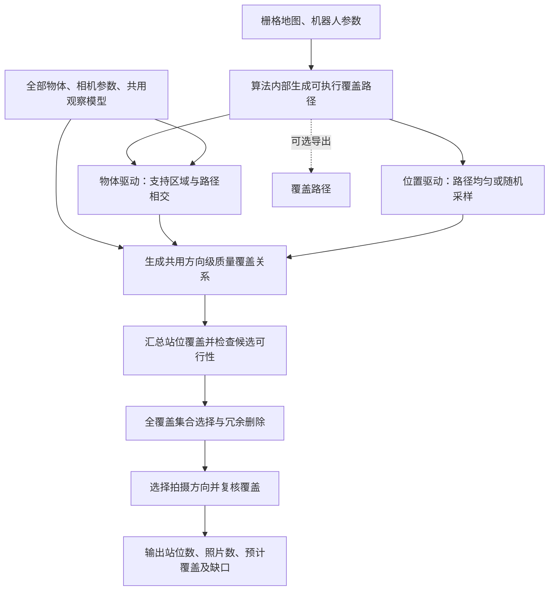
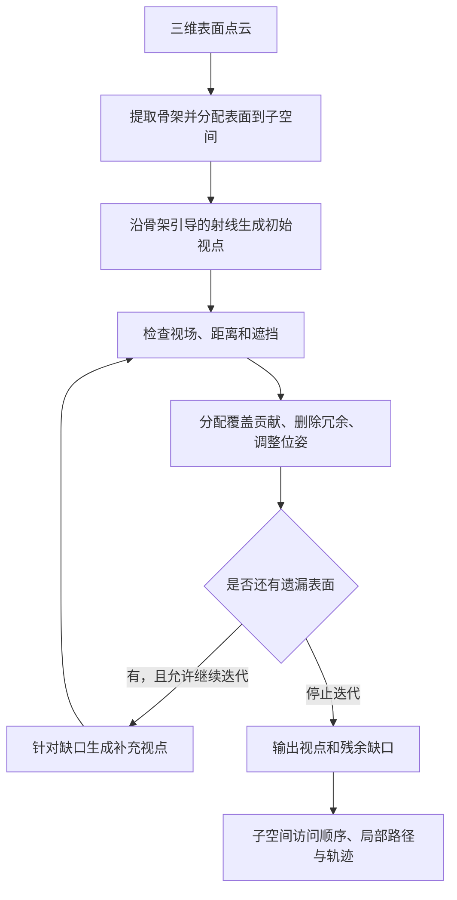
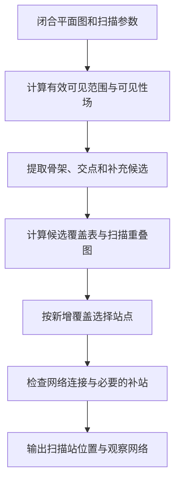
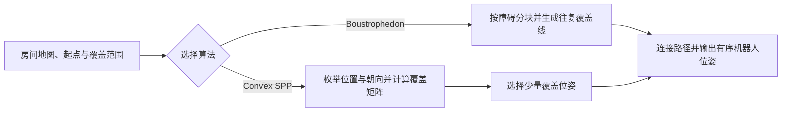
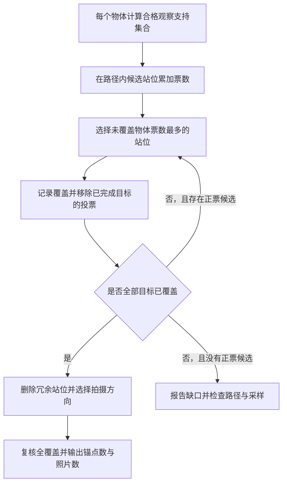

# 路径约束下的无类别物体全覆盖锚点选择 v0

- 更新日期：2026-10-15
- 关联规划与交接：[FALH-V2 研究路线与下一会话交接](research_roadmap_and_handoff.md)
- 当前进度：地图编辑器与 A1 已实现；A1 使用 EDT、OpenCV 四连通标记及分区往复扫描。A2/A3 已选用物体驱动，通过 `falhv2/anchor_selector.py` 接入 main；位置驱动留在实验分支。点模型已完成离线验证，实际采集待验证。
- 本次确定的范围：物体输入为带稳定 ID 的三维中心点集合；首版按路径、动作、视场、高度与有效距离计算预计覆盖，锚点数量由算法输出。物体尺寸、AABB 和像素尺度条件均为后续可选扩展。

## 1. 我们要解决什么问题

**给定栅格地图、无类别物体分布及机器人和相机参数，算法怎样生成可执行路径，并在路径上选择尽可能少的观察锚点，有效覆盖全部物体候选？**

路径生成是本算法内部的第一阶段：根据栅格地图、机器人尺寸和安全距离求全部可通行区域，再在各连通区域内生成覆盖路线，沿路线选择视觉采集锚点。调用者无需提供起点、终点、覆盖路径或路径生成参数；生成的区域路线是内部中间结果，可以作为可选输出用于展示。实际执行时另需机器人当前位置与导航控制。锚点类似静态扫描站：在一个位置执行一个或多个定向拍摄动作，覆盖一组物体。首版由相机视锥、目标点高度、有效距离及可执行动作共同定义预计有效观察；遮挡状态单独声明。

当前只将无类别物体候选作为覆盖目标。桌子、柜子等家具也按输入分布图中的物体候选处理；空桌面已有桌子候选时，观察需求由这个候选表达。空墙、通道和没有物体候选的角落不额外生成视觉覆盖目标。覆盖路径用于提供可执行的候选站位，其地面覆盖与物体视觉覆盖是两个不同环节。

例如，一个站位可以让桌子和杯子的中心点都入镜，但杯子中心超出了有效观察距离，首版就不计为杯子的合格候选。另一个更近的位置可能同时满足两者的视场和距离条件。该判断不代表已验证物体像素大小或实际可识别性。

**站位锚点与定向观察分开定义：**

- 一个站位锚点是路径上的位置 `(x, y)`，附带实际执行的拍摄方向集合及相机参数。
- 一次定向观察是 `(x, y, yaw)`；首版固定相机高度和俯仰。
- 同一位置转向拍四张照片，计为一个站位锚点、四次定向观察。候选方向及转向必须可执行，不能把一站理想化为无成本、无限制的全向观察。

首版主要减少站位锚点数，并在相同站位数量下尽量减少照片。两项分别统计；只允许一个拍摄方向时，站位模型可退化为单次定向观察选点。

整个项目的关系是：

**预建图 → 可执行覆盖路径 → 路径内锚点选择 → 到点拍摄 → 建立视觉记忆 → 检索与找物 → 物体分布变化后的更新。**

当前输出的是观察计划和预计覆盖。实际导航、拍摄、检索与动态更新执行留到后续。

### 1.1 当前要研究的一个科学问题

**在机器人路径约束和物体成像质量要求下，覆盖当前场景全部无类别物体候选需要多少个观察锚点，如何高效求得一个尽可能小的锚点集合？**

完整规划的外部输入是栅格地图、无类别物体分布及机器人和相机参数；其中 A1 路径阶段只用地图、机器人尺寸和安全距离。质量要求由算法的观察模型确定；区域覆盖路线在算法内部生成，所需锚点数由选点阶段输出。不预先输入起点、终点、覆盖路径或最多几个锚点，也不为了减少锚点而主动降低物体覆盖要求。

研究需要说明物体空间分布、尺寸、高度和观察质量要求怎样影响所需锚点数，以及路径限制和候选离散化会带来哪些缺口。对同一场景，质量要求提高可能增加所需锚点，也可能使某些目标无法从现有候选观察；这些关系需要实验核对。

实际记忆可检索性和找物表现用于检验质量模型。数学模型中全部覆盖，不等于真实物体已经全部拍清楚；真实实验需要独立验证预计覆盖。

### 1.2 为什么它是数学建模问题

当前选点可建模为**路径约束下、带物体观察质量条件的集合覆盖问题**。

| 层次 | 要回答什么 | 当前对应内容 |
|---|---|---|
| 研究问题 | 全部物体的有效覆盖需要多少锚点，影响因素和适用条件是什么？ | 路径、物体分布、成像质量与采集成本的关系 |
| 数学模型 | 怎样定义合格观察与全部覆盖？ | 候选站位、可执行方向、质量覆盖矩阵和全覆盖约束 |
| 求解算法 | 怎样减少站位和照片？ | 物体投票实现贪心集合覆盖，再删除冗余；小案例用整数规划核对 |

集合覆盖及其求解已有相关研究。第 7、8 节列出的工作是方法参考；是否构成研究贡献，要由质量模型、路径约束下的求解效果和真实采集验证来支撑。

### 1.3 与当前范围一致的最小数学模型

完整算法先在内部求可通行区域和各区域路径，再进行路径内选点。记栅格地图为 `M`，机器人足迹与安全距离为 `R`，则内部路径生成阶段为 `{P_k} = GenerateRegionPaths(M, R)`。若可通行区域断开，`P_k` 分别对应一个连通区域，不能未经额外连接条件就合称一条可执行连续路径。以下集合覆盖模型描述第二阶段：在本轮已生成的区域路径上采样并选择锚点；这些路径是中间结果，不是外部输入。

| 符号 | 含义 |
|---|---|
| `{P_k}` | 算法内部根据地图与机器人参数生成的各连通区域覆盖路径 |
| `O` | 当前物体分布图中的全部无类别物体候选 |
| `p_i ∈ V({P_k})` | 沿各区域路径采样的候选站位；重合站位按位置合并 |
| `Θ_i` | 站位 `i` 可执行的离散拍摄方向集合 |
| `q(i,θ,o)` | 在站位 `i` 朝 `θ` 观察时，物体 `o` 是否满足已声明的质量条件，取 0 或 1 |
| `y_i` | 是否选择站位 `i`，取 0 或 1 |
| `x_iθ` | 是否在站位 `i` 执行方向 `θ` 的拍摄，取 0 或 1 |

```text
主要目标：最小化 N_anchor = Σ_i y_i
次要目标：在最少站位数固定后，最小化 N_observation = Σ_i Σ_θ x_iθ

全部覆盖约束：对每个 o ∈ O，Σ_i Σ_θ q(i,θ,o) · x_iθ ≥ 1
站位关联约束：x_iθ ≤ y_i
候选约束：p_i ∈ V({P_k})，θ ∈ Θ_i，x_iθ 和 y_i 为二值变量
```

这两个目标可以顺序求解：先求最少站位数，再固定该数量减少照片。**模型中没有锚点数量预算 `K`。** 运行时间或迭代次数可以作为计算资源限制，但中途停止必须报告求解状态，不能当作完成全覆盖。

每个物体至少有一张定向照片达到质量要求才算覆盖；多个方向的联合覆盖，是这些照片分别覆盖的物体集合取并集。不能把同一物体在几张照片中的不足像素累加成一张合格观察。视场和投影计算应使用相机外参，把底盘站位转换为相机位姿。

便于实现的站位覆盖集合为 `S_i = {o ∈ O：存在 θ ∈ Θ_i，使 q(i,θ,o)=1}`。第一版可以先对 `S_i` 做贪心集合覆盖，删去冗余站位，再在保留站位中选择能够维持全覆盖的拍摄方向。这是近似求解，不保证上述两个目标都达到全局最优。

这些覆盖关系也可以通过物体向候选站位投票来组织：每个物体支持能合格观察它的站位，选择未覆盖物体支持最多的站位，再更新票数。Hough 式投票的原理、站位与方向的区别及实现建议，见[第 10 节](#10-hough-投票与路径内锚点选择)。

若某个目标没有任何合格候选，原始全覆盖问题在当前离散候选与质量模型下不可行。应先尝试沿路径加密位置或方向；仍有缺口时输出不可覆盖目标、原因和其余目标的观察计划。原始物体集合保持不变，覆盖统计使用全部输入目标，不能把困难目标删除后宣称全部覆盖。若 `O` 为空，返回零锚点，覆盖率标为不适用。

“最少”首先针对本轮内部生成路径与候选模型。即使精确求得这个离散模型的最优值，也不代表路径生成和锚点选择已经联合取得整个房间连续空间中的最少锚点，更不代表真实采集已经合格。

### 1.4 怎样验证这个问题

1. **先检查可行性与质量判断。** 使用全部候选计算物体覆盖并集，逐项核对视场、高度、距离与遮挡假设；对于缺口，区分采样不足、路径限制、观察条件不满足和已知遮挡。候选并集只给出当前离散模型的可覆盖范围，不能证明连续路径上也无解。
2. **再比较达到相同覆盖要求的成本。** 各方法使用相同路径、候选、物体集合和质量标准，比较选出的站位数、照片数、规划耗时与遗漏目标。均匀沿路径采集作为基线；纯几何选点最后仍按相同质量标准评价，不达标时记录缺口或明确计算补拍成本。
3. **核对求解质量。** 在小案例上用枚举或整数规划求离散最优值，比较贪心、冗余删除等步骤的差距；研究物体数量、分布、尺寸、质量阈值和路径采样间隔变化时的结果，不以输入锚点预算作主实验设定。
4. **最后验证实际采集。** 执行观察计划，独立检查每个物体是否获得合格图像，并固定下游模块验证检索、找物表现。质量阈值用独立标定数据确定。所有方法是否实际达成相同覆盖要求，需要与成本一起报告。

物体预计质量覆盖率用于检查是否达成要求，锚点数用于评价达成要求的成本。若模型预计全部覆盖，实际采集却缺少可用证据，应修正质量或几何模型，不能仅用模型内部评分证明有效。

完整算法的比较从相同地图、物体分布及机器人和相机参数出发，包含内部路径生成阶段。单独比较投票或其他选点方法时，才共用同一条内部生成路径与候选集合，以隔离选点阶段的差异；这不改变外部输入定义。

### 1.5 物体分布变化后怎样更新

无类别检测持续处理机器人实际获得的观测。检测到新增或移动物体后，更新物体分布图，重新检查已有锚点是否还能有效覆盖全部当前候选；已有锚点足够时刷新相关记忆，出现覆盖缺口时再补充或调整锚点。

这个范围支持“当前没有候选的墙面，出现并检测到新物体后，再形成新的观察需求”。检测器、物体分布更新与选点器是三个环节；机器人尚未观测到的变化不会自动进入分布图。这里的全覆盖承诺针对当前输入候选，真实候选是否漏检需要由检测与观测系统单独验证。

## 2. 输入是什么

| 输入 | 需要哪些信息 | 用来做什么 |
|---|---|---|
| 二维导航地图 | 空闲、障碍、未知格子，分辨率和原点 | 在算法内部生成可执行路径并检查站位安全 |
| 无类别物体分布 | 全部候选 ID 和中心 `(x, y, z)`，可用时加入尺寸或包围盒 | 定义本次必须覆盖的目标 |
| 机器人及相机参数 | 足迹长宽、安全距离、可执行动作，以及相机视场或内参、分辨率与安装外参 | 求可通行区域与区域内路线，检查拍摄动作，计算视锥和物体投影；实际执行时另需当前位姿 |

调用者不需要提供起点、终点、覆盖路径、路径生成参数或最多几个锚点。路径生成方法、采样策略采用算法内部配置；首版有效距离与遮挡处理属于已声明的观察模型；像素尺度仅在以后另有尺寸数据时研究。内部配置应随结果保存以便复现，不作为要求调用者预先规划路径的输入项。

地图、内部生成路径、物体和机器人使用统一坐标系及单位。当前地图以米为单位，原点在左下角，栅格行从上到下保存，读入时需要正确转换。

物体候选不要求类别，但必须保留稳定 ID 及几何信息。桌子等家具与小物体同样是候选；用一个家具中心点表示的观察需求，也不等于已经验证整个家具表面的细节覆盖。

## 3. 输出是什么

| 输出 | 大白话说明 |
|---|---|
| 锚点站位与拍摄动作 | 在路径哪里停、各站朝哪些方向拍；保存对应路径位置 |
| 所需锚点数与照片数 | 算法选择了多少个站位，合计需要多少次定向观察 |
| 各连通区域覆盖路线（可选） | 导出算法内部生成的区域路线，用于展示、检查，执行时还需连接机器人实际位置 |
| 预计覆盖关系 | 每个物体由哪些照片预计合格观察 |
| 未满足目标与求解状态 | 全部覆盖是否可行、是否已完成，哪些目标仍有缺口及原因 |
| 统计与可视化 | 路径、锚点、视锥、物体覆盖率、残余目标、规划耗时；精确求解时报告最优性状态 |
| 使用的条件 | 地图与物体分布版本、内部路径生成与采样配置、尺寸假设、相机与质量条件 |

访问顺序优先沿算法内部生成的各区域路径组织；内部路径生成和锚点选择分别记录结果，不宣称联合优化了整个行驶路线。覆盖路径上没有被选成锚点的位置，也不代表机器人执行时完全不经过。若目标分布在互不连通的区域，规划结果需报告无法仅靠当前地图连续到达全部区域。

所有规划覆盖都叫“预计覆盖”。实际图像质量、检索和找物效果在后续采集阶段验证。

## 4. 怎样算选得好

**覆盖全部输入物体是要求；在满足同样质量要求的前提下，站位越少、照片越少越好。** 两个方法覆盖程度不同，应先报告差异，再比较成本。

一个物体有效覆盖需要满足当前模型声明的条件：可执行的站位和方向，水平与垂直视场，目标高度、距离与投影大小，以及所使用的遮挡规则。同一目标被多个锚点观察不会增加已完成目标数；首版不额外要求物体共视网络连通，后续如需跨视图关联再研究重叠需求。

不单独给空墙、空闲区域或转弯角落设置视觉覆盖要求。持续检测产生的新候选在下一次分布更新中加入目标集合。

停止条件是：全部目标已覆盖；或候选无新增贡献／计算限制触发而仍有缺口，输出相应状态。全覆盖完成后继续尝试删除冗余站位与照片。启发式返回的是一个较小的可行集合，只有经精确求解确认时才称离散模型的最优解。

## 5. 当前数据能做到哪一步

已有[地图编辑器](../../falhv2/map_editor.py)、[A1 路径规划器](../../falhv2/path_planner.py)。A1 使用半栅格 EDT 做保守障碍膨胀、OpenCV 四连通标记提取区域，再通过区间分解、往复扫描和 A* 连接生成路线；输出前检查覆盖、四邻接连续性与净空。机器人尺寸与安全距离见[配置](../../falhv2/data/robot.json)。

主线地图统一从 `data/map.json` 读取，路线单元测试使用代码内固定小场景。包含 28 个稳定 ID 与三维中心点的固定实验快照保留在 `experiment/anchor-candidate-drivers` 分支；主线直接读取编辑器保存的地图，无尺寸要求。当前地图保存在 `falhv2/data/map.json`，机器人和相机配置同样由 data 提供；`config.py` 统一管理默认路径。运行结果保存在 Git 忽略的 outputs，可随时删除并重新生成；不再自动读取 outputs 或回退到示例。

中心点能支持方向、视场和距离判断；三维点投影仍是二维点，无法据此推断物体图像宽高。首版保持中心点输入，不构建 AABB、不引入尺寸假设或像素阈值。以后另有实际尺寸或包围盒时，才研究成像尺度条件。

**二维障碍格用于底盘通行，不能直接等同于相机视线遮挡。** 物体的 XY 可以落在桌柜等导航障碍格内，这本身不能证明物体被相机遮挡。地图没有障碍高度，无法可靠判断三维遮挡；为底盘安全膨胀的障碍图也不适合直接作为相机遮挡图。

首轮验证沿路径选站、相机视场、物体点高度与有效距离，并标记遮挡未评估；之后可按需要补充包围盒、点云或网格。若不评估遮挡，只能报告该模型条件下的预计覆盖。

## 6. A2 与 A3 的两条实现路线

**固定 A1 的可执行区域路径后，比较两种候选生成方向：物体反向生成支持区域，以及路径位置采样后正向检查。** 首轮已完成两种方法的离线实验；main 仅接入物体驱动，入口为 [anchor_selector.py](../../falhv2/anchor_selector.py)，不依赖实验模块。位置驱动作为历史对照保留在 `experiment/anchor-candidate-drivers`，结果见[实验报告](anchor_driver_experiment_20261014.md)。以下保留两条路线的模型定义以说明选型。

当前入口内部重算 A1，KDTree 保守半径为 `max_distance_m + norm(mount.xy)`，再逐方向精确验证；默认偏航间隔 30°。输出 JSON 计划、SVG 诊断图、自包含交互 HTML，可用 `--save-supports` 导出稀疏二值 `q`。缺口保留原始 ID，空目标覆盖率为 null；没有自动证明连续空间不可行，也没有自动重连断开的区域。完整命令见 [README](../../falhv2/README.md)。

### 6.1 共用的路径约束与观察模型

每个站位都位于本轮 A1 路径的安全航点上。路径重复访问同一格中心时合并站位，保留区域 ID 与路径索引；拍摄朝向独立于行驶方向。首版相机相对底盘安装固定，底盘可原地转向，相机高度与俯仰固定。

当前 A1 访问全部安全格中心，因此“站位在路径上”允许使用全部离散安全位置，同时约束访问顺序；它并不是稀疏骨架线。骨架路径可能更短、候选更少，也可能离目标过远，应作为后续单独的路径生成对照。

两条路线使用同一个 `q(i,θ,o)` 判断器：先检查动作可执行，再把物体中心点通过相机外参变换到相机坐标，检查前后关系、水平/垂直视场、有效距离和物体点高度。首版没有物体尺寸输入，不计算像素宽高；`q=1` 表示满足当前视场和距离条件的预计覆盖，不能据此声称真实图像已经拍清楚。遮挡首版标为未评估，待有可靠三维几何后再加入。

开始实现前需确定相机实际使用的图像分辨率、内参 `fx/fy/cx/cy`（或视场角与明确的估算假设）、相对底盘的位置和朝向、图像是否去畸变以及可执行拍摄动作。内参必须匹配实际图像；有效距离作为观察模型配置保存，后续以独立照片校准；内参对应的图像裁切、缩放和去畸变条件也需一致。

### 6.2 路线一：物体驱动的反向支持区域与投票（当前主线）

对每个物体 `o`，定义合格观察位姿集合：

```text
F_o = {(p, θ)：p 位于 A1 路径，动作可执行，观察质量条件全部满足}
```

`F_o` 是位置与朝向的集合，可包含多个不相连部分，不是单个方向矢量。只考虑距离时可以得到物体周围的近远限范围；再结合高度、俯仰、视场及已声明的遮挡条件，最终与底盘路径约束求交。存在相机安装偏移时，应通过外参判断对应相机位姿。

首版在现有离散路径上表示支持集合，不强求精确构建连续三维布尔几何：按距离界限筛选物体附近的路径点，再计算可执行方向与完整质量条件。用于粗筛的界限须保守，不能排除原本合格的观察；筛选后仍需调用共用判断器。由各物体支持集合生成稀疏覆盖矩阵，并按第 10 节逐轮投票选站、更新剩余需求。

### 6.3 路线二：位置驱动的采样、检查与压缩（实验对照）

实验实现按去重站位首次访问序号均匀选取，或随机选择已有安全航点；按米制弧长采样为后续可选扩展。去重后枚举可执行方向。计算每个观察能合格覆盖的物体；对无合格观察的目标，在附近路径段增加位置或方向候选，再执行共用的集合覆盖选择与冗余删除。

均匀采样是确定性基线；随机采样保存随机种子、抽样方式及去重后的候选数，并用多个种子报告波动。均匀与随机混合采样可以作为扩展，但要单独记录。位置间距 0.5 m、偏航间隔 30° 可用于首轮调试，属于未标定初值，不代表已经保证全覆盖。

这条路线借鉴 RRT 的采样思想，但没有生长运动树，不称为 RRT 算法。点数多或方向密并不自动保证有效观察，是否覆盖仍由共用质量判断确认。

### 6.4 共用的覆盖表达与站位优化

| 项目 | 物体驱动 | 位置驱动 |
|---|---|---|
| 起点 | 一个物体有哪些合格观察位姿 | 一个候选观察能覆盖哪些物体 |
| 候选建立 | 物体支持区域与路径相交 | 路径均匀或随机采样后检查 |
| A2 输出 | 站位、方向、稀疏 `q`、逐物体支持集合与缺口 | 相同结构 |
| A3 选择 | 对剩余物体动态投票 / 贪心集合覆盖 | 使用同一求解器作公平对照 |

若两条路线使用完全相同的位置、方向与观察模型，所得 `q` 应一致；它们不是两种不同的质量标准。反向组织计算是否提速，需要与相同候选上的完整判断对照验证。也可以在位置采样后用物体反向支持集合补点，作为独立的混合方法。

A3 首先按“当前未覆盖物体的站位票数”选站，随后删除冗余站位并减少照片。同一物体对同一站位最多投一票，多方向覆盖取并集。每轮移除已覆盖目标的投票，不能仅按初始峰值一次性取点。锚点数量由算法输出，不预设预算。

“合并优化”首版指保持已有覆盖的筛选与删点。若把两个站位移动到中点或其他新位置，必须重新检查其是否在路径上、是否安全、拍摄动作是否可执行及覆盖是否保留。位置相近不代表覆盖集合相同。

### 6.5 缺口与停止条件

先检查所有候选的物体覆盖并集。缺口可能来自采样不足、路径限制、相机视场、有效距离，以及已知遮挡；需要分别记录。

对于可能由采样引起的缺口，局部加密位置和方向，必要时检查附近全部原始路径航点，并增加指向物体的可执行方向。方向与位置离散化、加密次数及资源限制随结果保存。全部目标覆盖时结束；候选无新增贡献或资源限制触发时，保留未满足目标和状态。没有合格离散候选不等于已经证明连续空间无解，不能删除困难物体后宣称全覆盖。空物体集合返回零锚点、覆盖率不适用。

### 6.6 验收与比较

A2 先用带物体的小场景核对：不同高度、远处小物体、同站多方向、相机安装偏移、视场边界、距离阈值和路径不能靠近目标。用独立的人工或解析结果检查几何与投影；相同候选时，两条路线的覆盖矩阵应一致。原始 ID、观察条件和失败原因必须可追溯。

比较候选生成时，固定 A1 路径、全部物体、质量模型与 A3 求解器，记录候选数、方向数、质量判断次数、耗时、覆盖缺口、锚点数及照片数，并比较不同采样密度或相近计算资源下的结果。随机方法报告多种子的波动。此时允许两条路线产生不同候选；单独比较选站求解器时则固定同一覆盖矩阵，小案例再用枚举或整数规划核对求解差距。

三维扫描站的“一站多方向”和盲区补站可作为采集组织参考；重建所需的重叠约束仅在确有配准需求时引入。扫描站位置仍须用我们的相机和物体质量条件重新验证。A2 验收只确认模型下的预计覆盖，真实图像质量与找物表现留待后续采集验证。

## 7. 有哪些类似案例

| 案例 | 它在做什么 | 我们可以借鉴什么 |
|---|---|---|
| [视觉传感器布置，2008](https://www.sciencedirect.com/science/article/abs/pii/S0031320308001714) | 选择少量传感器位置覆盖环境边界，也考虑量程和观察角度 | 用少量位置覆盖目标的基本思路 |
| [机器人质量检测视点规划，2022](https://arxiv.org/abs/2201.04310) | 选择能看到测量点、并满足测量质量要求的视点 | 观察质量也要参与选点，这是当前最值得参考的方向 |
| [下一最佳视点 NBV，2022](https://arxiv.org/abs/2203.10113) | 边探索边决定下一次去哪看，兼顾重点区域检查 | 后续实际拍摄发现缺口时，怎样补充观察 |
| [3D-Mem，CVPR 2025](https://umass-embodied-agi.github.io/3D-Mem/) | 用多视角图像组织场景记忆，支持检索与探索 | 后续如何把锚点采集的图像组织成可用记忆 |

视点覆盖、质量约束和贪心选点已有相关工作。我们当前研究路径约束下的物体全覆盖：满足相同观察质量要求需要多少个站位与多少张照片，并以真实采集验证质量模型。

更广泛的开源项目、质量约束案例和阅读建议，见[第 8 节](#8-相近开源算法与案例调研)；FC-Planner、VF-Plan 和 IPA 的运行机制与本地论文，见[第 9 节](#9-三项相关工作的运行机制详解)。

## 8. 相近开源算法与案例调研

初次调研日期：2026-10-10；FC-Planner、VF-Plan 和 IPA 补充核对日期：2026-10-13。围绕“已知室内地图条件下，面向视觉记忆采集的、带观察质量约束的离线视点选择”进行检索。

**相近工作不少，主要分布在机器人巡检、室内扫描站位规划、相机覆盖规划和视觉重建中。** 最值得借鉴的是：怎样判断一个位置能有效观察哪些目标，以及怎样减少重复视点。

本轮没有找到同时满足“二维室内地图＋物体中心点＋地面机器人＋物体成像质量＋离线选点”的现成完整系统，但找到了可以分别解决其中几个环节的实现。这只是本轮检索结果，不能据此认为不存在其他相近工作，也不能据此判断我们的研究创新性。

本节保留调研概览；三项重点工作的逐步解读与本地论文见[第 9 节](#9-三项相关工作的运行机制详解)。以下核对了论文、仓库说明和部分接口，**没有在本地安装、编译或跑通这些项目**。“有代码”不等于可以直接读取我们的 `map.json`，也不等于已经验证其效果。代码状态和许可证以所链接仓库的实际版本为准。

### 8.1 先看哪些：五个接近当前问题的项目

| 项目 | 它解决什么问题 | 与我们接近的地方 | 接入我们的主要差距 |
|---|---|---|---|
| [FC-Planner，ICRA 2024](https://github.com/HKUST-Aerial-Robotics/FC-Planner) | 已知三维场景，生成覆盖表面的视点，再规划巡检路线 | 有独立视点模块和室内办公室案例；考虑视场、可见距离和遮挡 | 输入是表面点云；原系统面向无人机，需要加入地面可达性、固定相机高度和物体成像大小 |
| [VF-Plan，2025](https://github.com/xiongbiaostar/VFPlan) | 从室内平面图选择静态激光扫描站位 | 已知室内地图、离线选站、缩减候选，并兼顾覆盖与扫描重叠 | 面向激光扫描；需要替换成有朝向的相机模型，并补充物体高度和成像质量 |
| [IPA Coverage Planning，对应 ICRA 2018 工作](https://github.com/ipa320/ipa_coverage_planning) | 在已知室内栅格地图上规划覆盖路径 | 输入形式接近；含相机视场覆盖，以及先选观察位姿再规划路线的分支 | 主要覆盖二维平面，不能直接判断桌上物体是否拍清楚 |
| [Structural Inspection Planner，ICRA 2015](https://github.com/ethz-asl/StructuralInspectionPlanner) | 已知三角网格，联合优化观察位置与巡检路线 | 经典的“已知模型→视点→覆盖→路线”完整案例 | 面向飞行器；ROS Indigo 时代代码，迁移工作较多 |
| [ViewpointGeneration](https://github.com/cacton77/ViewpointGeneration) | 从 CAD 模型生成工业视觉检查视点 | 明确检查视场、景深、观察角度和遮挡，再做贪心覆盖 | 面向零件和机械臂，需要改造成房间与地面机器人；本轮未核实明确许可证 |

这些项目中，“优化路线”“减少视点数量”“固定预算下提高覆盖”是不同目标。比较时需要统一输入、候选、覆盖要求、成本定义和评价标准，不能直接照搬论文中的效果数字。

### 8.2 FC-Planner：优先参考视点生成和减少冗余

FC-Planner 从三维表面点云生成视点，减少重复并补齐遗漏，然后规划覆盖路线。独立 `viewpoint_manager` 支持地图点云、目标表面、法向和可选的初始视点输入，也提供法向引导的办公室示例。[模块说明](https://github.com/HKUST-Aerial-Robotics/FC-Planner/blob/master/FC-Planner/src/viewpoint_manager/README.md)

对我们最有用的是覆盖驱动的去重与补点；主要差距是表面几何输入、地面机器人可达性和物体成像尺度。详见[9.1 的逐步解读](#91-fc-planner表面覆盖视点调整与巡检路线)及[本地论文](FC-Planner_ICRA2024_arxiv_2309.13882v3.pdf)。

### 8.3 VF-Plan 和 IPA：更接近当前二维地图输入

VF-Plan 从闭合平面图中选择静态激光扫描站位，以可见性场和骨架缩小候选范围，并考虑扫描之间的重叠。它的站点网络服务于覆盖与配准，不能直接当成机器人行驶路线。当前源码存在质量检查未启用等差异，详见[9.2 的方法与实现核对](#92-vf-plan有重叠要求的激光扫描站位网络)。[本地论文](VF-Plan_2025_arxiv_2503.01562v1.pdf)、[官方代码](https://github.com/xiongbiaostar/VFPlan)

IPA Coverage Planning 包含多种室内覆盖方法。当前先借鉴 Boustrophedon 等分支生成可执行覆盖路径，锚点站位限制在该路径上；Convex Sensor Placement 提供离散覆盖矩阵与集合覆盖求解参考。其 FOV 是二维覆盖范围，我们需另行计算物体高度与成像质量。详见[9.3 的接口、算法和实验解读](#93-ipa-coverage-planning室内覆盖路径与离散选点)。[本地论文](IPA_Coverage_Planning_ICRA2018.pdf)、[官方代码](https://github.com/ipa320/ipa_coverage_planning)

### 8.4 两个工业巡检实现：参考完整流程和质量判断

**Structural Inspection Planner** 输入已知结构的三角网格，交替优化视点与连接路线：调整观察位置以降低移动代价，再优化访问顺序，同时考虑传感器和运动平台的限制。它提供旋翼和固定翼飞行器案例，适合读懂完整的巡检规划流程。代码说明仍以 ROS Indigo 为基础，作为直接工程起点需要评估迁移成本。[代码和论文信息](https://github.com/ethz-asl/StructuralInspectionPlanner)

**ViewpointGeneration** 更适合参考“质量合格才算覆盖”的具体实现。其核心是独立 Python 库，外面包装 ROS 2 接口。流程是：读取 STL/OBJ 模型，分割表面区域，按相机视场组织覆盖，生成相机位姿，最后优化访问顺序。

其中 `greedy_cover` 的覆盖判断包含视场、景深和入射角；启用遮挡检查时，还要检查到表面点的视线。无法观察的点会作为 `blind_spots` 输出。这与我们希望保留“未满足目标及原因”的做法相近。[仓库说明](https://github.com/cacton77/ViewpointGeneration)、[覆盖实现文件](https://github.com/cacton77/ViewpointGeneration/blob/main/viewpoint_generation/viewpoint_generation/fov_clustering.py)

它面向零件检查，观察质量定义也服务于这类成像任务。迁移到室内场景时，需要重新定义物体细节要求、地面站位约束和场景遮挡；本轮没有核实明确许可证，因此先把它当作公开实现参考。

### 8.5 三篇值得读的质量约束和视觉采集案例

| 工作 | 核心做法 | 对我们的启发 | 本轮代码核实结果 |
|---|---|---|---|
| [Multi-Scale View Planning，2019](https://pmc.ncbi.nlm.nih.gov/articles/PMC6630767/) | 为不同区域设置不同拍摄距离与质量等级，分别求覆盖，复用已有视点，再统一规划路线 | 借鉴不同目标尺度对应不同观察距离 | 未找到官方实现 |
| [Coverage Path Planning for Robotic Quality Inspection，2022](https://arxiv.org/abs/2201.04310) | 根据测量精度要求生成合格视点，同时优化视点数量与测量不确定性 | 把质量要求放进选点过程 | 未找到官方实现 |
| [Beyond Shortsighted Navigation，2024](https://arxiv.org/abs/2408.12513) | 在已知环境中，将地面机器人导航与机械臂相机观察轨迹联合规划 | 适合参考以后“边走边采集记忆”的阶段 | 未找到官方实现 |

“未找到官方实现”只表示本轮没有核实到，不能理解成作者一定没有发布代码。

第一篇的完整标题是 *Achieving Tiered Model Quality in 3D Structure from Motion Models Using a Multi-Scale View-Planning Algorithm for Automated Targeted Inspection*。它在大坝巡检中，让普通区域接受较远距离观察，让关键区域接受近距离细看，并让近景照片同时贡献整体覆盖。[论文全文](https://pmc.ncbi.nlm.nih.gov/articles/PMC6630767/)

迁移到我们的场景，可以这样理解：

> 大家具与小物体都属于无类别候选，但达到观察质量要求所需的距离可能不同。同一张照片若能合格观察两者，就可以同时贡献两个目标的覆盖，重复看到已覆盖目标不增加收益。

这段是对论文思路的室内应用解释，不是该论文做过的室内实验。当前将这种尺度差异放入物体质量覆盖条件，不另设墙面或空闲区域的视觉覆盖要求。

第二篇的完整标题是 *Coverage Path Planning for Robotic Quality Inspection with Control on Measurement Uncertainty*。它针对关键测量点的容差要求计算可接受的不确定性，再据此生成可行视点，并将选点数量和测量不确定性一起纳入优化。我们可以借鉴这种建模顺序，但其工业测量精度不能直接换算成物体识别成功率。[论文](https://arxiv.org/abs/2201.04310)

第三篇的完整标题是 *Beyond Shortsighted Navigation: Merging Best View Trajectory Planning with Robot Navigation*。其长时域视点规划 LHVP 面向已知环境的巡逻、监测和视觉数据采集，联合考虑移动底盘与机械臂相机运动。它与地面机器人的平台条件接近，但联合轨迹规划超出了当前 v0 的选点范围。[论文](https://arxiv.org/abs/2408.12513)

### 8.6 相邻方向：补拍、学习式选点和稀疏图像采集

| 项目 | 可以借鉴什么 | 与当前问题的区别 |
|---|---|---|
| [SEE++](https://github.com/robotic-esp/see-public) | 按点云测量密度判断哪里还需要观察，包含遮挡相关处理；MIT | 在线下一最佳视点方法，适合实际采集后发现不足再补拍 |
| [SCVP，RA-L 2022](https://github.com/psc0628/SCVP-Simulation) | 使用集合覆盖构造学习式一次性视点规划，公开数据生成与仿真代码；MIT | 面向未知单个物体重建 |
| [RL View Planning，2021](https://github.com/christianlandgraf/rl_viewplanning) | 强化学习选择工业检查视点，提供机器人仿真和训练实现；GPL-3.0 | 面向机械臂检查，训练与系统依赖较多 |
| [COVER / NBV-Gym，CVPR 2026](https://github.com/chengine/nbv_gym) | 在统一框架里比较相机视图选择策略；MIT | 围绕 3D Gaussian Splatting 训练选图，主要目标是重建质量 |

这些方向可以作为后续扩展：SEE++ 对应补拍，SCVP 和 RL 对应学习式选点，NBV-Gym 对应视觉重建中的视图选择评估。它们不能直接替代我们当前的离线几何与质量模型。

另一个值得跟踪的新工作是 **[CM-EVS：Sparse Panoramic RGB-D-Pose Data for Complete Scene Coverage，2026](https://arxiv.org/abs/2605.15597)**。它研究如何用较少的全景 RGB-D 视图覆盖室内场景，应用目标与稀疏视觉记忆采集接近。

但本轮打开其 [GitHub 主分支](https://github.com/Strange-animalss/CM-EVS)时，文件列表只有 README，尚未核实到说明中列出的算法文件。**暂时把它列为相关论文和数据采集案例，不算作已验证可直接复用的实现。** 全景图像与我们的定向相机观察也需要区别处理。

### 8.7 集合覆盖求解与 Submodlib 的适用边界

当前需要的是**覆盖全部物体、减少所需站位**。我们先计算各候选站位的物体集合 `S_i`，再用贪心集合覆盖或整数规划选站。首版的相机视场、有效距离与路径约束由共用观察模型处理。

一个教学例子：路径上的 A 能合格观察桌子，但杯子太小；B 能合格观察桌子和杯子。如果这就是全部目标，选 B 即可。若 A 与 B 朝向不同，各自还能拍到其他目标，则根据完整覆盖关系判断是否都需要。同一站可以有多个拍摄方向，锚点数与照片数分开计算。

[Submodlib](https://github.com/decile-team/submodlib) 提供覆盖函数和贪心优化工具，可参考其覆盖数据结构与实现。但是，文档示例 `maximize(budget=K, optimizer="LazyGreedy")` 求的是固定数量预算内的最大覆盖，**不能直接当作我们当前的最少站位全覆盖求解器**。[覆盖接口](https://submodlib.readthedocs.io/en/latest/functions/setCover.html)、[Lazy Greedy 文档](https://submodlib.readthedocs.io/en/latest/optimizers/lazyGreedy.html)

第一版可直接实现“选新增物体覆盖最多的站位，直到全覆盖，再删除冗余”的循环，避免引入不符合问题定义的锚点预算。小案例的整数模型见第 1.3 节。启发式、候选离散化和几何质量判断分别验证，不宣称全局最少。



### 8.8 建议阅读顺序和当前实现取舍

1. **先看 IPA 的覆盖路径方法，详见第 9.3 节。** 理解如何从栅格地图生成可执行路径；Convex SPP 则提供离散覆盖矩阵和集合覆盖模型参考。
2. **再看 VF-Plan 的扫描站思路，详见第 9.2 节。** 借鉴站位覆盖集合与去重方式，将扫描站替换为路径内的相机采集站，覆盖目标换成全部无类别物体。
3. **看 FC-Planner 的缺口检查和视点压缩，详见第 9.1 节。** 当前的候选调整仍须留在规定路径内，并重新核对质量条件。
4. **准备求解时看第 10 节的 Hough 式投票。** 用物体支持集合与逐轮更新实现贪心集合覆盖，用小规模整数规划检查最优性差距；Submodlib 的预算最大覆盖 API 只作为相邻优化工具参考。
5. **需要后续扩展时看质量巡检和补拍工作。** ViewpointGeneration 对应质量过滤，SEE++ 对应补拍，3D-Mem 对应拍摄后的记忆组织。

对当前 `falhv2`，采用**覆盖路径生成 → 路径内候选 → 物体质量覆盖 → 全覆盖集合选择**。不输入最大锚点数；实际所需站位与照片数由算法给出。等有可靠三维几何，再完善遮挡模型，最后用真实采集与找物验证预计覆盖。


## 9. 三项相关工作的运行机制详解

本节按“输入 → 观察模型 → 候选生成 → 选择与优化 → 输出”的顺序解读，并区分论文方法、公开代码和迁移到我们系统的建议。**文中的房间、候选编号和覆盖集合都是教学示例，不是论文实验结果，也不是我们的 `map.json` 运行结果。**

本轮核对日期：2026-10-13。已阅读论文和相关源码、下载论文，尚未编译或运行这三个系统。源码解读固定到本次核对的版本：[FC-Planner `880c202`](https://github.com/HKUST-Aerial-Robotics/FC-Planner/tree/880c202ab3e4d472964bdc68405c45754b7ee5be)、[VFPlan `0699efd`](https://github.com/xiongbiaostar/VFPlan/tree/0699efd96a197ad384f0c69160c3662f1a809fb8)、[IPA `986c183`](https://github.com/ipa320/ipa_coverage_planning/tree/986c18384ed884dadd3bc857cd0c47c13b7d4716)。

- [9.1 FC-Planner：表面覆盖、视点调整与巡检路线](#91-fc-planner表面覆盖视点调整与巡检路线)
- [9.2 VF-Plan：有重叠要求的激光扫描站位网络](#92-vf-plan有重叠要求的激光扫描站位网络)
- [9.3 IPA Coverage Planning：室内覆盖路径与离散选点](#93-ipa-coverage-planning室内覆盖路径与离散选点)
- [9.4 对我们的建模意味着什么](#94-对我们的建模意味着什么)

### 9.1 FC-Planner：表面覆盖、视点调整与巡检路线

论文：*FC-Planner: A Skeleton-guided Planning Framework for Fast Aerial Coverage of Complex 3D Scenes*，ICRA 2024。阅读入口：[本地 PDF，arXiv v3](FC-Planner_ICRA2024_arxiv_2309.13882v3.pdf)、[论文网页](https://arxiv.org/html/2309.13882v3)、[官方仓库](https://github.com/HKUST-Aerial-Robotics/FC-Planner)。

#### 9.1.1 它究竟要解决什么

**已知一个复杂三维场景的表面点云，怎样快速规划一条无人机巡检轨迹，让相机尽量完整地观察这些表面？** 它既处理视点，也处理连接视点的路线。论文的核心结构是：先利用场景骨架分解问题，再生成和压缩视点，最后分层规划路径。[论文第 III—VI 节](https://arxiv.org/html/2309.13882v3#S3)

先区分两个使用入口：

| 入口 | 输入与处理范围 | 对我们有什么意义 |
|---|---|---|
| 完整 FC-Planner | 三维点云、传感器及飞行约束；完成骨架提取、选视点和轨迹规划 | 理解完整巡检系统的分工 |
| 独立 `viewpoint_manager` | 地图点云、待覆盖表面点、朝外法向、可选的初始视点；输出更新后的视点和遗漏表面 | 可单独研究选点，不必先接入整套飞行系统 |

模块要求的是表面点云；物体中心点无法提供完整表面和法向。官方还提供法向引导的办公室案例，因此使用独立模块不必先实现论文的骨架提取。[模块输入与接口](https://github.com/HKUST-Aerial-Robotics/FC-Planner/blob/880c202ab3e4d472964bdc68405c45754b7ee5be/FC-Planner/src/viewpoint_manager/README.md)



#### 9.1.2 第一步：用骨架组织场景和初始视点

可以把一组相连管道想成若干根长条形结构。骨架描述这些结构的中心走向，分叉处和明显转弯处帮助划分子空间。随后把附近表面分配给对应分支，让一个子问题主要负责一段结构。

**这里的骨架主要描述被观察结构的形状，不等同于室内导航地图中的可通行走廊中心线。** 论文从骨架朝所属表面发射射线，标记结构内部，并把射线延伸到表面外的空间，在适当距离生成朝向表面的视点。视点具有三维位置、俯仰和偏航，共五个自由度。[论文第 IV、V-A 节](https://arxiv.org/html/2309.13882v3#S4)

对我们而言，这一步值得借鉴的是“先按几何结构缩小候选范围”。迁移时仍须用地面机器人的可达区域筛选；一个适合无人机的表面外视点，可能悬在半空，也可能在底盘无法到达的区域。

#### 9.1.3 第二步：计算视点能覆盖哪些表面

以独立模块为例，若没有提供初始视点，程序会沿目标点的朝外法向偏移一定距离，生成面向该点的候选，并执行位置安全检查。随后计算视点的可见表面及覆盖贡献。[`updateViewpoints()`](https://github.com/HKUST-Aerial-Robotics/FC-Planner/blob/880c202ab3e4d472964bdc68405c45754b7ee5be/FC-Planner/src/viewpoint_manager/src/viewpoint_manager.cpp#L143)

直观地说，一块表面需要落在视锥和可见距离内，视线还要通过遮挡检查。论文的双向射线检查从视点端和目标端同时向中间检查栅格，有助于更早发现靠近任一端的遮挡。它加速的是给定地图中的可见性判断，并没有补充地图原本缺失的几何。[论文第 V-B 节](https://arxiv.org/html/2309.13882v3#S5.SS2)

例如，视点 A 看见柜体正面，B 看见正面和侧面，C 看见被柜体挡住的后方墙面。A 与 B 可能存在大量重复，C 则可能承担其他位置无法覆盖的内容。只按视点间的空间距离去重，就可能误删 C；必须检查覆盖关系。

#### 9.1.4 第三步：分配贡献，移动并合并视点

模块会统计各视点的覆盖贡献，筛掉没有有效贡献的候选，再按贡献排序，在邻域内尝试合并。位姿更新采用类似引力的规则：覆盖贡献较大的视点向附近贡献较小的视点方向调整，位置、朝向可以随之变化。[`viewpointsPrune()` 与 `updatePoseGravitation()`](https://github.com/HKUST-Aerial-Robotics/FC-Planner/blob/880c202ab3e4d472964bdc68405c45754b7ee5be/FC-Planner/src/viewpoint_manager/src/viewpoint_manager.cpp#L620)

可以把它想成：A 原来负责一片较大的正面，B 负责邻近的一小片侧面，算法尝试移动并转动 A，让新的 A 同时承担两部分，再减少 B 的保留需求。**调整之后必须重新计算覆盖，不能假定合并前两张照片的内容都能被一张新照片容纳。** 源码也会检查新位置的安全性，随后更新有效视点的覆盖信息。[位姿更新与安全检查](https://github.com/HKUST-Aerial-Robotics/FC-Planner/blob/880c202ab3e4d472964bdc68405c45754b7ee5be/FC-Planner/src/viewpoint_manager/src/viewpoint_manager.cpp#L760)

这与我们当前模型有一个直接区别：v0 先固定路径候选及覆盖矩阵，只选择子集；FC-Planner 还会改变候选位置和姿态，因此覆盖矩阵也会变化。若迁移这种局部调整，需要将位置限制在规定路径上，并重新检查可执行性、固定高度约束和物体投影大小。

#### 9.1.5 第四步：查缺补点，再连接成路线

视点压缩后，程序收集未覆盖的表面，生成补充候选并再次处理。源码中的循环同时检查遗漏数量、最大迭代次数以及遗漏数量是否继续变化，所以实际接口仍可能返回残余缺口。论文中的完整覆盖目标，不应被读成任意输入都必然无遗漏。[补点循环](https://github.com/HKUST-Aerial-Robotics/FC-Planner/blob/880c202ab3e4d472964bdc68405c45754b7ee5be/FC-Planner/src/viewpoint_manager/src/viewpoint_manager.cpp#L196)

完整系统随后安排子空间访问顺序，在各子空间内部规划路线，再调整连接处并生成轨迹。这种分解主要服务于规模较大的三维巡检问题。论文在三种复杂三维场景上比较规划、覆盖和路径表现，并提供无人机实拍重建验证；这些结果不能直接解释为室内物品检索收益。[论文第 VI、VII 节](https://arxiv.org/html/2309.13882v3#S6)

#### 9.1.6 放到办公室例子里，应该怎样理解

假设办公室有桌面、柜体和隔断，已经有它们的表面点云。法向引导会在不同表面外生成候选：一些主要观察柜子，一些观察桌面，一些观察隔断后的区域。模块减少重复并补足表面缺口，最终输出一组视点及其负责的表面。

官方 `normal.launch` 确实配置了办公室表面与自由空间点云、可见距离、姿态类型和安全参数。不过，2.5D 示例本身不能证明视点已满足我们的底盘可达性和固定相机高度要求，应另行验证。[办公室配置](https://github.com/HKUST-Aerial-Robotics/FC-Planner/blob/880c202ab3e4d472964bdc68405c45754b7ee5be/FC-Planner/src/viewpoint_manager/launch/normal.launch)

**对我们的主要启发：覆盖关系驱动的去重、位姿调整和缺口修复。** 迁移时需加入物体级成像尺度，并把站位限制在已生成的可执行路径上。桌子与杯子各自是输入候选，各自必须有合格观察。当前先构建自己的物体覆盖矩阵；获得表面几何后，再评估复用这个模块。

### 9.2 VF-Plan：有重叠要求的激光扫描站位网络

论文：*VF-Plan: Bridging the Art Gallery Problem and Static LiDAR Scanning with Visibility Field Optimization*，2025 年预印本。阅读入口：[本地 PDF，arXiv v1](VF-Plan_2025_arxiv_2503.01562v1.pdf)、[论文网页](https://arxiv.org/html/2503.01562v1)、[官方仓库](https://github.com/xiongbiaostar/VFPlan)。

#### 9.2.1 它究竟要解决什么

**给定室内平面图，怎样布置较少的静态激光扫描站，既覆盖目标结构，又让不同站的扫描有足够重叠，能够组织成可配准的网络？** 其主要目标包括墙体等边界线段；平面图中的空闲面积不是唯一覆盖对象。每站按水平 360° 扫描模型处理，不需要像定向 RGB 相机一样逐个选择 `yaw`。[论文第 3.1 节](https://arxiv.org/html/2503.01562v1#S3.SS1)

官方实现读取闭合 DXF 平面图，构建加速可见性查询的 BSP 树，再生成可见性场、提取骨架候选并优化站位。输出包含站点布局和观察网络。[项目输入与流程](https://github.com/xiongbiaostar/VFPlan/blob/0699efd96a197ad384f0c69160c3662f1a809fb8/readme.md)



#### 9.2.2 第一步：把扫描条件变成可见性场

在每个平面位置，先计算能够扫到的边界，并结合扫描近限、远限评估有效范围。论文用这些有效边界张开的扫描角来描述观察信息，形成位置到分数的可见性场。距离和边界方向会改变这个角度。[论文第 4.2 节](https://arxiv.org/html/2503.01562v1#S4.SS2)

例如，同一面墙从正对它的位置和几乎贴着墙平行看的位置，张开的角度不同；太远会超量程，太近也可能处在近距离盲区。可见性场让这些差异参与候选生成。

**有效扫描角、墙面采样质量和 RGB 中的目标像素大小不能相互等同。** 把这个思路迁移给我们的相机时，需要重新构造与 `yaw`、高度、目标尺寸有关的评价量；不能直接把扫描场的高分位置当作最佳拍照位置。

#### 9.2.3 第二步：把二维搜索缩到骨架和关键点附近

实现依次生成热图、提取骨架、建立交点图，并创建扫描候选；对重叠不足的骨架连接，还会在路径中间加入站点。[初始化流程](https://github.com/xiongbiaostar/VFPlan/blob/0699efd96a197ad384f0c69160c3662f1a809fb8/VFPlanDLL/src/VPN/VpnOptimizerBySkeleton.cpp#L183)、[补充连接站点](https://github.com/xiongbiaostar/VFPlan/blob/0699efd96a197ad384f0c69160c3662f1a809fb8/VFPlanDLL/src/VPN/VpnOptimizerBySkeleton.cpp#L338)

在“两间房通过一段走廊相连”的例子中，可把房间内部、门口及走廊连接处理解为值得重点检查的候选区域。这样能够减少在整个平面密集枚举的开销，但实际候选依赖地图和场的计算，不能简化为固定取房间中心。

对我们的迁移建议是：在规定覆盖路径上比较均匀采样与结构位置加密。小物体需要近距离侧视时，先检查路径内是否存在合格站位；如果路径本身不足，报告路径限制带来的缺口。改变路径或加入离路径站位属于另一个实验设定。

#### 9.2.4 第三步：同时建立覆盖关系和重叠关系

这里有两张不同的表：

| 表 | 一个元素表示什么 | 用来做什么 |
|---|---|---|
| 覆盖表 `C(i,j)` | 站点 `i` 是否观察到目标边界段 `j` | 判断全局是否还有遗漏 |
| 重叠表 `O(i,k)` | 站点 `i` 与 `k` 共同观察了多少内容 | 判断扫描之间能否建立足够强的关联 |

论文比较了多种重叠度量，后续实验采用基于共同边界长度的平均比例。用长度写，可以表达为：

```text
O(A,B) = 2 × 两站共同观察的边界长度
         /（A 观察的边界总长度 + B 观察的边界总长度）
```

当重叠达到阈值时，在站点间建立边。**这条边表达扫描重叠关系，不能直接解释为机器人可以无碰撞地从 A 直线走到 B。** 覆盖全部墙段也不自动保证这些边组成连通网络。[论文第 4.4、5.3.1 节](https://arxiv.org/html/2503.01562v1#S4.SS4)

#### 9.2.5 第四步：用一个小例子理解连通的贪心选站

假设有六个等长墙段，三个候选的覆盖如下，重叠阈值设为 0.4，仅供演示：

| 候选站 | 可覆盖墙段 | 与其他站的重叠 |
|---|---|---|
| A | 1、2、3、4 | 与 B 为 `4/7`，与 C 为 0 |
| B | 3、4、5 | 与 A 为 `4/7`，与 C 为 `2/5` |
| C | 5、6 | 与 B 为 `2/5`，与 A 为 0 |

按论文的伪代码，先选覆盖最多的 A，再从与已选集合相邻的候选中，选择新增覆盖最多者；增益相同时优先考虑重叠。此时 C 能新增两个墙段，却不能直接接入 A，B 则兼有补覆盖和连接作用。选 B 后再加入 C，就形成 A—B—C 的观察网络。[论文算法 1](https://arxiv.org/html/2503.01562v1#S4.SS5)

这个例子说明：为了配准而保留的重复观察，可能是必要成本。我们 v0 中“同一目标多次观察不增加覆盖收益”的规则可以保留，但若未来还要求多视图关联，就需要另外建模重叠价值。

#### 9.2.6 怎样读它的指标与“最优”表述

论文除了站点数，还使用 WAPL 评价观察网络。其边权定义为 `1 − 重叠率`，再计算站点间的平均加权最短路。**WAPL 改善表示这套定义下的网络连接改善，不是机器人实际行驶距离按相同比例缩短。**[论文第 5.2 节](https://arxiv.org/html/2503.01562v1#S5.SS2)

对论文第 3 节“全局最优”的表述需要保留判断。作者先讨论用骨架上的一组点复现某个内部点的可见内容，但一组点能保持覆盖，并不自动说明它保持原来的站点数和重叠连通性；“不能再删除任何一个点”也不等于“所有方案中点数最少”。这是本次阅读对论证适用范围的判断，不能据此将骨架采样加贪心当成全局最优保证。[论文第 3.2—3.3 节](https://arxiv.org/html/2503.01562v1#S3.SS2)

若用于我们的研究，仍应在小案例上用枚举或整数规划比较最优值，并单独测量候选缩减导致的覆盖损失。

#### 9.2.7 公开代码中需要核对的两处差异

源码确实建立了边界覆盖矩阵并调用量程与分辨率检查，但 **`Station::isInValidResolutionArea()` 在函数开头直接 `return true`**，后面的分辨率计算没有执行。因此，不能因为存在这个函数名，就认定当前版本已经启用相应质量过滤。[`Station.cpp` 第 516 行起](https://github.com/xiongbiaostar/VFPlan/blob/0699efd96a197ad384f0c69160c3662f1a809fb8/VFPlanDLL/src/VPN/Station.cpp#L516)

另外，`getScanGroups()` 用 `loop` 区分首次全局选择和后续邻接选择，但本次版本中的 `loop++` 位于被注释的输出语句内。按该函数静态控制流，不能直接认定它逐步执行了上面论文伪代码中的邻接扩展。**这是源码阅读发现，尚未运行验证；复现时应先检查这两处，再比较效果。**[`getScanGroups()`](https://github.com/xiongbiaostar/VFPlan/blob/0699efd96a197ad384f0c69160c3662f1a809fb8/VFPlanDLL/src/VPN/VpnOptimizerBySkeleton.cpp#L127)

仓库给出的环境为 Windows 11、Visual Studio 2019、C++17，输入为 DXF；许可证为 CC BY-NC-SA 4.0。对我们最适合借鉴的是候选压缩和覆盖／重叠分开建模，直接复用前仍需处理地图转换与上述实现差异。[仓库说明](https://github.com/xiongbiaostar/VFPlan/blob/0699efd96a197ad384f0c69160c3662f1a809fb8/readme.md)

### 9.3 IPA Coverage Planning：室内覆盖路径与离散选点

对应论文：*Indoor Coverage Path Planning: Survey, Implementation, Analysis*，ICRA 2018。阅读入口：[本地 PDF](IPA_Coverage_Planning_ICRA2018.pdf)、[作者机构提供的全文](https://publica-rest.fraunhofer.de/server/api/core/bitstreams/193454c2-0c16-4291-a89f-1c116fff83f0/content)、[官方仓库](https://github.com/ipa320/ipa_coverage_planning)。

#### 9.3.1 它是一套方法集合，重点看哪两个分支

论文面向已知室内地图上的房间级覆盖，比较六类方法，同时考虑机器人作业足迹覆盖和传感器视场覆盖。它的价值包括统一实现与实验比较，其中 Contour Line 是文中提出的方法；不能把所有分支都归为作者首次提出。[论文第 I、III 节](https://publica-rest.fraunhofer.de/server/api/core/bitstreams/193454c2-0c16-4291-a89f-1c116fff83f0/content)

| 论文中的方法 | 直观运行方式 | 与当前选点的关系 |
|---|---|---|
| Boustrophedon | 分块后走往复扫描线 | 直观的布局覆盖路径对照 |
| Grid TSP | 生成覆盖网格，再安排访问顺序 | 分离候选分布与路线成本 |
| Neural Network | 用网格节点的活动状态引导下一步 | 这里是神经动力学规则，不是训练视觉大模型 |
| Grid Local Energy | 根据距离、转向和邻域访问状态选下一点 | 理解路程与转向的取舍 |
| Contour Line | 围绕障碍与区域边界的等距轮廓组织路径 | 适应房间几何的路径模式 |
| Convex Sensor Placement，简称 Convex SPP | 枚举观察位姿，求少量覆盖位姿，再连接路线 | **最接近我们的离散锚点建模** |

当前仓库比 2018 年论文多一些算法选项。配置中 `room_exploration_algorithm=4` 对应 Convex SPP，`2` 对应 Boustrophedon，`8` 是其另一变体；本次核对的默认值为 `8`。复现论文时应明确所选分支，不能把当前默认运行结果当成所有 IPA 方法的代表。[算法参数](https://github.com/ipa320/ipa_coverage_planning/blob/986c18384ed884dadd3bc857cd0c47c13b7d4716/ipa_room_exploration/ros/launch/room_exploration_action_server_params.yaml)

#### 9.3.2 第一步：准备房间地图、底盘和二维覆盖范围

`RoomExploration` 接口接收黑白地图、分辨率、原点、机器人半径、起始位姿等。足迹模式用圆形作业范围描述覆盖；FOV 模式用相对机器人坐标系的四个点描述二维视场，同时给出相机安装位置。`planning_mode=1` 是足迹覆盖，`2` 是 FOV 覆盖，输出是按访问顺序排列的位姿。[实际接口](https://github.com/ipa320/ipa_coverage_planning/blob/986c18384ed884dadd3bc857cd0c47c13b7d4716/ipa_building_msgs/action/RoomExploration.action)

例如，机器人前方地面上的一个梯形就是待扫过的 FOV；梯形覆盖中心可能在底盘前方，而不在底盘中心。实现可以先规划覆盖中心的路径，再转换成可执行的机器人位姿。地图的像素行方向、米与像素的换算也需要统一。[模块使用说明](https://github.com/ipa320/ipa_coverage_planning/blob/986c18384ed884dadd3bc857cd0c47c13b7d4716/ipa_room_exploration/readme.md)

**这是指定平面上的覆盖范围。** 把地面梯形移动到桌子附近，并不能直接推断不同高度的杯子是否进入相机视场；这正是我们需要额外计算三维目标投影的地方。

#### 9.3.3 路线一：按往复扫描方式覆盖房间

设想一间中间有大柜子的房间。Boustrophedon 用扫描线检查自由区域何时因障碍分裂、何时重新合并，据此分块；各块内部安排平行往复路径，再连接各块。相机覆盖范围决定扫描间隔，地图和障碍决定路径能否执行。[Boustrophedon 实现](https://github.com/ipa320/ipa_coverage_planning/blob/986c18384ed884dadd3bc857cd0c47c13b7d4716/ipa_room_exploration/common/src/boustrophedon_explorator.cpp)

在这个例子里，路径会分别处理柜子两侧的空闲区域。我们当前将这种路径生成方法放在算法内部第一阶段，再沿生成路径选站并枚举拍摄方向。路径长度、站位数与照片数分别记录，最终按全部无类别物体的质量覆盖要求评价采集计划。



#### 9.3.4 路线二：Convex SPP 怎样选观察位姿

这个分支先将地图按主方向对齐并采样位置，在 FOV 模式下为位置枚举朝向。每个位姿对应一个转换到地图上的视场四边形；程序逐个检查目标网格点是否在四边形内，并通过二维射线检查障碍，得到二值可见性矩阵。[候选与覆盖矩阵构建](https://github.com/ipa320/ipa_coverage_planning/blob/986c18384ed884dadd3bc857cd0c47c13b7d4716/ipa_room_exploration/common/src/convex_sensor_placement_explorator.cpp#L173)

用与我们一致的记号重写其选点目标，含义如下：

```text
x_j = 1 表示选择候选位姿 j，否则为 0
V_ij = 1 表示候选 j 可以观察目标网格点 i

最小化：Σ_j x_j
约束：对每个目标 i，Σ_j V_ij · x_j ≥ 1
      x_j ∈ {0, 1}
```

这是等观察成本下的集合覆盖模型。源码先反复求加权连续松弛、调整权重以获得稀疏解，再剔除相应零变量，在缩减后的候选集合上求整数问题。[优化模型与求解](https://github.com/ipa320/ipa_coverage_planning/blob/986c18384ed884dadd3bc857cd0c47c13b7d4716/ipa_room_exploration/common/src/convex_sensor_placement_explorator.cpp#L78)、[松弛与候选缩减](https://github.com/ipa320/ipa_coverage_planning/blob/986c18384ed884dadd3bc857cd0c47c13b7d4716/ipa_room_exploration/common/src/convex_sensor_placement_explorator.cpp#L374)

在教学例子中，门口位姿 A 的梯形视场覆盖前半间房，柜子左侧 B 和右侧 C 分别补上后方缺口。优化器依据覆盖矩阵决定是否需要 A、B、C；如果另一个位姿 D 能同时替代 A 和 B，就可能减少一次观察。**最终选择由完整候选与覆盖矩阵决定，不能只凭这个故事断定必选哪几个点。**

它与当前 v0 都采用全覆盖要求并减少采集位姿，但目标与候选不同：IPA 这个分支覆盖二维网格点并在选点后连接路线；我们先在算法内部生成可执行路径，再沿路径覆盖全部无类别物体，并把同站多方向拍摄与站位数量分开建模。首版检查物体点视场与有效距离，像素尺度留待以后具备尺寸数据时扩展。候选缩减和路径启发式均不能当作整个连续问题的全局最优保证。

#### 9.3.5 选完点后，怎样给机器人执行

Convex SPP 会提取选中位姿，构造位置间距离及朝向相关代价，再尝试以不同节点为起点的最近邻顺序，选出较好的连接方案。它会进一步计算选中位姿的访问顺序；我们的路径约束版本则沿算法内部生成的路径组织访问。[选点后的路径处理](https://github.com/ipa320/ipa_coverage_planning/blob/986c18384ed884dadd3bc857cd0c47c13b7d4716/ipa_room_exploration/common/src/convex_sensor_placement_explorator.cpp#L459)

动作服务可以只返回路径，也可以执行导航；还提供对执行后未覆盖区域进行回访的选项。本次配置为 `return_path=true`、`execute_path=false`、`revisit_areas=false`，因此回访功能存在不代表默认已经运行。其覆盖检查仍是自身几何模型下的检查，不能当作物体识别质量闭环。[执行与回访配置](https://github.com/ipa320/ipa_coverage_planning/blob/986c18384ed884dadd3bc857cd0c47c13b7d4716/ipa_room_exploration/ros/launch/room_exploration_action_server_params.yaml#L30)

#### 9.3.6 实验说明了什么，不能说明什么

论文在来自 20 张建筑地图的 550 多个房间上比较算法，包含有家具和无家具的条件。传感器实验采用面向地面的 RGB-D 视场，评价规划时间、路程、转向、执行时间和地面覆盖等。以下仅摘录论文表 II 中“有家具、传感器覆盖”的两个指标，数值为均值 ± 标准差：

| 方法 | 路径长度，米 | 覆盖率，% |
|---|---|---|
| Boustrophedon | 93.7 ± 154.0 | 97.4 ± 5.5 |
| Grid Local Energy | 52.6 ± 82.0 | 95.7 ± 7.8 |
| Convex SPP | 40.5 ± 73.4 | 88.5 ± 9.8 |

这些结果显示，在该实验设置下，更短的路径可能伴随更低的实际覆盖，且不同房间的波动很大。它们不是相同拍摄次数下的比较，也没有测量物体细节或找物成功率。我们应借鉴这种同时报告成本与残余覆盖的方式。[论文第 IV 节、表 II](https://publica-rest.fraunhofer.de/server/api/core/bitstreams/193454c2-0c16-4291-a89f-1c116fff83f0/content)

#### 9.3.7 对我们最直接的复用方式

**先参考 Boustrophedon 等覆盖分支生成可执行路径，再参考 Convex SPP 的“候选—覆盖矩阵—集合选择”结构。** 我们的站位来自规定路径，覆盖目标是全部无类别物体，并检查物体点高度、有效距离及声明的遮挡条件；成像尺度作为后续可选扩展。

若直接运行 IPA，需要转换二值地图、处理未知格与坐标方向、配置机器人和视场，并选定具体算法。若只是比较优化器，可让不同求解器共享我们自己构建的候选与质量覆盖矩阵。前一种比较包含了候选和几何模型差异，后一种才较能单独说明求解方式的差异。

### 9.4 对我们的建模意味着什么

| 对照项 | FC-Planner | VF-Plan | IPA 的 Convex SPP | 我们当前 v0 |
|---|---|---|---|---|
| 主要输入 | 三维表面点云 | 二维结构平面图 | 房间二值栅格地图 | 栅格地图＋无类别物体分布＋机器人及相机参数 |
| 采集单元 | 三维位置＋俯仰＋偏航视点 | 一个水平全向扫描站 | 二维位置＋朝向位姿 | 路径内站位锚点，附带一个或多个定向拍摄动作 |
| 覆盖目标 | 表面点／体素 | 墙体等边界段 | 二维区域采样点 | 全部输入无类别物体候选 |
| 主要优化思路 | 调整和压缩视点，再分层规划路线 | 骨架候选、覆盖与扫描重叠网络 | 集合覆盖选位姿，再连接路线 | 内部生成路径，再满足物体全覆盖并减少站位与照片 |
| 当前最可借鉴处 | 去重、位姿调整、补齐遗漏 | 候选缩减、重叠的独立建模 | 离散观察位姿和覆盖矩阵 | 验证质量模型与真实找物的关系 |

这三项工作进一步说明，第 1 节的建模路线：**根据外部地图与机器人参数在内部生成可执行路径，再计算物体质量覆盖关系，最后求解全覆盖所需的站位。** 当前路径是中间结果和可选输出，锚点数由算法输出，不设数量预算，也不额外要求空墙视觉覆盖。需要验证的是路径内站位的采集成本、残余缺口、求解质量与真实记忆可用性。

当前可以按三个独立因素设计对照：

1. **观察模型：** 相同路径与候选下比较几何选点和质量选点；统一按物体质量标准核对是否全部覆盖，同时报告站位数、照片数和必要补拍。
2. **候选生成：** 按第 6 节比较物体驱动反向支持区域与位置驱动的均匀/随机采样，共用质量模型和求解器；记录覆盖缺口、候选规模与开销。改变路径的实验单独报告。
3. **求解方法：** 在相同覆盖矩阵上比较贪心与小规模精确解，避免把候选变化、质量条件变化和优化器变化混在一起。

覆盖路径生成是完整算法内部的第一阶段，路径内选点是第二阶段；路径与站位的联合优化、扫描重叠网络可作为后续扩展。按内部生成路径组织选中站位，分别统计站位与定向照片数量，避免把全向扫描站和一张照片当作同一种采集成本。

## 10. Hough 投票与路径内锚点选择

本节补充导师建议关注的 Hough 投票思路。经典原理参考 [OpenCV Hough 直线变换说明](https://docs.opencv.org/4.x/d9/db0/tutorial_hough_lines.html)；将物体观察条件用于锚点投票，是结合当前问题提出的建模与实现方案，已在离散点观察模型中实现并完成首轮实验。以下编号与票数是教学示例。

### 10.1 Hough 投票的基本原理

**让每个观测给所有与它相容的候选解投票，再寻找得到最多共同支持的候选解。**

经典直线检测中，每个边缘点可能位于很多条直线上。把直线表示为参数 `(ρ, θ_H)`，其中 `ρ` 是原点到直线的距离，`θ_H` 是法向角：

```text
ρ = x · cos(θ_H) + y · sin(θ_H)
```

每个边缘点 `(x, y)` 在参数空间中给经过它的直线投票。很多点共同支持同一组参数时，累加器出现峰值，对应可能的直线。这里的 `θ_H` 是直线法向角，与我们相机的观察朝向 `yaw` 是不同参数。[原理与累加器说明](https://docs.opencv.org/4.x/d9/db0/tutorial_hough_lines.html)

### 10.2 对应到我们的锚点问题

在我们的模型中，可以让每个无类别物体支持所有能合格观察它的路径内候选。直观地说：物体产生一片“能够观察我的位置与方向”，多个物体的支持区域交叠处，是值得选择的采集位置。

| 经典直线投票 | 当前锚点投票 |
|---|---|
| 投票者：边缘点 | 投票者：具有 ID 的无类别物体候选 |
| 候选解：直线参数 | 候选解：路径内站位，或站位与拍摄方向 |
| 相容条件：直线经过该点 | 相容条件：该观察满足物体的质量条件 |
| 累加器峰值：许多点支持同一直线 | 累加器峰值：许多物体支持同一站位或定向观察 |

路径采样后用第 1.3 节的 `p_i` 表示站位；如果用路径弧长 `s` 标记采样位置，定向观察的参数空间可以写成 `(s, yaw)`。路径重复经过同一物理位置时，统计站位数仍按合并后的站位 ID 计，不能因路径索引不同虚增锚点数。

投票资格直接使用 `q(i,θ,o)`。首版物体点进入视锥但超出有效距离，不投有效票；候选动作不可执行，或被所使用的遮挡模型判为遮挡，也不投票。遮挡尚未评估时，投票图仍只表达该假设下的预计覆盖。

### 10.3 站位票数与定向观察票数要分开

令 `U` 为当前尚未覆盖的物体集合：

```text
定向观察票数 H_direction(i,θ) = Σ_{o∈U} q(i,θ,o)

站位票数 H_station(i) = Σ_{o∈U} max_{θ∈Θ_i} q(i,θ,o)
                     = |S_i ∩ U|
```

`H_direction` 回答“一张定向照片能新增覆盖几个物体”；`H_station` 回答“这个站位通过允许的拍摄方向，能新增覆盖几个物体”。当前主要减少站位锚点数，因此先按 `H_station` 选站，再决定保留哪些拍摄方向。

**同一个物体对同一个站位最多投一票。** 它可能在三个方向都进入视锥，但不能据此给该站位算三票。也不能把某个方向的最高票数当成整个站位的票数：站位可以通过不同照片分别覆盖不同物体。

首版使用每个物体一票的二值规则。若以后加入质量分数或置信度加权，应说明权重依据；无论分数怎样变化，全部物体的合格覆盖约束仍需独立检查，不能因票数低而忽略某个目标。

### 10.4 用一个小例子理解逐轮投票

假设有四个物体，三个候选站位的合格覆盖如下：

| 候选站位 | 能合格观察的物体集合 | 初始站位票数 |
|---|---|---:|
| A | 1、2 | 2 |
| B | 1、2、3 | 3 |
| C | 3、4 | 2 |

第一轮选择 B，记录需要的拍摄动作，物体 1、2、3 从未覆盖集合中移出。第二轮只剩物体 4 投票，A 和 B 为 0 票，C 为 1 票；选择 C 后，全部物体覆盖完成，输出两个站位。

如果只根据初始票数一次性取最高的几个峰值，就可能重复选择覆盖物体 1、2、3 的站位而漏掉物体 4。**票数必须在每轮选择后更新；停止依据是全部目标覆盖完成，而不是预先规定选几个峰值。**



### 10.5 第一版怎样实现

先计算完整的方向级质量覆盖，保存两种对应关系：每个站位能覆盖哪些物体 `S_i`，以及每个物体支持哪些站位 `R_o`。两者来自同一份覆盖关系，方便分别查询与更新。

```text
U = 全部输入物体 O
A = 空站位集合
H(i) = |S_i ∩ U|

当 U 非空：
    选择 H(i) 最大的未选站位 i
    若没有正票候选：保留 U 作为残余缺口，停止
    将 i 加入 A
    new = S_i ∩ U
    对 new 中的每个物体 o：
        从 U 移除 o
        对 R_o 中的每个站位 k，将 H(k) 减 1

删除不损害已有覆盖的冗余站位
在保留站位中选择维持覆盖的定向拍摄动作
复核全部原始目标，输出 A、拍摄动作和残余缺口
```

票数相同时可固定按路径顺序或站位 ID 选择，以便复现。站位减少和照片减少分两步，最终方向选择仍须保证每个已覆盖物体至少有一张合格照片。

如果没有任何站位支持某个物体，不能靠继续投票解决。先沿路径加密位置与方向；仍无合格候选时，按第 1.3 节报告当前模型不可行及目标缺口。

### 10.6 它与集合覆盖是什么关系

在候选和二值覆盖关系固定时，选择最大 `H_station(i)`，就是选择新增覆盖最多的站位。**这个投票循环与贪心集合覆盖等价，Hough 式表达并没有额外提供最少锚点保证。** 它的作用在于把物体的观察支持空间、票数峰值和剩余需求组织得更直观。

若从物体的位置、视场与有效距离可以直接推导路径上的可观察区间，反向投票可能用于缩小候选检查范围；若仍需逐一遍历全部物体与站位，计算量未必减少。遮挡、相机外参和高度条件仍要逐项核对，任何区间加速都需要与完整质量判断比较。

验证时建议显示路径站位票数图和 `(s, yaw)` 方向票数图，保留峰值对应的物体 ID，并展示每轮移除目标后的变化。相同覆盖矩阵、相同 tie-break 规则下，投票实现应与普通贪心给出一致的选择；若有新的候选生成或加速策略，再单独比较成本与遗漏。小案例继续用整数规划核对最终站位数。

### 10.7 在现有流程中的位置

当前主线可以具体写成：**输入地图、物体分布和机器人及相机参数 → 算法内部生成可执行路径 → 物体反向支持区域与路径相交 → 点视场和距离关系产生投票 → 逐轮选择站位并更新票数 → 删除冗余 → 输出锚点与拍摄动作，可选导出路径。**

经典 Hough 直线检测也可用于提取栅格地图中的主要墙线或方向，辅助路径生成；这是另一个使用环节。当前补充的“物体向锚点投票”需要我们定义观察支持关系，不能直接把 OpenCV 的 `HoughLines()` 当成物体选点器。这里没有增加空墙视觉覆盖要求，也没有引入最大锚点数输入。

### 10.8 反向支持区域的相关研究

[Automated Model Acquisition from Range Images with View Planning，CVPR 1997](https://www.cs.hunter.cuny.edu/~ioannis/cvpr97.pdf) 为未观察目标表面构建可见性体积，与传感器可达空间相交，再搜索能够观察更多未观察表面的位置。其“从目标反推可见空间，再搜索重叠区域”的结构可用于理解本项目的物体支持集合；原工作面向距离图像建模，不能直接作为室内物体成像质量算法使用。

[Viewpoint Planning for Range Sensors Using Feature Cluster Constrained Spaces for Robot Vision Systems，2023](https://pmc.ncbi.nlm.nih.gov/articles/PMC10537344/) 为特征构建满足观察约束的位姿空间，通过空间求交形成多特征共同可观察空间，并讨论集合覆盖。这为按约束组织反向支持集合提供参考；本项目仍需实现地面底盘路径限制、物体尺寸与 RGB 成像质量条件。

上述工作支持的是约束空间、交集与视点规划的相关性，不意味着已有可直接替代本项目的 Hough 选锚点程序。我们的首版实现按第 6.2 节使用离散支持集合，第 10.3—10.6 节定义动态投票及其与贪心集合覆盖的关系。
