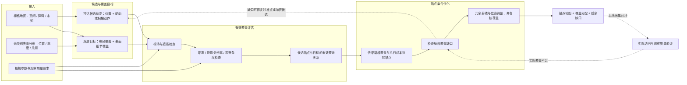

# 面向长期动态室内找物的记忆锚点地图：研究与实现计划 v0

- **版本日期：** 2026-09-17
- **验证载体：** 真实室内移动机器人为主，仿真辅助。
- **当前范围：** 先研究锚点生成、维护与基于锚点的找物闭环，不以通用 Agent 为首阶段目标。
- **文档性质：** 讨论结果与后续研究计划。下文算法设计、贡献点和实验均为拟开展内容，不代表已经实现、取得实验结果或确认具有首创性。

## 1. 本轮明确的核心思路

系统首先回答：**为了以后可靠地找到东西，机器人应该在哪里、朝哪里、以什么观察尺度建立记忆？**

给定室内栅格地图、无类别的物体或表面分布信息，以及相机参数，选择一组能够充分观察房间布局和物品细节的记忆锚点。机器人访问这些锚点采集观测，形成可以检索、回访和刷新的记忆地图。

锚点不能仅以“房间大部分区域落在 FOV 内”为选取依据。例如，站在门口看向整个房间，虽然可能看见房间轮廓，但远处桌面上的小物品不够清晰、家具后的角落也可能被遮挡，因此不应被计为完整的有效覆盖。

后续找物时，机器人通过记忆检索候选锚点，先到对应位置获取当前观测并刷新记忆，再定位目标或开展局部细查。环境变化后，系统检查锚点的观察覆盖是否仍然有效，按需刷新、增加、调整或删除锚点。

**研究主体是锚点的生成与持续维护；记忆检索和导航是检验锚点设计价值的下游任务。** 前期关于通用任务规划、技能编排和复杂 Agent 的设计不作为 v0 的实现前提。

## 2. 已确定的方向与尚待验证的判断

### 2.1 已确定的方向

1. 锚点选取同时利用通行几何与物体/表面分布，不要求预先获得具体物体类别。
2. 覆盖必须包含观察质量要求，不能只计算视场投影面积。
3. 锚点组织可回访的视觉记忆；找物时执行到点刷新与现场验证。
4. 快系统持续处理在线观测与地图变化，慢系统负责锚点覆盖评估、结构维护和补充采集调度。
5. 初期采用明确的任务状态机即可，不要求引入复杂的自主 Agent。

### 2.2 待验证的研究假设

- 在相同锚点数量或采集时间下，质量约束的锚点选择能够提高后续找物成功率，减少观察盲区和漏检。
- 相比每次全局重建，增量修复能够以更少的补拍、更低的计算和移动成本维持相近的有效覆盖。
- 到点刷新能够减少过期记忆导致的错误定位，但其额外时间成本需要与收益共同评估。
- 上述组合是否构成足够明确的新方法，需要继续与覆盖规划、视点选择和具身记忆方法比较；目前不作“首次提出”判断。

## 3. 问题定义与适用边界

### 3.1 输入

| 输入 | 含义与用途 |
|---|---|
| 栅格地图 | 已知空闲、障碍和未知区域，用于候选位置生成与导航可达性判断 |
| 无类别表面分布 | 几何表面、空间占据或物体候选的分布，用于确定细节观察需求 |
| 相机参数 | 水平/垂直 FOV、图像分辨率、相机高度与外参、可调整的朝向及俯仰范围 |
| 观察质量参数 | 有效距离、最小目标尺度或表面分辨率要求，以及必要的观察角度约束 |
| 机器人约束 | 足迹、通行安全距离、可达性、转向和观察动作限制 |
| 当前锚点与采集状态 | 增量维护时使用，初次生成时为空 |

FOV 不是唯一充分输入。距离、分辨率、遮挡和相机高度共同决定一个区域能否被有效观察。

### 3.2 输出与锚点定义

锚点应至少包含“机器人位置 + 相机观察方向”，或者“机器人位置 + 明确的扫描策略”。对于固定高度相机，最简候选位姿可写成 `(x, y, yaw)`；具备云台时还需要俯仰等参数。

建议每个锚点保存：

- 稳定的锚点 ID、位姿及版本。
- 单次观察方向，或环视/分段拍摄动作。
- 预计高质量覆盖的区域与表面集合。
- 已实际采集且通过质量检查的覆盖集合。
- RGB-D 观测、采集位姿、时间戳及可检索特征。
- 待采集、有效、待刷新、暂不可达或失效等状态。
- 覆盖置信度、关联地图版本和待补充的覆盖缺口。

几何规划可以不依赖类别；后续检索仍然可以从采集的图像中提取语义或视觉特征。二者不矛盾。

### 3.3 覆盖承诺的边界

v0 的目标是：对**当前模型中、机器人可达观察位姿能够观察到的区域和外露表面**建立充分的有效覆盖。

不能将其直接表述为“保证看清房间所有真实物品”。抽屉内部、封闭容器、所有可达视点均被遮挡的位置，以及尚未探索的空间，都可能超出能力范围。未知、不可达和残余未覆盖部分应单独记录，不计为已覆盖。

仅有二维地图时，结论也应限定为二维几何近似下的覆盖；不能据此宣称已经解决桌面、柜格和不同高度表面的三维可见性问题。

## 4. 地图与覆盖表示

### 4.1 布局覆盖与表面细节覆盖

同时维护两类目标：

1. **布局覆盖：** 对房间各区域、角落和遮挡后的空间提供基本观察保障。
2. **表面细节覆盖：** 对家具和物品的可见表面要求更高的成像质量，以支持小物品查找。

布局覆盖作为基础约束，表面分布用于分配额外观察需求。不能只以物体密度作为权重，否则低密度角落可能被持续忽略。

### 4.2 无类别分布图的实现方向

优先考虑经过空间均匀采样或体素化的表面分布，而不是直接使用原始点云点数。原始点密度受距离、视角和重复观测影响，不能直接代表物品数量。

首阶段可以采用二维栅格及表面投影，验证候选采样、质量覆盖和优化流程。面向真实找物实验时，优先评估带高度信息的分层地图或三维表面表示，以处理桌面、柜格等位置的可见性。

导航可达性和相机可见性应分开计算：机器人足迹膨胀后的障碍地图适合判断底盘能否通过，但不等同于相机视线遮挡模型。

### 4.3 预计覆盖与实际覆盖

- **预计覆盖：** 根据当前几何模型和传感器模型推断该锚点应当能够观察的区域。
- **实际覆盖：** 已完成采集，并通过有效深度、遮挡和图像质量检查的区域。

新增锚点首先处于待采集状态，不能直接被当作已有视觉记忆。实际采集发现预测不成立时，应保留缺口并触发补充观察。

## 5. 初始锚点生成算法

### 5.1 质量约束的覆盖关系

设候选锚点集合为 `V`，布局与表面采样目标集合分别为 `S_layout` 和 `S_surface`。

定义 `C(a, s) = 1`，当且仅当候选锚点 `a` 对目标 `s` 满足：

1. 机器人能够到达并执行观察动作。
2. 目标位于指定相机视场或扫描范围内。
3. 相机到目标之间不存在模型中已知的遮挡；未知区域按选定的保守规则处理。
4. 距离与投影分辨率达到该类覆盖目标的要求。
5. 必要时满足表面观察角度和位姿可信度要求。

否则 `C(a, s) = 0`。后续可扩展为连续质量分数，但 v0 先使用可解释的阈值模型。

“看清楚”的阈值应由相机和目标尺度实验标定。例如，以希望支持的最小物品尺度和成像像素要求确定有效细节观察距离，而不是随意指定统一半径。该指标是识别条件的代理，最终仍需用真实找物表现验证。

### 5.2 优化目标

从 `V` 中选择锚点集合 `A`，在满足布局与表面覆盖要求的条件下，降低：

`锚点数量成本 + 图像采集成本 + 锚点间移动成本`。

覆盖率应分别报告布局和表面部分，并检查局部区域的残余缺口，避免全局高覆盖率掩盖一个完整角落的遗漏。无法满足的约束需要显式报告，不通过缩小统计范围隐藏。

第一版可以分开进行锚点集合选择和访问路线优化；联合优化作为后续扩展，避免一开始引入过多复杂度。

### 5.3 可落地的基线流程

1. 从可达空闲区域采样候选位置，枚举观察方向或扫描策略。
2. 构建布局与表面覆盖目标，计算候选锚点的可见性和质量覆盖关系。
3. 根据新增有效覆盖与新增执行成本，贪心选取候选锚点。
4. 对覆盖不足的局部区域补点，必要时增加候选采样密度。
5. 删除不损害覆盖要求的冗余锚点，并进行局部位姿调整。
6. 规划访问顺序，导航到点并采集观测。
7. 验证实际覆盖，针对预测失败或新发现的区域继续补充。

贪心集合覆盖是实现起点和实验基线，本身不作为新贡献。候选离散化、质量模型和路线近似也意味着第一版不宣称全局最优。

对于未知环境，可先获得初步地图，再执行锚点覆盖补全；在探索中同时生成锚点属于后续在线扩展。

## 6. 动态环境中的增量维护

### 6.1 变化触发覆盖检查，而不是直接触发全局重选

快系统产生地图或观测变化后，慢系统先判断：

- 原有锚点是否仍然可达？
- 原来负责的区域是否仍能被有效观察？
- 是否出现了需要新增观察的表面或覆盖缺口？
- 变化是否只涉及记忆内容，而没有损害观察结构？

| 变化情况 | 处理策略 |
|---|---|
| 杯子换位置，原锚点仍能看清桌面 | 保留锚点，刷新对应记忆 |
| 新增家具遮挡旧视线 | 重新评估受影响覆盖，补充或调整锚点 |
| 家具移走，多个锚点覆盖高度冗余 | 验证覆盖后合并或删除冗余锚点 |
| 锚点被占用或路径暂时阻断 | 标记暂不可达，按任务需要选择替代观察位姿 |
| 人员短暂经过或观测抖动 | 保留临时障碍处理，延迟长期锚点结构调整 |
| 外观或物体身份变化，但几何分布基本不变 | 更新视觉记忆，不强制改变锚点位置 |

### 6.2 增量修复策略

1. 汇总变化区域及其观测置信度，区分短时变化与需要长期处理的变化。
2. 查找受变化影响的锚点与目标，包括视线穿过变化区域的锚点；不能只检查位置附近的锚点。
3. 更新受影响的覆盖关系，保留不受影响的锚点。
4. 对覆盖缺口局部补点或调整观察方向，按需处理不可达和冗余锚点。
5. 将新增或待刷新的锚点加入采集队列，执行后更新实际覆盖与记忆。

优化时加入锚点增删、位姿变化和重新采集成本，使系统倾向于用较小调整恢复覆盖。采用变化确认、迟滞或最小持续时间等机制抑制反复增删；具体机制与参数需要实验确定。

位姿改变时必须记录版本，不能将旧位姿拍摄的图像直接归为新位姿观测。定位或地图坐标发生校正时，也需要同步处理锚点和观测的坐标一致性。

### 6.3 变化可观测性的限制

地图只能根据机器人实际获得的观测更新。机器人未访问区域中发生的物品移动，不会自动产生变化事件。

长期维护需要结合：任务途中的顺路观测、找物时到点刷新，以及预算允许的巡检或过期记忆复查。补充采集由覆盖缺口、当前任务需要与执行成本决定，不要求每个微小变化都立刻安排专程访问。

## 7. 快慢系统与找物流程

### 7.1 快系统

- 接收 RGB、深度和机器人位姿。
- 更新局部几何、通行障碍和无类别表面分布。
- 输出可靠的变化信息与当前观测证据。
- 执行局部导航、避障、图像采集和目标现场验证。

快系统可以高频处理当前观测，但向长期地图和慢系统提交结构变化时，需要避免将瞬时噪声直接固化。

### 7.2 慢系统

- 初始锚点集合规划。
- 质量覆盖评估与缺口检查。
- 环境变化后的局部锚点修复。
- 锚点记忆整理、刷新状态维护和补充采集调度。

慢系统采用事件触发并可辅以周期检查，不必只依靠固定定时器进行全局更新。

### 7.3 最小找物闭环

`用户描述目标 → 检索候选锚点 → 选择并导航到锚点 → 采集当前观测 → 刷新记忆 → 定位目标或局部细查 → 成功结束 / 更新证据并继续搜索`

需要保留以下分支：

- 当前观测直接发现目标时，进入定位与到达验证。
- 未找到目标时，记录本次确实看清的范围；单次未检出不能等同于整个锚点区域不存在目标。
- 原锚点覆盖受损时，将缺口交给锚点维护模块处理。
- 检索候选耗尽或目标从未出现在历史记忆中时，转入覆盖缺口检查或探索。

初期检索可使用视觉/文本相似度、距离和记忆时间等简单策略。复杂的检索决策不作为验证锚点生成算法的前置条件。

## 8. 相关工作定位与贡献边界

本次思路明确后，必须同时对照三类工作：覆盖与视点规划、长期地图维护、具身视觉记忆。

| 相关工作 | 已有内容及对本方案的启示 |
|---|---|
| [A nearly optimal sensor placement algorithm for boundary coverage](https://doi.org/10.1016/j.patcog.2008.05.001) | 传感器布置已有可见性、距离与观察角度约束；不能把这些条件本身当作新方法 |
| [Coverage Path Planning for Robotic Quality Inspection with Control on Measurement Uncertainty](https://arxiv.org/abs/2201.04310) | 已将测量质量与视点选择结合；需要说明面向找物的观察质量与任务收益有何不同 |
| [Occlusion-Aware Visibility Coverage for Robotic Stop-and-Scan 3D LiDAR Mapping](https://www.mdpi.com/1424-8220/26/17/5430) | 在实时二维占据地图上结合遮挡感知可见性和覆盖增益决定扫描位置，是重要的几何覆盖对照 |
| [3D-Mem](https://umass-embodied-agi.github.io/3D-Mem/) | 通过物体共视关系组织记忆快照；本方案需区分主动规划采集位姿与从已有观测中组织记忆 |
| [DualMap](https://arxiv.org/abs/2506.01950) | 已研究动态环境中的对象搜索及抽象锚点；本方案的锚点主要是可回访观察位姿，仍需比较整体找物机制 |

以上为当前定位依据，不构成完整查新。特别是“质量感知覆盖”“增量维护”“到点验证”均有相关研究基础，是否形成贡献取决于具体算法及实验中显示的差异。

## 9. 面向 IROS 的三个候选贡献方向

### 贡献方向一：面向找物的质量约束锚点生成

联合布局覆盖与无类别表面细节覆盖，在有限观察预算下选择可回访锚点。重点研究如何减少影响小物品检索与定位的真实观察盲区，而不只提高二维地图覆盖率。

**需要证明：** 在相同锚点数量、采集时间或移动预算下，相比合理的几何覆盖及关键帧基线，能够形成更适合后续找物的记忆。

### 贡献方向二：变化驱动的锚点地图增量维护

区分内容过期、可见性退化和导航不可达，保留有效锚点，仅修复受影响部分，并维护位姿与观测版本的一致性。

**需要证明：** 相比固定锚点和全局重建，以较低的重新规划、补拍与移动成本维持覆盖质量和找物性能，同时减少不必要的锚点变动。

### 贡献方向三：锚点回访刷新驱动的长期找物系统与验证

构建真实机器人上的建图、锚点采集、记忆检索、回访刷新与局部查找闭环，评估多次任务和环境变化下的持续表现。

**需要证明：** 前两项设计能够在真实部署中降低漏检、过期记忆引起的无效访问及变化后的恢复成本。第三项可以是系统与实验贡献，不必强行包装成独立算法。

上述表述为研究目标。投稿时应根据真实结果重写，避免在实验完成前使用“显著优于”“保证完整覆盖”等结论性措辞。

## 10. 实验设计

### 10.1 首先验证的问题

**在相同锚点数量或采集时间下，所选锚点是否更能支持之后的找物？**

先固定静态环境验证选点价值，再加入动态维护，避免一开始无法判断收益来自哪一个模块。

### 10.2 对照基线

- 均匀位置与方向采样。
- 房间中心、门口或拓扑节点等简单代表点；仅作为直观弱基线。
- 包含遮挡处理的几何可见性覆盖方法，使用相同候选和预算。
- 从已有采集序列选关键帧或记忆快照的方法；比较时计入获得原始序列的采集成本。
- 动态实验中的固定锚点、全局重新规划与所提增量维护。

各方法尽量共用地图、相机、导航和目标识别模块，明确是否使用地图先验，避免将模型或传感器差异归因于锚点算法。

### 10.3 场景与变化类型

- 静态：远处小物品、家具遮挡、低密度角落、狭窄通道、不同高度表面。
- 内容变化：物品移动、新增或移除，但原有观察结构基本不变。
- 结构变化：家具移动、新增遮挡、通道或锚点位置被占用。
- 短时扰动：人员经过、临时遮挡与观测噪声。
- 长期序列：多轮任务间发生变化，包含机器人未在场时的变化，检查回访发现和恢复过程。

### 10.4 指标

| 维度 | 建议指标 |
|---|---|
| 覆盖 | 布局覆盖率、质量合格的表面覆盖率、局部残余盲区、预计与实际覆盖差异 |
| 初始建图成本 | 锚点数、采集时间、移动距离、规划耗时 |
| 动态维护成本 | 增删与调整数量、补拍次数、额外路程、恢复耗时、锚点身份稳定性 |
| 找物效果 | 成功率、完成时间、实际行驶距离、漏检率、无效锚点访问次数 |
| 长期表现 | 多轮变化后的性能、记忆过期造成的失败、内存和采集数据增长 |

覆盖评估尽量使用独立的参考几何或人工标注，并通过真实找物任务交叉验证，避免只用算法自己的评分证明有效。真实实验至少记录重复运行的波动，不仅展示成功案例。

### 10.5 关键消融

1. 去掉观察质量约束，仅保留 FOV 与遮挡。
2. 去掉布局覆盖保障，仅按表面分布分配锚点。
3. 去掉表面细节覆盖，仅覆盖空间布局。
4. 去掉稳定性与局部修复机制，改为全局重选。
5. 去掉到点刷新，直接依赖历史记忆。

## 11. 分阶段实现与检查点

### 阶段 A：离线锚点生成原型

输入固定地图、几何分布与相机参数，实现覆盖关系、候选采样、锚点选择和可视化。

**检查点：** 能说明每个锚点负责什么；远距离或被遮挡区域不会被错误计为高质量覆盖；未覆盖区域能够显示。

### 阶段 B：静态真实采集与找物

机器人执行锚点访问，采集 RGB-D 并验证覆盖；接入简单检索和目标定位，对比不同选点方式。

**检查点：** 在受控预算下，先确定锚点选择是否改善实际找物。若没有改善，优先检查质量模型和覆盖目标，而不是增加 Agent 复杂度。

### 阶段 C：动态增量维护

接入地图变化事件、受影响覆盖计算、局部修复和采集队列，区分记忆刷新与锚点结构改变。

**检查点：** 小范围变化不导致全图锚点反复变化；新增锚点采集前不会冒充有效记忆；变化后能恢复覆盖并记录成本。

### 阶段 D：长期真实验证与论文整理

运行多轮找物与可控环境变化实验，完成基线、消融、成本统计和失败分析，再确定最终贡献表述。

**检查点：** 能够用实验分别支撑锚点质量、增量维护和系统任务收益，明确仍然无法处理的场景。

## 12. 下一步需要确定的参数与取舍

1. 相机分辨率、水平/垂直 FOV、高度及是否具有云台。
2. 首阶段希望可靠查找的最小物品尺度，以及相应质量阈值的标定方式。
3. 无类别表面信息来源，以及首版使用二维投影、分层表示还是三维表面。
4. 锚点采用单朝向、多朝向还是环视，各自的采集成本如何计入。
5. 覆盖目标、预算和未知/不可达区域的报告规则。
6. 初始地图的获取方式，以及地图坐标校正对锚点记忆的处理。
7. 变化确认、刷新调度和临时不可达的恢复策略。

这些取舍不阻止阶段 A 启动。第一项实际工作应是用一个小房间案例，把“门口看起来覆盖全屋，但物品细节没有覆盖”的问题定量展示出来，并与质量约束后的锚点结果进行比较。

## 13. 质量约束锚点选择的流程图

本图聚焦初始锚点选择。主线为“输入地图 → 构建候选与观察需求 → 质量覆盖评估 → 锚点集合优化 → 输出锚点地图”。动态维护与检索属于后续模块，不放入这张局部方法图。

循环需设置执行预算和终止条件：覆盖要求达到时输出；如果候选耗尽、预算耗尽或缺口不可达，则输出当前结果及明确的残余缺口，避免无限补点。

### 13.1 论文 overview 的画面组织

横向安排五个区域，每个区域使用同一房间底图或局部放大图保持对应关系：

| 区域 | 建议画面 |
|---|---|
| 输入地图 | 栅格图、表面分布与相机视锥 |
| 候选与目标 | 地面上的浅色候选位置和方向，区域目标与表面目标采用不同标记 |
| 观察质量评估 | 对比门口远视点与室内近视点，突出“看见”和“看清”的差异 |
| 集合优化 | 将大量候选转为少量高亮锚点，展示互补覆盖与局部补点 |
| 输出地图 | 标记最终锚点、朝向、负责区域及残余缺口 |

图例建议：绿色为有效覆盖，黄色为可见但质量不足，灰色为遮挡或未覆盖。门口视点可以覆盖整体布局，但其视场内的远处表面仍可能不满足细节质量要求。

图名暂定为 **Quality-Constrained Observation Anchor Selection**。输出标注“预计有效覆盖”；实际到点观察采用虚线反馈，避免把预测和已采集记忆混为一谈。

## 14. 可执行工作清单

### P0：确定输入与最小实验

- [ ] 记录机器人尺寸、相机高度、分辨率、FOV 和可用扫描动作。
- [ ] 选定最小目标尺度，设计观察质量阈值的标定实验。
- [ ] 确定初版地图格式、单位、坐标系，以及未知/不可达区域的表示。
- [ ] 准备包含门口、桌面、家具遮挡和低密度角落的最小房间案例。

### P1：离线生成与评估

- [ ] 实现布局及表面采样目标，避免原始点云密度偏差。
- [ ] 实现可达位置与观察方向候选生成。
- [ ] 实现视场、遮挡及观察质量检查。
- [ ] 实现基于新增有效覆盖与成本的初始选择、缺口补点和冗余检查。
- [ ] 输出锚点位姿、负责区域、质量信息和残余未覆盖部分。
- [ ] 在相同预算下比较均匀采样、几何覆盖与质量约束覆盖。

### P2：静态真实找物闭环

- [ ] 接入锚点导航、到点采集与观测质量验证。
- [ ] 保存锚点 ID、位姿版本、RGB-D、时间戳和检索特征。
- [ ] 接入候选检索、回访刷新、现场定位与失败转移。
- [ ] 测量实际覆盖、找物成功率、完成时间与移动成本。

### P3：变化与长期维护

- [ ] 接入变化区域与置信度，区分临时遮挡和持续变化。
- [ ] 实现受影响视线及覆盖关系的局部更新。
- [ ] 实现刷新、增补、调整、冗余删除与暂不可达状态处理。
- [ ] 实现采集队列与防止锚点反复变化的机制。
- [ ] 对比固定锚点、全局重建与增量修复。
- [ ] 完成多轮变化、关键消融和失败案例记录，再形成论文结论。

优先完成 P0、P1 并检验核心假设。后续阶段按实验结果调整，不将尚未确定的方法或参数提前固化为系统依赖。
